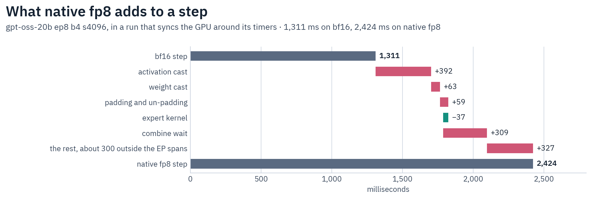

# Mixed-Precision Training: FP8 / FP4 (Low-Precision Compute)

Mixed precision here means **bf16/fp32 master weights with low-precision (fp8/fp4) matmul compute**. The parameter, checkpoint, and optimizer state are never stored in low precision; only the GEMM operands are cast to a block-scaled format for the forward, and the gradient flows back to the bf16/fp32 master (straight-through estimator). This is quantization-aware training (QAT): it answers *"does this model converge in fp8/fp4?"* and pairs with a block-scaled weight export.

**Train in bf16; it stays the default.** Neither low-precision path Halo ships beats it. As whole training steps at ep8 the simulated fake-quant path (the QAT oracle) runs at 0.10–0.45× bf16 and the opt-in DeepGEMM adapter, an FP8 forward over a bf16 backward, at 0.37–0.54× ([Why bf16 is the default](#why-bf16-is-the-default)). The one faster whole step measured, torchao MXFP8, ran in a test wrapper with its quality unmeasured, and Halo has not adopted it.

`scripts/after_training/quantize_to_lowp.py` writes MLP and expert weights in block-scaled fp8 (½ the bytes) or fp4 (¼). `halo.kernels.lowp.quantization.dequantize` reads them; serving engines do not load the manifest as-is. The roofline argument: [GPU Training Theory §7](../reference/gpu-training-theory.md#when-low-precision-compute-helps).

## The three paths

| Path | What it is | Speed | When used |
|------|-----------|-------|-----------|
| **bf16** | `F.grouped_mm` (MoE) / `F.linear` (dense) | Baseline | Default; all production training |
| **Simulated** (fake-quant) | block-scale quantize→dequantize→bf16 matmul, straight-through gradient | Whole step 0.10–0.45× bf16 (fp8, mxfp4) | QAT numerics oracle: `lowp_precision: fp8\|fp4\|mxfp4`. Any GPU. |
| **DeepGEMM adapter** (fp8, mxfp4) | DeepSeek's on-device-`m_indices` grouped kernel, real fp8/fp4 tensor cores | Whole step 0.37–0.54× bf16 | Opt-in (`HALO_DEEPGEMM_NATIVE=1`); never auto-selected |

The `lowp_*` keys build one `LowpSpec` (`halo/kernels/lowp/spec.py`), carried as `ParallelismConfig.lowp` and validated there (`LowpSpec.validate`). `LOWP_RECIPES` maps each `lowp_precision` mode to its block-scaled `QuantFormat` and the peak-FLOPS key the MFU callback scores its native path against; the EP layers, the dense linear and the export tool all read it.

The apply step is `apply_lowp_compute(model, lowp, *, expert_weight_cacheable)` (`halo/model_loading/parallel/lowp_compute.py`), called pre-FSDP in `load_distributed_model`: it converts the dense MLP `gate_proj`/`up_proj`/`down_proj` (attention, embeddings, `lm_head`, and norms stay bf16) and sets each EP layer's expert quant format (`set_lowp_compute`) per `lowp_apply_*`. `lowp_keep_first_blocks` / `lowp_keep_last_blocks` exempt whole blocks, counted over the text backbone only so a vision tower's `layers.N` is not miscounted.

**The dense conversion is in place, not a rebuild.** `LowPrecisionLinear.convert_` (`halo/kernels/lowp/linear.py`) retypes the existing `nn.Linear` (`linear.__class__ = cls`) and attaches one attribute, so the module keeps the DTensor parameters and the `_is_hooked` marker tensor parallelism attached to it.

Under TP a projection also carries an instance-level `forward`: the [local-shard forward](../parallelism/tensor-parallelism.md#local-shard-linears) that runs Colwise's and Rowwise's collectives as explicit c10d calls. It would shadow the retyped class's `forward` and keep the module computing in bf16, so `convert_` refuses a module that still carries one, and `apply_lowp_compute` strips it, retypes, and re-installs it around the low-precision matmul (transformers' own forward for a style the local-shard path does not cover). An instance-level `forward` that is not a TP-plan style raises.

## Why bf16 is the default

**Whole steps.** tok/s/GPU on 8× B300 at 4,096-token rows, gradient checkpointing on, uniform token ids, a 1.2.0 development build, with each arm as a ratio to bf16 on its shape:

| Shape | bf16 | simulated fp8 | simulated mxfp4 | native fp8 | native mxfp4 |
|---|---:|---:|---:|---:|---:|
| gpt-oss-20b ep8 b4 | 13,399 | 0.449× | 0.183× | 0.539× | 0.531× |
| Qwen3-30B-A3B ep8 b8 | 14,063 | 0.294× | 0.098× | 0.425× | 0.369× |
| Qwen3.5-35B-A3B ep8 b8 | 16,536 | 0.442× | 0.171× | 0.533× | 0.373× |


**Kernels.** A sweep on one B300 timed each expert GEMM alone, forward and with both gradients, at the local expert counts, widths and rows per expert of gpt-oss-20b, Qwen3-30B and Qwen3.5-35B, on uniform and skewed routing: 94 cells, 3 repeats each. An arm counts as faster only when its range is disjoint from bf16's and the gap is at least max(2%, 2× bf16's spread). Halo's simulated and adapter paths are faster in 0 of the 94. Arms outside Halo's training path, in the same sweep:

- DeepGEMM's fp8 kernel alone beats the bf16 forward in 59 of 94, but that ratio leaves out the casts: at gpt-oss-20b ep8 b4's shape the activation cast takes 2.66 ms against 0.86–0.89 ms for the whole bf16 forward.
- DeepGEMM's bf16 kernels show no net win: their forward and weight-gradient pair reads 0.69–1.01× torch's on uniform routing (median per model and row count).
- torchao MXFP8 as a whole path is faster only at 16,384 rows per expert: 1.08–1.30× on gpt-oss-20b, 0.90–1.07× across Qwen3-30B's GEMM pair, and never on Qwen3.5-35B. `F.scaled_grouped_mm` refuses more than 32 groups, which rules out Qwen3-30B and Qwen3.5-35B at ep2, and its mxfp4 kernel failed to initialize on two wide cells.

**Where native's time goes.** gpt-oss-20b ep8 b4 s4096, in a run that syncs the GPU around its timers: bf16 takes 1,311 ms a step and native fp8 2,424 ms, +1,113 ms. Activation cast +392, weight cast +63, padding and un-padding +59, kernel −37 and combine wait +309. Of the remaining +327, about +300 sits outside the EP spans, unattributed. The backward's GEMMs stay bf16 at 114 ms either way. So cheaper casts alone do not win: with every cast and copy free, native reaches about 1.08× (calculated).



**torchao MXFP8 as a whole step.** Through a test wrapper (torchao forward and input gradient, bf16 weight gradient), gpt-oss-20b ep8 b4 s4096 ran 1.133× bf16 over 3 repeats, peak memory +0.9%. The two Qwen shapes above raised a GPU memory fault in that wrapper, at 16 and 32 local experts, and whether the kernel or the wrapper caused it is unresolved. Quality is unmeasured and torchao is not in the lock, so Halo has not adopted it. On the gpt-oss shape, lower EP and GC off, which ship today, gain more ([tables](throughput-benchmarks.md#gpt-oss-20b-8-b300)).

**Hardware.** `tcgen05` has no native bf16×fp4 mixed-input MMA; the mixed modes are narrow×narrow (fp8×fp4). A weight-only scheme (fp8/fp4 weight × bf16 activation) must upcast the weight and run the MMA at bf16 rate, so its win vanishes above the bf16 ridge. A hand-rolled CuTe-DSL grouped kernel measured 0.03–0.31× of bf16 on Halo 1.1.0 or earlier (host-launch-bound).

## Where the adapter closes on bf16

Rows per expert are `ep_size × tokens_per_rank × top_k / num_experts`. At s4096: gpt-oss-20b (K=N=2880) 512–2048 at ep1 b1–b4, 4096–16384 at ep8 b1–b4; Qwen3.6-35B (gate_up K2048 N1024, down K512 N2048) 256–1024 at ep2 b1–b4, 1024–8192 at ep8 b1–b8. The bf16 ridge (AI ≈ 275) sits near 256–512 rows per expert at these widths, so most configurations are compute-bound in the GEMM.

Forward time, bf16 ÷ adapter fp8, at 8 local experts on uniform routing, from the same sweep (**>1.0 means the adapter is faster**):

| K · N | 256 rows | 512 | 1024 | 2048 | 4096 | 8192 | 16384 |
|-------|----|----|----|----|----|----|----|
| 4096 · 8192  | 0.25× | 0.33× | 0.42× | 0.53× | 0.60× | 0.67× | 0.76× |
| 4096 · 16384 | — | — | — | — | 0.85× | 0.93× | 1.02× |
| 2880 · 2880 (gpt-oss) | 0.15× | 0.14× | 0.17× | 0.18× | 0.20× | — | — |

These ratios measure Halo's adapter: it casts with DeepGEMM's Python utilities, passes float32 scales (a transform kernel per call) and copies rows in Python loops.

The adapter clears the bar only at K4096 N16384, wider than the three models above: forward 1.05× at 16384 rows per expert on skewed routing, forward with both gradients 1.03–1.08× at 8192. At gpt-oss-20b ep8 b4's own shape its forward reads 0.24×.

Pushing sequence length is the throughput lever for bf16 too: it fills the expert GEMMs.

## The simulated path — why it is not bf16 speed

The simulated path realizes fp8/fp4 by block-scale fake-quant: quantize→dequantize each operand (so the matmul sees the low-precision numerics), run the bf16 matmul, straight-through gradient. It is the exact QAT oracle but does quantization work bf16 never does. Measured (one B300, expert grouped GEMM at 8 local experts, K=N=2880, forward, uniform routing):

| rows per expert | bf16 | simulated mxfp8, weight cached | simulated mxfp8, no cache | simulated mxfp4 |
|-------|------|------|------|------|
| 256 | 80 µs | 322 µs | 2,810 µs | 658 µs |
| 4096 | 368 µs | 2,408 µs | 4,866 µs | 7,976 µs |

Cost is dominated by quantizing the weight (eagerly, 2.5 ms for a 133 MB expert weight — launch-bound, ~15 elementwise kernels per call). Two optimizations cut it:

**Per-step weight cache.** The expert weight is invariant within an optimizer step, so it is quantized once per step (keyed on `weight._version`) and reused across gradient-accumulation microbatches. The fixed-shape weight round-trip is also `torch.compile`d (~6× faster, bit-identical for the power-of-two-scale formats mxfp8/mxfp4).

**nvfp4's weight stays eager**: its e4m3 scale is not a power of two, so the compiler's reciprocal-multiply flips ~0.18% of elements at block boundaries, desyncing the QAT forward from the eager checkpoint quantizer (QAT→inference relerr 0 holds only eager).

The cache covers expert weights the optimizer writes directly (plain EP params, `ep_size>1`); every shipped optimizer advances `_version` on its raw-pointer stores to keep it honest.

FSDP2-managed experts (the `ep_size==1` + `fsdp_shard_ep1_experts` default) quantize every call instead, because FSDP2 pins its unsharded param's version counter and a cache keyed on it would serve the step-0 quantization forever. Dense MLP linears and fp32-master `weight.to(bf16)` copies (a fresh non-leaf tensor each call) are uncached for the same reason.

`HALO_LOWP_WEIGHT_CACHE=0` disables it; the cache holds a dequantized copy per expert weight for the step, which costs memory under gradient checkpointing.

**Eager activation.** The activation quant runs eager: after EP dispatch the token count varies every step, so a compiled activation round-trip recompiles until it falls back to eager. With weight cached+compiled and activation eager, the median over the 94 cells above is 7× a bf16 expert GEMM forward for simulated mxfp8 (21× uncached) and 22–23× for the fp4 formats, floored by the fp4 activation quant (pack + bucketize), which is identical for mxfp4 and nvfp4.

**Fused mxfp8 round trip.** An mxfp8 fake-quant of a CUDA, contiguous tensor blocked along its last axis (every activation, and both operands of a dense lowp linear) runs as one Triton kernel, `fake_quant_mxfp8_triton`, instead of the eager chain: it reads the tensor once and writes it once, whatever the token count, so it needs no compile. Its output is bit-identical to the eager quantizer, NaN blocks and subnormal scales included, so there is no switch; fp4 formats and other layouts stay eager. The figures above predate it.

The simulated path is a convergence-validation tool — run a few hundred steps to confirm the loss tracks bf16, not a production run. For bf16 throughput leave low precision off (`lowp_precision: bf16`).

## DeepGEMM: the native fp8/fp4 path

Native fp8/mxfp4 calls **DeepGEMM** ([deepseek-ai/DeepGEMM](https://github.com/deepseek-ai/DeepGEMM)), DeepSeek's Blackwell grouped block-scaled GEMM, via `halo/kernels/lowp/deepgemm.py`. A fixed-layout grouped kernel rebuilds its per-expert layout on the host every call. DeepGEMM instead resolves each row's expert on device via a single int32 `m_indices[M]` in the tile scheduler and launches one JIT-compiled kernel (cached to disk). The cost sits around the kernel: at 256 rows per expert and K=N=2880 the adapter's forward takes 520 µs, the kernel 73 µs and the activation cast 180 µs.

It is never auto-selected. With `HALO_DEEPGEMM_NATIVE=1`, every grouped expert GEMM runs native, and a shape the kernel rejects raises.

`fp8` and `mxfp4` have a native path; `fp4` (nvfp4) stays simulated, with a one-time warning under the flag. What it gives, opted in:

- **fp8** — DeepGEMM's fp8 grouped kernel, DeepSeek's UE8M0 recipe: 1×128 groups for the activation, 128×128 blocks for the weight (forward rel ≈ 0.038 vs bf16).
- **mxfp4** — FP8 activation (1×128) × MXFP4 weight (1×32, UE8M0) (forward rel ≈ 0.12 vs bf16). Simulated `mxfp4` is 4-bit on both operands, so the two backends are different numerics. The adapter zero-pads K to ÷256 (K=2880 → 3072; matmul unchanged).
- **backward is always bf16** (Wgrad-in-HP via `F.grouped_mm`, measured bf16-exact); the master dtype (bf16 or fp32) is preserved.

    DeepGEMM ships fp8 weight-gradient kernels (`k_grouped_fp8_gemm_*`) but the adapter keeps the backward in bf16: the 4-bit-training literature finds gradients are the precision-sensitive path (NVFP4 applies stochastic rounding to gradients only, [arXiv 2509.25149](https://arxiv.org/abs/2509.25149)).

The native path requires the `deep_gemm` wheel, built into the **Blackwell** image only (its kernels are the SM100 block-scaled grouped ones). On Hopper `HALO_DEEPGEMM_NATIVE=1` cannot be honored; `use_deepgemm` says so once and the simulated path runs. DeepGEMM officially targets SM90 (Hopper) and SM100 (B200/GB200); on **B300 (sm_103a)** it runs through JIT sm_100f forward-compat (no sm_103-specific path).

## Formats — MX vs NV

A block-scaled format is defined by element type, scale type, and block size. MX (OCP Microscaling) uses a power-of-two `e8m0` shared exponent per 32-element block — coarse but cheap and exact, so the simulated weight round-trip compiles bit-identically. NV (`nvfp4`) uses a finer `e4m3` scale per 16-element block — more accurate, but the non-power-of-two divide does not compile bit-identically, so its weight round-trip stays eager.

A NaN weight stays NaN through every simulated format. An MX block whose amax is NaN takes `e8m0`'s spec `0xFF` NaN code; without it, `e2m1` (which has no NaN encoding) would decode the poison as a finite `format_max × 2^-127` block and a diverged run would be reported as near-zero weights.

nvfp4 propagates NaN through its `e4m3` block scale and fp32 global scale. The native mxfp4 cast has no such code and would decode the block as zeros, so a non-finite expert weight raises there. `quantize_to_lowp.py --verify` refuses to export a checkpoint holding inf/NaN rather than writing a corrupt one.

`nvfp4` is **two-level**: a per-tensor fp32 global scale brings the tensor's amax up to `e4m3`'s maximum, and each block's `e4m3` scale is relative to it. An absolute `e4m3` block scale would underflow to zero — silently quantizing the whole block to zeros — for any block whose amax falls below `E2M1_MAX ×` half of `e4m3`'s smallest subnormal, i.e. `5.86e-3`, which covers residual-scaled `down_proj` init (`0.02/√(2L)`).

The global scale is rounded up to a **power of two**, under which `e4m3` rounding is invariant while the block scale stays in `e4m3`'s normal range. An EP rank quantizing its `[E/ep, …]` expert shard and `quantize_to_lowp` quantizing the gathered `[E, …]` checkpoint then produce bit-identical weights despite their differing tensor amax.

That bit-identity holds for any block whose amax is within `2^-16` of the tensor's, far beyond the spread real expert banks show, but not unconditional. MX needs no second level: `e8m0` spans `2^±127`.

| Format | Element | Scale | Block | Accuracy | Weight quant |
|--------|---------|-------|-------|----------|--------------|
| **mxfp8** (OCP MX) | e4m3 | e8m0 (pow-2) | 1×32 | best (fp8) | compiled |
| **mxfp4** (OCP MX) | e2m1 | e8m0 (pow-2) | 1×32 | coarsest fp4 | compiled |
| **nvfp4** (NVIDIA) | e2m1 | e4m3 + per-tensor fp32 | 1×16 | best fp4 | eager |
| DeepGEMM native fp8 | e4m3 | UE8M0 (pow-2) | act 1×128, weight 128×128 | — | (native kernel) |
| DeepGEMM native mxfp4 | e2m1 (act fp8) | UE8M0 | act 1×128, weight 1×32 | — | (native kernel) |

`lowp_precision` exposes three formats (`LOWP_RECIPES`): **`fp8`** = mxfp8; **`fp4`** = nvfp4 (the accurate fp4; validate an nvfp4 deployment); **`mxfp4`** = OCP fp4, whose power-of-two scale lets its cached weight quant compile bit-identically (~6× cheaper than nvfp4's eager weight quant, helps at low gradient-accumulation). Pick by deployment target.

In the cache-hit steady state both fp4 formats are bounded by the eager activation quant, so their per-microbatch cost is similar; fp8 is cheaper because its activation quant is lighter. DeepGEMM's native recipes (UE8M0 scales over 1×128 activation groups, and 128×128 blocks for the fp8 weight) are coarser still; use the simulated path when you need exact mx/nv numerics.

Published end-to-end gains over bf16: MXFP8 1.13× on DeepSeek-V3 (256 GB300, Megatron Bridge), 1.22× on DeepSeek-V3 671B (TorchAO #4798) and 1.22× on GPT-OSS 120B (64 B300, across containers); MXFP8 on the attention projections alone 1.19× on DeepSeek-V3 671B (64 GB300, TorchTitan). NVFP4 adds about 3% over MXFP8 on Nemotron 3 Super and reaches 1.34–1.37× on DeepSeek-V3 with MXFP8 attention projections. NVFP4 pretraining keeps about the last 15% of blocks in bf16 ([arXiv 2509.25149](https://arxiv.org/abs/2509.25149)).

The gpt-oss release stores its experts in MXFP4; Halo fine-tunes from the BF16 mirror (`unsloth/gpt-oss-*-BF16`). bf16 with stochastic-rounding master weights is the floor — see [BF16 Optimizer](bf16-optimizer.md).

## QAT → low-precision inference

The simulated path is QAT: the bf16 master is quantized to the block-scaled format for every forward, so the trained weights stay accurate under that format at inference. The native path uses other block layouts (fp8: weight 128×128, activation 1×128), so this export does not reproduce it. To export, convert the checkpoint once:

```bash
python scripts/after_training/quantize_to_lowp.py \
    --input_dir  <large-volume>/checkpoints/my-model \
    --output_dir <large-volume>/checkpoints/my-model-mxfp8 \
    --lowp_keep_first_blocks 1 --lowp_keep_last_blocks 1 \
    --format mxfp8            # or mxfp4 / nvfp4
```

Pass the run's **scope** back in; the weights do not carry it. `--lowp_apply_dense_mlp`,
`--lowp_apply_moe_experts`, `--lowp_keep_first_blocks` and `--lowp_keep_last_blocks` are the four
config fields verbatim, at the same defaults (`true`, `true`, `0`, `0`); the bools take the
`--no-` form to turn off.

The kept-block window resolves through the same helper the training conversion uses, over a block count
read from the checkpoint's own key names, so an exempted block exports in bf16 exactly as it trained.

That numbering must be unambiguous. When the selected weights carry two `layers.N` stacks — an MTP/draft
head, or a vision tower spelled past the exclude fence — the export **refuses** the keep window and names
both roots, since block `N` would mean two different blocks and the window would hold back whichever one it
hit. Narrow `--include`/`--exclude` to the text backbone, or export without a window.

This writes block-scaled MLP and expert weights under Halo's own `block_scaled` manifest, copying attention/norm/embed/bias unchanged.

Which names those are is **derived** from the two rosters that decide what QAT quantized — `MLP_PROJECTIONS` (the dense projections `apply_lowp_compute` converts) and the family specs' declared expert layouts, fused (`HF_FUSED_EXPERT_KEYS`, the same names the sharded merge and the un-fuse tool read) and per-expert un-fused (`gate_proj`/`up_proj`/`down_proj`, `w1`/`w3`/`w2`) — so the export cannot quantize a weight the training forward left in bf16.

A dense projection spelled like a per-expert roster name but outside an expert container (LFM-2's dense `feed_forward.w1`) is left in bf16, as training left it. `--no-lowp_apply_moe_experts` declares the experts out of scope when training left them in bf16.

A MoE checkpoint whose experts match none of the roster's spellings (Inkling's hub `experts.w13_weight` / `w2_weight`), or a 3-D bank under a spelling no EP layer class declares as fused (Step-3.7's per-layer `moe.gate_proj` / `moe.up_proj` stacks), is **refused** before any write rather than copied through under a `quantization_config` that claims QAT parity. Gathered saves write those hub spellings, so an Inkling composite or Step-3.7 export has no low-precision export.

A VLM's **vision tower and projector are excluded** on top of that: the dense conversion runs inside the text backbone only, so a quantized tower would compute in a format training never saw.

Fused 3-D expert banks take their contraction axis from the resolved layer class, so a multimodal wrapper or remote-code checkpoint quantizes on the correct axis; 2-D `*.weight` matrices block along the last axis, the `in_features` of an `[out, in]` Linear, as the QAT forward does.

A weight whose contraction axis is not block-divisible is copied through in high precision rather than silently mis-blocked. `--verify` reports the max round-trip dequant relerr, which is how a wrong axis shows up: past the format's own error (mxfp8 0.08, nvfp4 0.25, mxfp4 0.35) it raises naming the worst tensor, before the index and `config.json` are written, so the rejected export does not load.

`--include` only narrows that set; `--exclude` replaces the vision-tower/norm fence. `--output_dir` must differ from `--input_dir`.

Consuming the result — per quantized weight `<name>`:

- `<name>.weight_packed` (`float8_e4m3fn` for mxfp8, `uint8` with two `e2m1` nibbles per byte for fp4), `<name>.weight_scale` (one per block), `<name>.weight_shape` (the original shape — packed fp4 data halves the contraction axis).
- `<name>.weight_global_scale` — **nvfp4 only**, in compressed-tensors' convention: shape `[1]`, `E4M3_MAX × E2M1_MAX / amax` (rounded to a power of two), and an element is `code × weight_scale / weight_global_scale`. A loader that drops it reads the tensor rescaled by up to `E4M3_MAX × E2M1_MAX`. An all-zero weight stores `1.0`, compressed-tensors' own value for it, never the `+inf` its amax implies, which vLLM's max over a fused layer's partitions would spread to every partition; a nonzero weight too small for the scale's fp32 range is refused.
- The contraction axis is **per weight**, from `quantization_config.json`'s `weight_axes` map — fused 3-D experts differ by family (gpt-oss contracts on axis 1, the rest on the last), so the manifest's single `contraction_axis` is only the fallback for names absent from that map.
- `quantization_config.json` also carries a `scope` block recording what this export reproduced: `apply_dense_mlp`, `apply_moe_experts`, `keep_first_blocks`, `keep_last_blocks` (the flags, minus the `lowp_` prefix) plus the resolved `kept_blocks` indices. The whole manifest is stamped into the output `config.json` under `quantization_config` as well.

For a bf16 source the dequantized weight reproduces the simulated QAT forward exactly (relerr 0); `halo.kernels.lowp.quantization.dequantize` is the reference reader (its nvfp4 `global_scale` is the reciprocal of the stored one). Serving engines do not load this manifest as-is.

## Usage

```yaml
# Validate fp8/fp4 convergence (simulated fake-quant — any GPU; slower than bf16):
lowp_precision: fp8            # bf16 (off, default) | fp8 (mxfp8) | fp4 (nvfp4, accurate) | mxfp4 (fast fp4)
lowp_apply_dense_mlp: true     # convert dense MLP gate/up/down (attention/embeds/norms stay bf16)
lowp_apply_moe_experts: true   # low precision on MoE expert grouped GEMMs
lowp_keep_first_blocks: 0      # keep the first/last N blocks bf16 (NVFP4 recipe — precision-sensitive ends)
lowp_keep_last_blocks: 0
```

Low precision is the fake-quant oracle by default; there is no backend knob. The native DeepGEMM kernel is opt-in via `HALO_DEEPGEMM_NATIVE=1`. `HALO_LOWP_WEIGHT_CACHE=0` disables the simulated path's per-step expert-weight cache. The master weight stays bf16/fp32 and the checkpoint is unchanged.

Rejected at config/load time, loudly: any trainer but SFT; a `quantization_config` (QLoRA/bitsandbytes — the weights are not plain `nn.Linear`); `fp16: true` masters; both `lowp_apply_dense_mlp` and `lowp_apply_moe_experts` false, which would apply low precision to nothing; and pipeline parallelism, whose stages re-base block indices so the `lowp_keep_*` windows would land on each stage's own ends ([PP rejected combinations](../parallelism/pipeline-parallelism.md#rejected-combinations)).

`lowp_apply_moe_experts` reaches the experts only on the grouped-GEMM path (`EPMoELayerBase._grouped_mm`). A layer running the per-expert loop instead (`use_grouped_gemm: false`, e.g. `examples/sft/gptoss/gptoss-20b-multinode-ep.yaml` at ep16) ignores the precision and stays bf16 on its experts. Set `use_grouped_gemm: true` to apply low precision to the experts.

The fake-quant blocks both GEMM operands along the contraction axis, so `apply_lowp_compute` refuses at load any projection it converts whose contraction, as this rank holds it, the format's block (32 for `fp8`/`mxfp4`, 16 for `fp4`) does not divide: a grouped-path expert weight (the hidden size for gate/up, the intermediate for down) or a dense MLP linear (its input width). Loop-path layers never quantize and are not checked. Two parallel sizes shard such an axis. Expert TP splits the experts' intermediate, so gpt-oss's 2880 leaves 720 per rank at `expert_tensor_parallel_size: 4` (only `fp4` divides it) and 360 at 8 (none does). Rowwise TP splits a dense `down_proj`'s input to `intermediate_size / tensor_parallel_size`. The error names the module, the axis, the precisions that fit and the opt-out flag (`lowp_apply_moe_experts` or `lowp_apply_dense_mlp`).

`apply_lowp_compute` warns with the count of loop-path layers, and raises when the whole request converted zero modules (a fused-expert MoE with no EP layers would otherwise train pure bf16 with no signal).

Native expert-LoRA adapters always compute in bf16 under lowp: block-scale quantization along the rank axis is unrepresentable for common ranks and no serving stack quantizes adapters.
