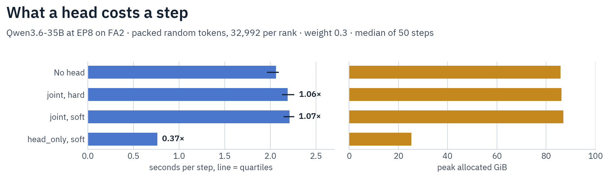

# MTP heads

`mtp_loss_weight` trains the multi-token-prediction head a family's release ships, as that release's architecture: the family's own decoder layers plus its projection and norms, at the release's key path. The SFT script alone carries the knobs ([fields](../reference/configuration-reference.md#sftscriptarguments)). At weight 0 nothing is built and no hook is installed.

## Families

| Family | Placement | Head |
|---|---|---|
| Qwen3.5/3.6 dense and MoE, text and composite; Qwen3.8-27B; Qwen3-Next | `mtp.*`, beside the backbone | `fc`, `pre_fc_norm_embedding`, `pre_fc_norm_hidden`, `layers.0`, `norm` |
| GLM-4 MoE Lite | decoder list entry at `num_hidden_layers` | `eh_proj`, `enorm`, `hnorm`, `shared_head.norm` beside the layer's own children; the release's `embed_tokens` and `shared_head.head` copies are the trunk's in training |
| Nemotron-H: Lightning, and Super VL on its text and composite routes | `mtp.*` beside the output embedding it shares, so `language_model.mtp.*` on the composite | `layers.0`, an attention block with `eh_proj`, `enorm` and `hnorm`; `layers.1`, a MoE block with `final_layernorm` |

Every other tail is refused by name (`MTP_REFUSALS`, `halo/models/mtp/spec.py`): Flash-Next's draft layer reads hyper-connection streams, GLM-5.3's tail lacks layers its class builds and is stored in fp8, Step-3.7 owns a head per draft layer, Inkling needs renames, DeepSeek-V4 stores vendor names and quantized experts. A family with no tail gets a plain refusal. `tests/cpu/models/test_mtp_head_spec.py` holds every class declaring a tail to a spec or a refusal.

Ling-3.0-flash's remote forward runs its own head; see [Bailing](../models/bailing.md#mtp-tail).

A Nemotron-H head is the chain both engines draft with: the norms and the projection, the attention block, the MoE block, the final norm, then the trunk's output embedding, with each block's residual folded before the next block's norm and no zeroed embedding at position 0. Each block takes its class from the trunk's last layer of its kind, and the attention block takes that layer's call, so packed rows keep their documents apart. A config declaring another `mtp_layers_block_type`, or a depth cut whose trunk holds no layer of a block's kind, refuses before the load. Super VL's text route reads `language_model.mtp.*` and writes `mtp.*`.

## Objective

Index `t` reads the embedding of token `t+1` and the trunk's hidden `t`, and predicts token `t+2`. The term is the cross-entropy at those targets, divided by the same count as the next-token loss, added inside the model's forward, so HF's later scale multiplies both alike. No draft scores across a document start under packing or padding-free rows.

- `mtp_loss_type: hard` fits the gold token.
- `mtp_loss_type: soft` is [Soft-MTP](https://arxiv.org/abs/2610.38331). It keeps the loss value and the output embedding's gradient, and routes the head's gradient to the trunk's next-token distribution: a KL at the same step, with the routed term exactly `mtp_loss_weight` at any batch.
- `mtp_train_scope: joint` lets the term reach head, trunk, embedding and output embedding.
- `mtp_train_scope: detached` trains the head alone while the trunk takes the next-token gradient. The global clip norm still covers both.
- `mtp_train_scope: head_only` is `detached` over a frozen trunk, which runs with no graph. `moe_balancing: auto` resolves to `none` there.

On `joint` and `detached`, a bias balancing mode takes the head's gate too: `moe/*` counts one more layer, and its slot stays the release's key. The router aux loss stays the trunk's, as the head's gate runs past the backbone forward that records it.

A run logs `ntp_ce` and `mtp_ce`, each cross-entropy per target over the world, beside `loss`, which holds both weighted over one normalizer. Under `detached` with `max_grad_norm: 0`, the trunk's weights match a run with no head byte for byte, and `ntp_ce` is the same under either head loss. `ntp_ce` is not a no-head run's `loss`, which is a mean of each rank's own average: on rows of unequal length the two differ, by up to 10% in the measured `detached` run, at equal weights.

## Hard and soft

`test_sft_mtp_head_real.py`, Qwen3.6-35B at EP8: `eval_mtp_acceptance_tv` on 24 held-out first-turn rows of 256 tokens, at steps 0, 30, 60, 90, 120 and 150. A stale start is the Qwen3.5-35B head on the Qwen3.6 trunk; an own start is the release's head.

| Start, loss | `learning_rate` | Acceptance | Gate |
|---|---|---|---|
| Stale, `soft` | 1e-5 | 0.7760, 0.8154, 0.8240, 0.8238, 0.8247, 0.8252 | Passes |
| Stale, `hard` | 1e-5 | 0.7760, 0.8009, 0.7985, 0.7896, 0.7845, 0.7643 | Stops |
| Stale, `hard` | 3.33e-6 | 0.7760, 0.7992, 0.8060, 0.8054, 0.8038, 0.7983 | Passes |
| Stale, `hard` | 1e-6 | 0.7760, 0.8051, 0.8056, 0.8071, 0.8072, 0.8070 | Passes |
| Own, `soft` | 1e-5 | 0.8187, 0.8223, 0.8232, 0.8238, 0.8248, 0.8245 | Passes |
| Own, `soft` | 3.33e-6 | 0.8187, 0.8210, 0.8230, 0.8255, 0.8251, 0.8260 | Passes |
| Own, `soft` | 1e-6 | 0.8187, 0.8206, 0.8214, 0.8226, 0.8232, 0.8241 | Passes |
| Own, `hard` | 1e-5 | 0.8187, 0.8015, 0.8005, 0.7905, 0.7869, 0.7638 | Stops |
| Own, `hard` | 3.33e-6 | 0.8187, 0.8094, 0.8082, 0.8075, 0.8057, 0.8004 | Stops |
| Own, `hard` | 1e-6 | 0.8187, 0.8172, 0.8129, 0.8119, 0.8109, 0.8106 | Stops |

What `hard` does depends on the rate: from a stale start it climbs then falls at 1e-5 and holds at 1e-6, and from the release's own head it falls at all three. Only `soft` fits have been served, so this page names no winner.

On first-turn rows through `--release`, Nemotron-H's own head reads 0.8124 on Lightning and 0.8876 on Super VL before any fit. A `soft` fit at 1e-5 falls and the gate stops it (0.8076 and 0.8854). At 1e-6 Lightning holds at 0.8126 and the gate passes. Super VL did not run at that rate.

The same stale `soft` row ends at 0.8253 on the fused kernel and 0.8256 on FA4, and at EP2 at 0.8185 on FA2 and 0.8189 on FA4. On the trunk's own samples at temperature 1, an own start reads 0.8704, 0.8877, 0.8919, 0.8916, 0.8902, 0.8901. Under `detached` at 5e-6, acceptance follows the moving trunk over 200 steps: 0.8187 to 0.8158 `soft`, 0.8187 to 0.8136 `hard`.

## Parallel axes

| Axis | Head |
|---|---|
| FSDP2 | Its own shard group on either placement, cut as a decoder layer's is, with a router of another dtype split off and unsharded with it. `head_only` leaves the frozen trunk out of the wrap, so no trunk parameter gathers and a step reduces the head's group alone. Every GPU then holds that trunk whole, and at `ep_group_size: 1` that takes in the expert banks a sharded wrap would split: about 244 GB at bf16 on Qwen3.5-122B, by its parameter count. |
| EP, ETP, EP+ETP | The head's MoE block takes the family's EP layer, and each rank streams its slice of the tail. It dispatches the tokens the first MoE layer sized for, so it adds no capacity all-reduce, and a row with no target still walks its ops on every rank. |
| Long rows | The term runs Liger's fused kernel where the family's fused loss is on, else fp32 logits in checkpointed chunks, so no `[T, V]` plane stays held through backward. |
| Gradient checkpointing | Follows the run. `detached` passes the head grad-requiring leaves, so a reentrant checkpoint around a list head keeps its gradient. |
| Several nodes | EP groups replicate each other, with the head's experts in the deferred sweep as the trunk's are, and plain FSDP2 spans the nodes. A save writes the head on every node's disk under per-node output storage. Node-local EP and plain FSDP2 ran on two machines at 2 and at 4 GPUs each, each on its own disk. |

## Step cost

`joint` and `detached` add the head's forward and backward and a second cross-entropy to a step. `head_only` drops the trunk's graph and its gradient checkpointing, and still runs the next-token cross-entropy for the metric; `soft` takes a gradient through it, so `soft` costs more than `hard` there and not where the trunk already trains on that loss. MFU's attention term walks the decoder list, so it counts a GLM-4 head's layer and not a `mtp.*` head's.

`test_sft_mtp_head_cost.py`, Qwen3.6-35B at EP8 on FA2: packed random tokens, 32,992 per rank per step, weight 0.3, gradient checkpointing except on `head_only`, the median of 50 steps.

| Arm | Seconds per step (quartiles) | Against no head | Tokens/s per rank | Peak allocated | Peak reserved |
|---|---|---|---|---|---|
| No head | 2.062 (1.962, 2.093) | 1.00 | 16,001 | 85.8 GiB | 255.2 GiB |
| `joint`, `hard` | 2.189 (2.126, 2.263) | 1.06 | 15,069 | 86.2 GiB | 256.9 GiB |
| `joint`, `soft` | 2.209 (2.143, 2.260) | 1.07 | 14,933 | 87.0 GiB | 255.7 GiB |
| `head_only`, `soft` | 0.762 (0.761, 0.763) | 0.37 | 43,303 | 25.3 GiB | 58.2 GiB |

The row's bars hold on these arms: `joint` at most 1.30x, `soft` within 2% of `hard` (0.9%, inside the quartiles), `head_only` at most 0.60x. Reserved memory is the allocator's cache filling a 268 GiB card, so read allocated for what a head adds. `detached`, `head_only` with `hard`, and the repeat of the no-head arm are not measured.

## Loading

`halo/model_loading/parallel/mtp_head.py` runs once after the per-mode load. It builds the head on meta in a head-only shell and streams the tail through the lazy planner, so a per-expert or a fused tail both load, each rank reads its expert slice, and fp32 masters apply as they do on the trunk. The tail comes from a resumed checkpoint, then `mtp_head_source`, then the model's own. A missing, partial or extra tail and a quantized source are refused. `init_from_scratch` draws the head with the family's own init.

## Checkpoints

A save walks the head as it walks the trunk, so a checkpoint holds it at the release's key path on every saver, and on every node's disk under per-node output storage. Its expert bank takes the family's gathered layout, which both engines read. A GLM-4 head's `embed_tokens` and `shared_head.head` are written off the trained embeddings, on one process too, where that save takes the gathered writer since `save_pretrained` writes the state dict alone. A stock load ignores the head. A Nemotron-H head's expert bank is per expert, so an untrained tail comes back byte for byte, its router bias in fp32.

A resume writes the bytes of a run that never stopped. It reads the checkpoint's head and ignores `mtp_head_source`; a resume built from the base (`use_grouped_gemm: false`) reads the usual source, and the FSDP2 restore overwrites it. A head cannot join a run midway: a checkpoint with none refuses at the load, or over a base load at the optimizer gate (`have no saved optimizer state`), which `head_only` to `joint` also raises. `joint` to `head_only` passes: the head's moments restore, and the trunk's go unread. A resume at `mtp_loss_weight: 0` builds no head, so what it saves carries none; keep the last checkpoint that does.

| Tool | A stored head |
|---|---|
| `convert_to_bf16`, `patch_vocab` | Written back at the output's dtype on a family with a head, in the expert layout of the class's save, GLM-4's copies off the live embeddings a patch grew, a router bias at its stored width (Nemotron-H's fp32 pin, or a slot `bias_update` trained). Any other family's tail drops, with a warning naming the config field its output keeps. |
| `merge_ep_shards` | Merged with the trunk's experts into the gathered save's bytes. A family whose export writes trunk copies refuses `save_sharded_ep`, and Nemotron-H refuses it for its trunk's names. |
| `merge_models` | Merged where every input carries it, refused where only some do, except a base's under `task_arithmetic` or `ties` that no fine-tune stores, which the merge leaves out. |
| `reattach_vision_tower` | The export's head supersedes the base's whole, at the composite's level; with none, the base's is carried with a warning, which offers a `head_only` fit only on a family with a head spec. |
| `unfuse_moe_experts`, `quantize_to_lowp` | Streamed with the trunk. |

## Serving

vLLM reads the head through `VLLM_SPECULATIVE_CONFIG`, SGLang through `--speculative-draft-model-path`. The rollout weight sync carries none: the knobs live on the SFT script alone, every trainer that syncs refuses a head at construction, and a load through the stock class holds none, so the server drafts with the head of its launch checkpoint. See [Rollout servers](../infrastructure/rollout-servers.md).

A head can follow a policy another trainer produced: a `head_only` fit with `mtp_head_source` runs over that trainer's export. Tiny rows from SMPO and offline GRPO exports on Qwen3.5 MoE, GLM-4 Lite and Nemotron-H keep the trunk's bytes and move the head. A stock reload loads the result, and reports GLM-4 Lite's head keys as unexpected, since its class builds no layer past `num_hidden_layers`.

`test_sft_mtp_head_serving.py`, 64 first-turn prompts at temperature 1, one draft token, by the engine's own counters, each against the release head on the same prompts:

| Engine, head | Acceptance | Release head |
|---|---|---|
| vLLM, Qwen3.6 stale `soft` fit | 0.8215 | 0.8284 |
| SGLang, the same fit | 0.8295 | 0.8415 |
| vLLM, the same fit from an EP8 export | 0.8223 | 0.8371 |
| SGLang, the same fit from an EP8 export | 0.8285 | 0.8374 |
| vLLM, the same fit at EP2, reattached to the composite | 0.8252 | 0.8438 |
| SGLang, the same fit at EP2, reattached to the composite | 0.8217 | 0.8357 |
| vLLM, GLM-4.7 Flash `own_soft` fit the gate stopped | 0.7317 | 0.7450 |
| vLLM, Lightning `own_soft` fit the gate stopped | 0.8282 | 0.8372 |
| SGLang, the same fit | 0.8366 | 0.8407 |
| vLLM, Super VL `own_soft` fit the gate stopped, reattached | 0.8335 | 0.8262 |
| SGLang, the same fit | 0.8337 | 0.8385 |

Qwen3.6's release head alone reads 0.83 to 0.84 across launches: 0.8284, 0.8311, 0.8394, 0.8438 and 0.8371 on vLLM. The Nemotron-H rows are one launch each. No fit here shows a served gain.

- **SGLang one draft token:** `--speculative-algorithm EAGLE --speculative-draft-model-path <checkpoint> --speculative-num-steps 1 --speculative-eagle-topk 1 --speculative-num-draft-tokens 2`. Its multi-step defaults read 0.62 on the same fit and are not comparable.
- **A checkpoint with no head:** vLLM exits non-zero at load, `Following weights were not initialized from checkpoint`. SGLang starts on one and every draft misses (0.0000), so read its counters before trusting a server.
- **Greedy output:** a draft changes a forward's batch shape and so its bf16 rounding, so greedy output parts from a plain server's on about half of the prompts, the release head's too. Each first split is a near-tie: the widest measured is 0.5 logprob, and the row holds it to 1.0. vLLM takes neither of these models at fp32, so no bf16-free reading exists.

## Acceptance

Every evaluation of a run with a head scores each held-out draft against the trunk's own distribution over the same token, on every rank, and leaves `eval_loss` the next-token loss.

| Metric | Holds |
|---|---|
| `eval_mtp_acceptance_tv` | `sum(min(p, q))`, the acceptance of a draft sampled from the head |
| `eval_mtp_acceptance_greedy` | `p(argmax q)`, the acceptance of a greedy draft, vLLM's default |
| `eval_mtp_top1` | Drafts naming the gold token |
| `eval_mtp_scored_positions` | The positions scored, over the world |

`head_only` gates on them unless `mtp_min_acceptance_gain` is `null`. The run scores before its first step and at its last, and exits non-zero on every rank, after its teardown, when either acceptance ended below its first logged reading plus the gain; a resume keeps that first reading. The last step's save already holds the head judged, and the error names that checkpoint, which is not one to serve.

The loss cannot make this call: a released head at `learning_rate: 1e-4` with no warmup lost acceptance while its loss fell, and the fit warns off `learning_rate: 1e-5` over 20 warmup steps. A fit on rows other than the ones you serve can pass its gate and leave served acceptance where it was, as the Qwen3.6 recipe does below.

## Recipes

| Recipe | Fits |
|---|---|
| `examples/sft/qwen3_5/qwen3.6-35b-a3b-mtp-head-only.yaml` | The head over a frozen trunk, at the learning rate and warmup the gate does not warn off |
| `examples/sft/glm4/glm-4.7-flash-mtp-head-only.yaml` | The same fit at the same rate, which the gate stopped on GLM-4's first-turn rows, so this recipe's run may exit non-zero |
| `examples/sft/nemotron_h/nemotron-3.5-lightning-mtp-head-only.yaml` | The same fit, at the lower learning rate whose fit passed the gate on first-turn rows |
| `examples/sft/qwen3_5/qwen3.6-35b-a3b-mtp-joint.yaml` | The head inside the SFT recipe's objective, at the weight DeepSeek-V3 published for pretraining |

Both Qwen3.6 recipes render `qwen3.6-reasoning-effort.jinja`, an empty think block before every reply. Without the block, the same reply tokens read a next-token cross-entropy of 3.03 and top-1 of 0.27, against 0.85 and 0.77 with it, on Halo, stock transformers and vLLM alike. So `qwen3-multiturn.jinja` gives a run an `eval_loss` near 3.3 that a frozen trunk keeps; a no-head SFT run reads 0.83 after its first two real optimizer steps at 1e-5, its `grad_norm` falling from 244 to 4.5.

| `head_only` recipe, 150 steps, `soft` | Acceptance on its rows | `eval_loss` | `eval_mtp_top1` | vLLM on its checkpoint | Release head, same launch |
|---|---|---|---|---|---|
| `qwen3.6-reasoning-effort.jinja` | 0.8376 to 0.8494 | 0.899 | 0.704 to 0.712 | 0.8339 | 0.8311 |
| `qwen3-multiturn.jinja` | 0.3076 to 0.8656 | 3.286 | 0.662 to 0.193 | 0.8372 | 0.8394 |

The Qwen3.5-35B-A3B, Qwen3.5-122B-A10B, Qwen3-Next and two Qwen3.8-Flash-Next recipes also render `qwen3-multiturn.jinja`, and the loss it starts at differs by model: Qwen3.5-35B-A3B's recipe starts at 1.12, on rows packed to 33,000 tokens. Train and serve under one render.

Neither render shows a served gain. Each recipe's rows are ultrachat replies, not a server's own samples after an open think block, so the gate's reading here does not predict the served one; the template only keeps that reading meaningful. The `joint` recipe's cost is under [Step cost](#step-cost), and what it does to a trunk or a served head over a fine-tune is not measured. The GLM-4.7 Flash recipe's numbers are from first-turn rows at its learning rate: acceptance 0.7685 to 0.7649, which the gate stops, with its served reading under [Serving](#serving).

## GPU rows

`tests/gpu/trainers/sft/`:

| Script | Holds |
|---|---|
| `test_sft_mtp_head.py` | Per family and shard layout: the head's gradient against a plain model at the run's dtype, one dispatch and one capacity generation per forward, equal first loss hard and soft, accumulated forwards, packed rows on flash, a rank with no head token |
| `test_sft_mtp_head_checkpoint.py` | Exact resume, fp32 masters included, export, shard merge, a scope change and the gate; two EP groups as replicas of a head that moved, on two simulated domains or two machines |
| `test_sft_mtp_head_real.py` | Qwen3.6-35B at EP8: acceptance hard and soft from a stale and from its own head, at the safe learning rate; the fit on the trunk's own samples; the gate on an oversized rate and an off-by-one target; a `detached` trunk against a run with no head. `--release` runs an own-head row on a Nemotron-H release through its knob, recording only |
| `test_sft_mtp_head_cost.py` | Seconds per step and peak memory of each scope, hard and soft, against no head at 33,000 tokens; `--arms` picks a subset, which leaves out the bars needing every arm |
| `test_sft_mtp_head_serving.py` | The acceptance a live engine reads off a checkpoint's head, against a control head on the same prompts, and on vLLM that greedy output parts from a server with no draft only within 1.0 logprob. `--release` reads a Nemotron-H server's tokenizer through that release's knob |

## Refusals

Before the load (`reject_unsupported_mtp_options`, `halo/trainers/sft_rules.py`): context, tensor and pipeline parallelism, HSDP, an accelerate launch, adapters and quantized loads, `lowp_precision`, `torch_compile`, `tree_packing`, image rows, label smoothing, `loss_type` other than `nll` or `chunked_nll`, `save_sharded_ep` where the export writes trunk copies, and `mtp_head_source` under `init_from_scratch`. `head_only` also refuses gradient checkpointing and `gradient_checkpointing_plan`, freeze patterns, `init_from_scratch`, a balancing mode that updates off the trunk, `fp32_non_ep_params`, `fp32_experts`, and a gate with no eval split. A trainer whose forward takes no labels raises at construction, as does a head the freeze patterns froze whole. `added_special_tokens` past the checkpoint's rows raises at tokenizer setup: the resize replaces the output embedding the head's term holds. Grow the vocabulary first with `patch_vocab.py`, which carries the head.

A run trained under context or tensor parallelism gets a head through a `head_only` fit on its export, at rows short enough to run without either.
