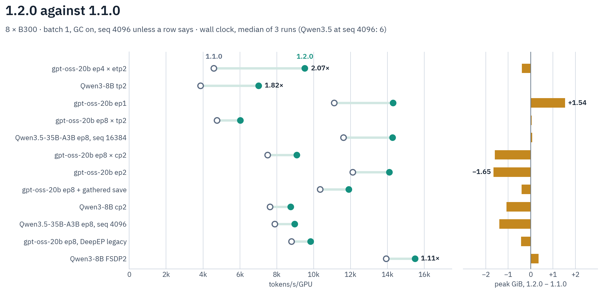
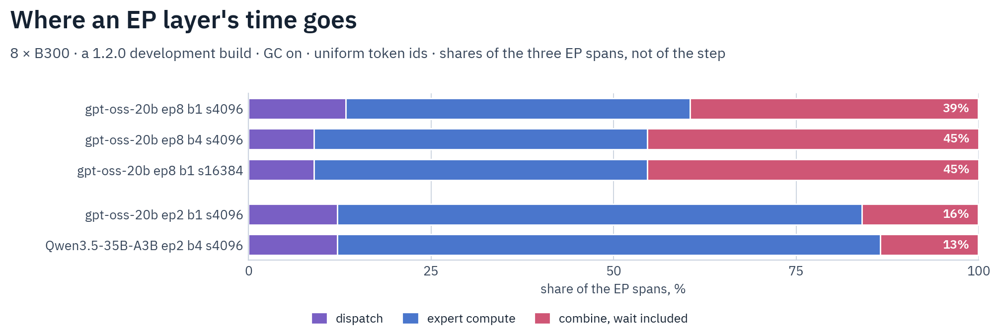

# Throughput Benchmarks

Throughput (tokens/s/GPU) and achieved-TFLOPS benchmarks on **NVIDIA B300** (GPU count per section). tokens/s/GPU is the headline metric (hardware- and sparsity-independent); achieved TFLOPS is the diagnostic. What MFU measures and why MoE complicates it: [GPU Training Theory §11](../reference/gpu-training-theory.md#mfu-and-why-moe-complicates-it).



## Setup

- **GPU**: B300 SXM6 (288 GB HBM3e, 148-SM die). Peak TFLOPS from the toolkit's registry (`halo/hardware.py`): bf16 **2250 TF**, fp8 4500 TF, fp4 9000 TF; the measured best large square bf16 GEMM is ~1800 TF (80% of peak).

    The peak scales the MFU/S-MFU percentages only; the tok/s/GPU and achieved-TFLOPS columns below do not use it.

- **Framework**: PyTorch 2.11+cu130 + DeepEP + Flash Attention + Liger. The Blackwell image ships FA2 and FA4 co-installed; `--attn_implementation` defaults to `None` in `tests/common/benchmark_args.py`, which auto-selects `flash_attention_4`. **All tables are FA4 unless a row says otherwise.**

    FA4's end-to-end gain is small on MoE/EP and grows with sequence length on dense; see [Flash Attention](flash-attention.md).

    Liger's host time per kernel launch is measured in [Liger → Benchmarks](liger-kernels.md#benchmarks). Its fused linear cross-entropy also reads the batch's non-ignored target count to the host in every forward, a host sync inside each fused-loss micro-batch (upstream; on Halo's paths the count feeds only token accuracy).

- **Release**: each section names the release that measured it. [1.2.0 against 1.1.0](#120-against-110), the
  [EP phase split](#where-the-ep-steps-time-goes), [recipes and real text](#recipes-and-real-text) and the NUMA A/B ran on 1.2.0 code; every other table ran on Halo
  1.1.0 code or earlier. Those older rows predate 1.2.0's
  MoE route sort, local-shard TP linears, two-layer FSDP2 units and single Ulysses exchange, which run most EP, TP,
  ep1 and CP rows faster, and its step clock, which counts the host time between steps and reads 1.4–2.1% lower
  tok/s than the clock these rows used. Their per-GPU rates count a shared batch once ([Metrics](#metrics)).
- **Optimizer**: AdamWBF16 with stochastic rounding (6 bytes/param). **Gradient checkpointing** on unless a row says "GC off".
- **Config**: 3 warmup + 7 measured steps (defaults `--warmup 3 --steps 10`); throughput is the warm-step average from `EfficiencyCallback`. Peak memory is its `torch.cuda.max_memory_allocated`, in GiB (2³⁰ bytes). Both are rank 0's.
- **Cold compiles**: on a fresh `TRITON_CACHE_DIR` a recipe's first ~20 steps run about 40% of its steady rate while one-off kernels compile, once per kernel shape: Qwen3.5-35B-A3B's recipe reads about 7,100 tok/s/GPU cold against 17,225 warm. Read a rate on a warm cache.

## 1.2.0 against 1.1.0

One 8× B300 host, batch 1, gradient checkpointing on, the seeded uniform-token corpus of `make bench`
([Golden performance baselines](../contributing/README.md#golden-performance-baselines)), each release on its own
image. Each row is the median of three recorded runs per release after a warm-up, interleaved (six on the Qwen3.5
s4096 row). The rate is wall clock: tokens per step × steps ÷ the wall time of steps 5–20 ÷ 8 GPUs. Logged
tok/s/GPU does not compare across the two releases, since 1.1.0's counts a shared TP or ETP batch on every rank of
its group and its clock leaves out the host time between steps. Peak is the highest rank's allocated peak.

| Shape | 1.1.0 tok/s/GPU | 1.2.0 tok/s/GPU | 1.2.0 / 1.1.0 | Peak GiB, 1.1.0 → 1.2.0 |
|---|---:|---:|---:|---|
| Qwen3-8B FSDP2, s4096 | 13,935 | 15,490 | 1.11× | 26.02 → 26.38 |
| Qwen3-8B CP2, s4096 | 7,635 | 8,748 | 1.15× | 25.07 → 24.00 |
| Qwen3-8B TP2, s4096 | 3,861 | 7,013 | **1.82×** | 22.53 → 22.53 |
| gpt-oss-20b ep1, s4096 | 11,114 | 14,304 | 1.29× | 60.29 → 61.83 |
| gpt-oss-20b ep2, s4096 | 12,121 | 14,107 | 1.16× | 78.97 → 77.32 |
| gpt-oss-20b ep8 with a gathered save, s4096 | 10,349 | 11,896 | 1.15× | 26.87 → 26.47 |
| gpt-oss-20b ep8, `ep_buffer_backend: legacy`, s4096 | 8,801 | 9,826 | 1.12× | 26.67 → 26.24 |
| gpt-oss-20b ep8 × tp2, s4096 | 4,749 | 6,013 | 1.27× | 31.11 → 31.16 |
| gpt-oss-20b ep8 × cp2, s4096 | 7,501 | 9,085 | 1.21× | 25.18 → 23.58 |
| gpt-oss-20b ep4 × etp2, s4096 | 4,589 | 9,521 | **2.07×** | 26.14 → 25.75 |
| Qwen3.5-35B-A3B ep8, s4096 | 7,893 | 8,974 | 1.14× | 43.03 → 41.63 |
| Qwen3.5-35B-A3B ep8, s16384 | 11,618 | 14,275 | 1.23× | 74.89 → 74.96 |

- No row runs slower on 1.2.0. The comparison covers these twelve shapes only. On the two Qwen3.5 rows the attention
  backend differs too: SDPA on 1.1.0, FA4's head_dim-256 path on 1.2.0.
- Peak memory falls or stays within 0.07 GiB, except Qwen3-8B FSDP2 (+0.36 GiB) and gpt-oss-20b ep1 (+1.54 GiB), the
  cost of [two decoder layers per shard group](../parallelism/data-parallelism.md#shard-groups).
- The gathered save takes 29.13 s on 1.1.0 and 29.08 s on 1.2.0, at 4.94 and 4.87 GiB peak host RSS.
- The 1.2.0 arm is a release candidate from before the rollout-engine fixes, Nemotron-H and MTP heads, whose commits
  also touch shared EP, FSDP2 and kernel code. Rerun on the release's code, as medians of three on another machine,
  the eight shapes the band covers stay within 2% of these rates and their allocated peaks within 0.01 GiB, which puts
  ep4 × etp2 at 2.04× against the same 1.1.0 rate. Single repeats can leave that range: Qwen3-8B CP2 read 8,377 once, and
  FSDP2 12,758 on a cold first row. The other four rows, on a logged rate: ep8 × cp2 9,107 (8,749 on its first run),
  ep8 `legacy` 9,699, and Qwen3.5-35B-A3B 8,960 at s4096 and 13,951 at s16384, the last 2.3% under its row.

`make bench BAND=1` holds eight of these shapes and the gathered save to the five-repeat baselines in
`tests/baselines/bench/`, measured on the same code. Same-code A/Bs of the largest changes sit on their owner pages:
[local-shard TP linears](../parallelism/tensor-parallelism.md#local-shard-linears),
[ETP grouped GEMM](../parallelism/expert-tensor-parallelism.md#forward-path),
[two-layer shard groups](../parallelism/data-parallelism.md#shard-groups),
the [routing sort](grouped-gemm.md#performance),
the [single Ulysses exchange](../parallelism/context-parallelism.md#how-ulysses-works) and the
[fused AdamWBF16 step](bf16-optimizer.md#benchmarks). Pipeline parallelism did not run on 1.1.0; its 1.2.0 rates are on
[its own page](../parallelism/pipeline-parallelism.md#measured-throughput), including what a logged PP rate counts.
GLM-5.3-Flash's rates, with and without its kernels, are on [GLM-5 Next](../models/glm5-next.md#throughput), and
Nemotron-H's on [its page](../models/nemotron-h.md#memory).

## Full-parameter SFT framework comparison

**Gemma 4 26B-A4B**, 2× B300, BF16, micro-batch 1 per GPU, Halo at its main branch of 2026-09-24. Every framework trains the same tokens, labels and row
order with the same optimizer hyperparameters, each at its newest release (2026-09-24) in its fastest configuration of
those tried. Tokens/s are measured over steps 6–25 at 2,048 tokens per row (25 steps) and over steps 6–50 at 16,384
tokens per row (8 rows packed into one causal sequence, 50 steps); peak memory is `max_memory_allocated`, max over
ranks. Each rate is the mean of its configuration's valid runs: a run whose token-weighted step-1 loss is more than 2%
from the common value is left out. In a separate run set Halo measures 15,090 cluster tok/s at 2,048 tokens and 16,219 at
16,384, within 1% of its rows below at the same peak memory.

| framework | version | layout | cluster tok/s | peak GiB/GPU |
|---|---|---|---:|---:|
| Halo | this toolkit, with the MoE kernels and sliding-window attention | EP2 + FSDP2, bf16 experts, `sdpa_flex_sliding`, no checkpointing | **14,980** | **101.8** |
| Axolotl | 0.19.0 | FSDP2 no-reshard, FA2 sliding | 9,064 | 137.6 |
| NeMo AutoModel | container 26.08.00 | EP2 + FSDP2, eager attention | 7,424 | 119.1 |
| Unsloth | 2026.9.11 | DDP, bf16 AdamW | 6,100 | 238.6 |
| Megatron Bridge | 0.6.1 (NeMo 26.08.01) | EP2, distributed optimizer, fp32 master | 5,462 | 255.6 |
| MS-SWIFT | 4.5.3 | FSDP2, fp32 master | 5,342 | 195.1 |

At **16,384 tokens per row** each framework starts from its 2,048-token configuration and turns on its own activation
checkpointing when that runs out of memory:

| framework | what it needs at 16,384 tokens | cluster tok/s | peak GiB/GPU | at 2,048 tokens |
|---|---|---:|---:|---:|
| Halo | nothing (no checkpointing) | **16,204** | 225.0 | 14,980 |
| Axolotl | nothing (no checkpointing) | 12,274 | 249.1 | 9,064 |
| Unsloth | Unsloth gradient checkpointing | 6,190 | 240.9 | 6,100 |
| NeMo AutoModel | activation checkpointing | 5,682 | 183.6 | 7,424 |
| Megatron Bridge | full recompute + bf16 Adam moments | 4,514 | 245.8 | 5,462 |
| MS-SWIFT | FSDP activation checkpointing | 2,820 | 204.9 | 5,342 |

- At 2,048 tokens Halo uses the least memory. At 16,384 tokens Halo and Axolotl are the two frameworks that fit
  without checkpointing, Halo at 225.0 GiB and Axolotl at 249.1; NeMo AutoModel and MS-SWIFT use less memory there,
  with activation checkpointing, at 35% of Halo's rate or less. Megatron Bridge fits only with bf16 Adam moments on
  top of full recompute.
- Axolotl's first run in each environment measured 9,604–9,630 tok/s at 2,048 tokens and its second 8,313–8,709;
  its row averages all four.
- Unsloth's step-1 loss varies between runs on identical, verified rows; its rows are the means of its valid runs (two
  of four at 2,048 tokens, five of six at 16,384, each 16,384-token pair from a fresh environment run alone).
- Halo's loss falls faster over the first steps (2.05 at step 2 against 4.54–4.67) because AdamWBF16 rounds the bf16
  weights stochastically; from step 5 on it tracks the fp32-master frameworks.

Per-run tokens/s, memory and step-1 loss: `agent-docs/assets/benchmarks/gemma4-sft-2026-09/summary_2048.tsv`
and `agent-docs/assets/benchmarks/gemma4-sft-2026-09/summary_16384.tsv`. The protocol, the result JSONs and the harness are in the
[benchmark gist](https://gist.github.com/advpropsys/0de3c36fd118a5ad18e4883ac15404a2); after `bash unpack.sh`,
`BENCH_ROOT=<dir> HALO_TREE=<halo checkout> [BENCH_SEQ=16384 BENCH_STEPS=50] bash <gist>/scripts/benchmarks/gemma4_sft/reproduce.sh`
runs the data build, every framework and the summary.

The kernels Halo runs for Gemma 4: [Gemma 4](../models/gemma4.md).


**Mistral Small 4 119B**, 4× B300, BF16, sequence length 2,048, batch size 1 per GPU, 25 total steps, mean
of all 20 post-warmup steps, Halo 1.1.0 or earlier:

| model | framework | topology | cluster tok/s | peak GiB/GPU |
|---|---|---|---:|---:|
| Mistral Small 4 119B | Halo | DP2, EP2, ETP2 | **7,587** | **207.1** |
| Mistral Small 4 119B | Axolotl 0.18.0 | FSDP2, eager experts | 380 | 251.0 |

In this run set NeMo AutoModel and TRL ran out of memory near 268 GiB, and Megatron Bridge, MS-SWIFT and Unsloth did not
support the architecture.

Halo's trace runs synthetic tokens (its run JSON records `"dataset_group": "halo_synthetic"`), so its loss and gradient-norm curves
are numerical-health evidence, not a convergence comparison. The raw 20-step traces are in
`agent-docs/assets/benchmarks/runs/`.

### Published numbers in similar setups

Vendor-reported figures beside Halo's, with the setup stated; Halo's are from 1.1.0 or earlier. The NeMo AutoModel and transformers
figures ran on H100; the Megatron-LM figures and the last bullet ran on the same B300s as Halo. B300 has
2.3× the bf16 peak of H100, so read a cross-GPU row as a ceiling on the gap, not the gap.

- **gpt-oss-20b, seq 4096, bf16.** Halo: 28,700 tok/s/GPU at EP1 (8× B300,
  batch 4, GC off; 23,590 GC on) and 13,239 at EP8 (batch 4, GC on, 48 GiB). NeMo AutoModel reports 13,058 on 8× H100 (FSDP
  without EP, mock data, forced-balanced routing). Megatron-LM on the same 8× B300 in a separate batch-2, GC-off
  sweep: OOM at EP1, where Halo runs 27,707 at 158 GiB peak; 13,932 vs Halo 21,642 at EP2 (246 GB vs
  104 GiB); 14,734 vs Halo 15,945 at EP8 (104 GB vs 52 GiB; Halo measured in its own run). Halo's
  peaks are `max_memory_allocated` in GiB; Megatron's are its reported GB.
- **Qwen3-30B-A3B, bf16.** transformers' own expert-parallel path: 3,485 tok/s/GPU at 38.6 GB
  (8× H100, seq 2048, `tp_size=8`). Halo EP2 on 8× B300 at seq 4096: 6,898 / 11,343 / 14,536 at
  batch 1 / 2 / 4. NeMo AutoModel reports 12,040 on 8× H100 at EP8, seq 4096 (mock data,
  forced-balanced routing).
- **Same hardware.** Gemma 4 26B-A4B against NeMo AutoModel, Axolotl, Megatron Bridge, MS-SWIFT and
  Unsloth on 2× B300, and Mistral Small 4 119B against Axolotl on 4× B300: [above](#full-parameter-sft-framework-comparison).
  Laguna-S 2.1 on 4× B300: Halo 11,298 vs Axolotl 5,617 tok/s/GPU at 15% less memory. LFM2.5-8B-A1B:
  Halo 31,262 vs Axolotl 28,330 at seq 8192, 35,517 vs 29,520 at seq 16384.

The Megatron-LM, Laguna and LFM2.5 rows are from the Halo research page (whitecircle.com/research/halo).

## Metrics

All metrics computed by `EfficiencyCallback` (`halo/callbacks/efficiency.py`).

**Achieved TFLOPS** = `(rank_tokens × (6·N_trainable + 4·N_frozen) + attention_score_flops / tp_size) / step_time`
(PaLM/Megatron FLOP count).

The linear-projection term is `6·N` for trainable params (2N forward + 4N backward) and `4·N` for frozen ones
(forward + input-gradient backward, no weight gradient — a LoRA base or frozen layers); for full fine-tuning
`N_frozen = 0` and it is the usual `6·N_local`. `N` counts all params physically on this GPU (DTensor-aware
for TP).

`rank_tokens`, the tokens this rank computes over, = `num_input_tokens_seen / world_size`, further divided by
`cp_size` (each CP rank receives the full `input_ids`; the wrapper splits inside forward). It equals tok/s/GPU ×
step time only where no batch is shared: a TP, expert-TP or pipeline group runs one batch on every member. Under PP
the count is of attended tokens, padding excluded ([PP](../parallelism/pipeline-parallelism.md#measured-throughput)).

The attention-score term costs each decoder layer at `6 × keys × heads·(d_qk + d_v)` per token (QKᵀ and Attn·V,
forward + backward; `12·S·H` for standard heads). Full attention is costed at every key (the PaLM convention,
not the causal half); bounded layers at the keys their kernel visits. `keys` is set by the layer's
`config.layer_types` entry (`halo/models/attention/layout.py`):

| `layer_types` entry | `keys` |
|---|---|
| full attention | the document length `L` |
| sliding | `min(L, sliding_window)` |
| chunked | `min(L, attention_chunk_size)` |
| GLM-5 sparse attention | the top-k plus a pooled indexer |
| DeepSeek-V4 compressed layers | `L / compress_rate` plus the local band |
| linear-attention / conv | nothing |

`L` is each **document's** length: the trainer costs every batch's documents (`cu_seq_lens_q`, `position_ids`
resets, or the padded row) and the callback swaps that rank-local measurement in per step, so a packed 64k
row of 1–40k-token documents is not costed as one 64k sequence. A trainer whose collator emits no `input_ids`
keeps the config term (every token in a `max_seq_len` document): online and async GRPO, offline GRPO outside CP, KTO, SMPO and embedding.

The measured term
carries the same divisors as the tokens: `tp_size` (heads are sharded) and, under Ulysses CP, `cp_size`
(the wrapper splits the sequence's heads inside forward). Per-step wiring and the logged fields:
[Callbacks](../training-methods/callbacks.md#efficiencycallback).

**S-MFU** (sparsity-aware utilization) is the meaningful roofline fraction for MoE: it scales the *expert*
FLOP term by `(top_k / num_experts) × ep_size` before dividing by `step_time × peak_gpu_flops`, so it does
not credit experts that never fired. Shared experts, router and attention params count at full weight;
`expert_tp_size` does not appear, since it already divides the local expert params.

The `ep_size` factor is not a sharding correction: a rank holds `num_experts / ep_size` experts but serves
the whole EP group's tokens, so per-rank active FLOPs/token is ep-invariant and S-MFU stays comparable across
EP degrees. With `num_full_model_params` set, the full expert bank is reconstructed as
`local_expert_params × ep_size × expert_tp_size`, so pure ETP is counted too.

If top-k is not detected the sparsity factor stays 1.0 and S-MFU silently collapses to plain MFU; check the
`S-MFU: N experts, top_k=K` startup line.

Compare configs with tok/s/GPU and achieved TFLOPS; reach for S-MFU only when you need a roofline fraction
(see [Why MoE utilization reads low](#why-moe-utilization-reads-low)).

**Cluster throughput** counts each of the `ParallelismConfig.data_parallel_size` replicas' batches once
([Stacking the dimensions](../parallelism/README.md#stacking-the-dimensions)), and **tok/s/GPU** is it over
`world_size`. A TP, expert-TP or CP group and a pipeline chain share one batch, so they count it once; `ep_size`
does not shrink the replica count (EP ⊥ DP, each EP rank processes a distinct batch). MFU is the exception: it
charges each rank every token it runs through its own parameter slice (the whole batch under TP, expert-TP and
PP, `1/cp_size` of it under CP).

## GPT-OSS-20B (8× B300)

**Model**: `unsloth/gpt-oss-20b-BF16` (20.7B total, 32 experts, top_k=4, 3.5B active). Setup: FA4, liger on, grouped-GEMM on (default), AdamWBF16/bf16, GC on, seq 4096 batch 1 unless noted. Every table in this section but the EP phase split: Halo 1.1.0 or earlier, 8× B300 on the Blackwell image; the gpt-oss-20b ep8 rows (EP+CP and EP+TP included) are the median of two runs from a separate run set.

### EP-only (batch scaling)

EP distributes experts; DP = world_size = 8. Raising batch fills the expert GEMMs, and the dispatch grows slower than the tokens ([where the time goes](#where-the-ep-steps-time-goes)):

| EP | batch | tok/s/GPU | TFLOPS | peak mem | step |
|----|-------|:---------:|--------|----------|------|
| 1 | 1 | 11,041 | 1,413 | 148.3 GiB | 0.37s |
| 2 | 1 | 12,432 | 878 | 78.9 GiB | 0.33s |
| 2 | 4 | 20,554 | 1,452 | 85.2 GiB | 0.80s |
| 8 | 1 | 10,905 | 301 | 25.5 GiB | 0.38s |
| 8 | 4 | 13,239 | 366 | 48.2 GiB | 1.24s |

Rows are the grouped-GEMM path (default); the ep1 row holds experts replicated per rank (`fsdp_shard_ep1_experts: false`). `make bench` measures the b1 shapes at ep1 (sharded experts, the default), ep2 and ep8 and holds them to committed baselines ([Golden performance baselines](../contributing/README.md#golden-performance-baselines)).

`fsdp_shard_ep1_experts` (the ep1 default) shards the replicated experts across the DP group. It is faster and leaner than the replicated row at both measured batches: ep1 b1 runs **11,236 tok/s/GPU · 60.3 GiB** (+1.8% throughput, −59% memory), and b4 runs 23,590 · 75.8 GiB against replicated 22,386 · 149.4 GiB (+5.4%, −49%). It is the dense-EP1 config in the [achieved-TFLOPS table](#maximizing-achieved-tflops).

Grouped beats the per-expert loop (`use_grouped_gemm: false`) in every measured gpt-oss-20b cell; the margin shrinks as local experts per rank fall and batch grows. The A/B is in [grouped-gemm](grouped-gemm.md#grouped-vs-the-loop-path).

> [!CAUTION]
> **No ep4 row: single-node `ep_size=4` on 8 GPUs is rejected at config time**
>
> Two 4-rank dispatch groups on one node race FSDP2's DP-wide NCCL and hang. Benchmark 8 GPUs at **ep2 or ep8**, or ep4 on exactly 4 GPUs; for a 4-way expert split across all 8 use `ep4 + etp2`. Mechanism and the full rule: [Expert Parallelism](../parallelism/expert-parallelism.md#single-domain-multi-group-ep-races-and-hangs).

### EP+CP (long context)

CP splits sequences via Ulysses attention. ep8 + CP=8 (DP=1), GC on:

| SeqLen | tok/s/GPU | TFLOPS | peak mem | step |
|--------|-----------|--------|----------|------|
| 16,384 | 7,149 | 249 | 24.6 GiB | 0.29s |
| 32,768 | 9,031 | 402 | 29.9 GiB | 0.45s |
| 65,536 | 8,862 | 566 | 41.9 GiB | 0.92s |

Achieved TFLOPS rises with sequence length (longer sequences amortize the Ulysses all-to-all); memory grows slowly (25–42 GiB) from 16k to 64k. CP trades per-GPU throughput for cheap long context.

### EP+TP

TP shards attention (Q/K/V/O), each linear computing on its local shard between explicit collectives ([Local-shard linears](../parallelism/tensor-parallelism.md#local-shard-linears)); EP distributes experts. **EP+TP requires `ep_size` to be a multiple of `tp_size`**: each EP group must span whole TP groups (the validator rejects `ep_size % tp_size != 0`).

On one 8-GPU node, full-EP (`ep8`) combines with `tp2`, `tp4`, or `tp8` (all valid); `ep2tp8`/`ep4tp8` are rejected (ep < tp). The table below is `ep8tp8` (one TP group of 8): DP=1, so all eight GPUs share each batch and the cluster runs 8× the tok/s/GPU.

| SeqLen | tok/s/GPU | TFLOPS | peak mem | step |
|--------|-----------|--------|----------|------|
| 4,096 | 1,277 | 226 | 32.5 GiB | 0.40s |
| 16,384 | 1,638 | 301 | 68.5 GiB | 1.25s |
| 32,768 | 1,780 | 345 | 118.7 GiB | 2.30s |

Achieved TFLOPS rises with sequence length (amortizes the TP all-gather/reduce-scatter). The step time moves by a few percent across TP widths, so tok/s/GPU falls nearly in proportion to the width, which divides the replicas: at s4096 `ep8tp2` runs 5,006, `ep8tp4` 2,450 and `ep8tp8` 1,277 tok/s/GPU; at s16384 6,306, 3,246 and 1,638. Use TP for a model whose layers do not fit, not for throughput.

### Why MoE utilization reads low

Sparsity first: gpt-oss-20b fires top-4 of 32 experts (3.5B active of 20.7B), so a sparse MoE cannot
approach a dense model's plain MFU. Higher EP also shrinks `N_local` far faster than throughput (ep2 = 11.36B
→ ep8 = 4.19B, −63%, against −12% tok/s/GPU at b1): ep8 trades per-GPU utilization for memory. Part of the gap is
idle hardware too: at ep8 ranks wait for the busiest one ([where the time goes](#where-the-ep-steps-time-goes)).

Levers to raise it: lower EP (more local params), longer sequence (the EP-independent attention-score
term), larger batch.

### Maximizing achieved TFLOPS

Keep more params local (low EP), then drop GC if activations fit, then add batch and sequence (8× B300, FA4, liger, best config per topology):

| model | topology | config | tok/s/GPU | TFLOPS | peak mem |
|-------|----------|--------|-----------|--------|----------|
| gpt-oss-20b | ep1 (dense FSDP, sharded experts) | b4, s4096, GC-off | **28,700** | **3,673** | 131.3 GiB |
| gpt-oss-20b | ep1 (dense FSDP, sharded experts) | b4, s4096, GC-on | 23,590 | 3,019 | 75.8 GiB |
| gpt-oss-20b | ep2 | b6, s8192 | 21,707 | 1,586 | 138.9 GiB |
| gpt-oss-20b | ep8 | b2, s16384 | 12,936 | 451 | 80.3 GiB |
| qwen3.5-35b-a3b | ep2 | b4, s4096 | 16,447 | 1,908 | 137.8 GiB |
| qwen3.5-35b-a3b | ep8 | b8, s4096 | 15,126 | 659 | 111.0 GiB |

- **Local params set the TFLOPS figure.** ep1 keeps all 20.7B local and tops the table; ep2 ~11.4B; ep8 ~4.2B;
  qwen3.5-35b ep2 ~17.5B. ep1 also has no dispatch group whose busiest rank it must wait for. Choose the lowest EP
  that fits. (The ep1 rows count every local expert as active,
  so their TFLOPS are nominal — above what the silicon can issue — and over-read as a utilization fraction
  for sparse MoE.)
- **Sequence length raises ep8's floor** but does not close the gap to ep1/ep2 — ep8 is the memory topology.
- **Drop GC where activations fit** — the largest single throughput lever. Past the GC-off memory wall, the
  largest batch that fits under GC-on is the recipe.

Picking a corner: **ep1** (sharded experts) when it fits, else **ep2 b4** for maximum throughput, **ep8 b4**
for balanced throughput/memory, **ep8 b1** for minimum memory, **ep8+cp8** for 32–64k context.

## Maximizing throughput: sequence & batch

Throughput is dominated by the effective per-GPU token count `M = per_device_train_batch_size × max_length` —
bigger `M` amortizes fixed per-step costs (kernel launches, dispatch latency, optimizer step) until a
memory wall. This section's figures are from Halo 1.1.0 or earlier, except the EP phase split. **Target `M` ≥ ~8k on B300 MoE before judging throughput**; below that it still climbs fast: ep8 b1 gains 12% from s4096 to s8192 and 1% from there to s16384 on gpt-oss-20b, 49% and 0.4% on Qwen3.5-35B-A3B.
Cross-node EP is pinned to `M ≤ 8192` by the Gin dispatch ceiling
([DeepEP → EFA](../infrastructure/deepep.md#expert-parallelism-over-aws-efa)) — the floor of this range by
construction.

1. **Push `max_length` as high as data/memory allow, and pack** (`packing: true` / padding-free collator —
   raises tokens/expert = `M × top_k × ep_size / num_experts`). Use
   [Context Parallelism](../parallelism/context-parallelism.md) when a sequence won't fit one GPU.
2. **Raise `per_device_train_batch_size` until just below OOM** with gradient checkpointing on — the ~20–30%
   recompute usually pays for itself through the bigger `M`.
3. **Fill with `gradient_accumulation_steps`, not more parallelism** — global batch at near-zero memory cost.
4. **Keep DP large** — EP is orthogonal to DP; reach for TP/CP only when a model/sequence won't fit.
5. **Measure**: `enable_efficiency_metrics: true` logs per-step tokens/s/GPU (add
   `report_mfu_diagnostics: true` for achieved-TFLOPS and S-MFU); sweep `(seq, batch)` until it plateaus.

### Where the EP step's time goes

`benchmark_sft_ep.py --comm_profile` times each EP layer's dispatch, expert compute and combine on CUDA events on
every rank, past the warm-up steps, over the forward and the checkpoint recompute. These are shares of those three
phases, not of the step: the backward's GEMMs and wire sit outside them. Mean over ranks, 8× B300, GC on, uniform
token ids, a 1.2.0 development build:

| Shape | Dispatch | Expert compute | Combine, wait included |
|---|---:|---:|---:|
| gpt-oss-20b ep8 b1 s4096 | 13.3% | 47.2% | 39.4% |
| gpt-oss-20b ep8 b4 s4096 | 9.0% | 45.6% | 45.4% |
| gpt-oss-20b ep8 b1 s16384 | 9.0% | 45.6% | 45.4% |
| gpt-oss-20b ep2 b1 s4096 | 12.2% | 71.8% | 15.9% |
| Qwen3.5-35B-A3B ep2 b4 s4096 | 12.2% | 74.3% | 13.4% |



Dispatch is the smallest phase. At ep8 it averages 0.35 ms per layer call at 4,096 tokens per rank and 0.80 ms at
16,384; both ep2 rows read about 0.2 ms. The recompute's call replays the cached result, so a dispatch on the wire costs
about twice that (calculated).

At ep8 a rank's combine is mostly waiting for the rank with the most rows. On uniform ids that rank holds about 2.4×
the mean, and the mean rank waits 27–39% of the ep8 b4 step, depending on what scales with rows (both calculated
from span timings). The factor is lower on real text: CPU routing reads 1.99 on gpt-oss-20b and 1.40–1.72 on
Qwen3-30B-A3B. A timing-only row that forces even routing at ep8 b4 ran 1.83× (24,515 against 13,399 tok/s/GPU); it
changes the model, so it only sizes the wait. `moe_balancing` is the shipped lever on that skew; how far it lowers the
factor on real text is not measured here.

Raising batch or sequence fills the expert GEMMs, and at ep8 dispatch grows 2.3× for 4× the tokens. Throughput plateaus
around b4 (b8 only adds memory). At b1 ep8 runs 3% below the default sharded ep1 (10,905 vs 11,236 tok/s/GPU) at
~2.4× less memory (25.5 vs 60.3 GiB).

**Feature A/B at the optimal point (ep8 b4 s4096):**

| feature | tok/s/GPU | vs bf16 | note |
|---|---|---|---|
| bf16 + FA4 + grouped + GC | 13,239 | 1.00× | production recipe |
| **GC off** | **17,018** | **1.29×** | when the batch fits (88.9 GiB here) |
| grouped GEMM off (loop) | 9,869 | 0.75× | grouped wins at ep8-b4 |
| flex attention | 1,784 | 0.13× | FA4 ~7.4× faster; flex runs the unfused math path |

SDPA runs GptOss only with the sinks reset (the neutralized column contributes 0) and raises with live
sinks ([Flash Attention](flash-attention.md#model-specific-handling)); use FA4.

The roofline ridge (AI ≈ 275 on B300) sits near 256–512 rows per expert at K=N=2880. This point runs 16384 rows per
expert, so its expert GEMM is compute-bound. Expert GEMMs at the busiest rank take 46–48% of this step (calculated
from 1.2.0 span timings).

`CUDA_DEVICE_MAX_CONNECTIONS=1` (baked into the image), the setting EP is validated with, costs no throughput:
ep8 b1 reads +1.5% against `8` ([DeepEP](../infrastructure/deepep.md#environment-variables)).

**EP throughput vs sequence length (ep8, b1, liger + FA4):**

| seq | GC-on tok/s/GPU | GC-on mem | GC-off tok/s/GPU | GC-off mem |
|---|---|---|---|---|
| 4,096 | 10,905 | 25 GiB | 13,885 | 35 GiB |
| 8,192 | 12,239 | 33 GiB | 15,787 | 53 GiB |
| 16,384 | 12,382 | 49 GiB | 16,335 | 96 GiB |
| 32,768 | 11,414 | 81 GiB | 14,248 | 159 GiB |
| 49,152 | 10,905 | 108 GiB | — | — |
| 65,536 | 8,359 † | 138 GiB | — | — |

† s65536 GC-on uses `ep_buffer_backend=legacy`: elastic ep8 multi-step training at ≥~64k tokens/rank deadlocks ([DeepEP → Transport backend](../infrastructure/deepep.md#transport-backend)); s49152 trains on either transport. GC-off is not run past 32k.

GC-off is +25–32% at 1.4–2.0× the memory, and on the default elastic transport it fits to 32k (159 GiB);
`ep_buffer_backend: legacy` runs 32k GC-off at 11,438 tok/s/GPU. Use GC-off for max throughput up to 32k;
GC-on for long context — pure ep8 GC-on streams to 64k (138 GiB) without Context Parallelism, tapering past
16k as the per-rank sequence grows. Against stock TRL: [Halo vs stock TRL](halo-vs-stock-trl.md#gradient-checkpointing-on-vs-off).

## Qwen3.5-35B-A3B MoE (8× B300)

**Model**: `Qwen/Qwen3.5-35B-A3B` (35B total, 256 experts, top_k=8, ~3B active). liger on, grouped-GEMM on, AdamWBF16/bf16, GC on. Both tables: Halo 1.1.0, 8× B300, Blackwell image, on **SDPA**, that release's default for the family. 1.2.0 trains it on FA4 ([1.2.0 against 1.1.0](#120-against-110), [Flash Attention](flash-attention.md#model-specific-handling)).

### EP scaling (seq 4096)

| EP | batch | tok/s/GPU | TFLOPS | peak mem | step |
|----|-------|-----------|--------|----------|------|
| 2 | 1 | 6,692 | 776 | 130.0 GiB | 0.61s |
| 2 | 4 | **16,447** | 1,908 | 137.8 GiB | 1.00s |
| 8 | 1 | 7,876 | 343 | 41.5 GiB | 0.52s |
| 8 | 4 | 14,275 | 622 | 72.1 GiB | 1.15s |

ep2 keeps ~17.5B params local and reaches **1,908 TFLOPS at batch 4** — the highest `ep ≥ 2` figure in the table, below only gpt-oss-20b at ep1, consistent with [local params setting the ceiling](#maximizing-achieved-tflops). ep8 trades achieved TFLOPS for memory: 41.5 GiB at batch 1 vs 130 GiB for ep2. Batch is the dominant lever (ep2 b1→b4 = 2.5×; ep8 b1→b4 = 1.8×): ep2 b1 holds 256 rows per expert, at the bf16 ridge, and b4 holds 1,024.

At ep2 batch 4 on 1.2.0, expert compute takes 74.3% of the EP phases ([split](#where-the-ep-steps-time-goes)). Sequence 8192 runs **17,446 tok/s/GPU** (b4).

Two kernels are load-bearing here: [grouped GEMM](grouped-gemm.md#grouped-vs-the-loop-path), with 128 local experts/rank, and [Liger](liger-kernels.md), whose RMSNorm + CE add **+6.6% throughput and −15 GiB**.

### Recipes and real text

Halo 1.2.0, ep8, real conversations, FA2 as the recipes set it, GC on, warm Triton cache, one run per row.

- **The packed recipe** (`qwen3.5-35b-a3b-ultrachat-ep.yaml`, 33,000 tokens per row, gradient accumulation 8, 20 steps): Qwen3.5-35B-A3B **17,225** tok/s/GPU at 15.14 s/step and 155.5 GiB peak. Qwen3.6-35B on that shape, under its own render: 17,096 at 15.21 s/step and 155.5 GiB.
- **One conversation per row, Qwen3.6-35B:** 11,977 at 16,384 tokens (96.2 GiB), 10,643 at 32,768 (136.3 GiB) and 8,113 at 65,536 (217.2 GiB, 259.5 GiB reserved, about 63,200 tokens per row).
- **Packed to 32,768:** 16,344, 1.54× the unpacked rate at that length.

### EP throughput vs sequence length (ep8, b1, GC on)

| seq | tok/s/GPU | peak mem |
|-----|-----------|----------|
| 4,096 | 7,876 | 41.5 GiB |
| 8,192 | 11,726 | 51.8 GiB |
| 16,384 | 11,768 | 72.4 GiB |

Longer sequences raise throughput at modest memory growth — ep8 is the long-context / memory-efficient topology, ep2 batch 4 the throughput one.

## Single-GPU dense (1× B300)

`Qwen/Qwen3-4B-Instruct-2507` (4.02B, hidden 2560) and `Qwen/Qwen3-8B` (8.2B, hidden 4096), both 36 layers and dense. Liger on, AdamWBF16/bf16, FA4 (`--attn_implementation flash_attention_4`) on every cell; the FA4/FA2/SDPA/flex comparison lives in [Flash Attention](flash-attention.md#fa4-vs-fa2-vs-sdpa-on-blackwell). tok/s/GPU on one B300 (every cell on the same device), mean of two runs that repeat within 0.9%, Blackwell image, Halo 1.1.0 or earlier.

| Model | best no-GC (b16×s2048) | s4096 b1 GC | s32768 b1 GC | b4 no-GC memory |
|---|---:|---:|---:|---|
| Qwen3-4B | **41,022** · 181 GiB | 23,614 | 17,504 | 102 GiB @ s4096 · 181 GiB @ s8192 |
| Qwen3-8B | **25,569** · 235 GiB | 16,637 | 13,399 | 140 GiB @ s4096 · 235 GiB @ s8192 |

Batch is the dominant lever — raise it with GC off while it fits. At a fixed 32k tokens per step shorter rows run faster, since attention cost grows with row length: Qwen3-4B runs 41,022 at b16×s2048, 38,936 at b8×s4096 and 34,775 at b4×s8192. At batch 1 a short sequence is overhead-bound. b8 no-GC OOMs at s8192 on both models, so 16k and longer are batch-1 GC-on. The 8B runs at roughly ⅔ the 4B's tok/s (more FLOPs/token) while saturating the tensor cores better on short rows (60% vs 51% MFU at b16×s2048; equal at s32768).

## GPT-OSS-120B notes

**Model**: `unsloth/gpt-oss-120b-BF16` (120B total, 128 experts, top_k=4). On B300 (288 GB) it fits with **EP=8 + GC**, last run on code before 1.2.0. By calculation, local params = 16.47B → ~99 GB model + AdamWBF16 state, plus ~33 GB bf16 gradients + activations, comfortable at 8K sequence (it does not fit a 141 GB H200 at this config). EP+TP further reduces local params (attention sharded across the TP group); multi-node raises aggregate memory.

## Allocator: expandable segments

`PYTORCH_CUDA_ALLOC_CONF=expandable_segments:True` against PyTorch's default caching allocator on B300, Halo 1.1.0 or earlier. Memory here is peak **reserved** memory (what the allocator holds, fragmentation included), not the allocated peak the tables above report.

| Run | Peak reserved, default → expandable | Throughput |
|---|---|---|
| Dense packed SFT (Qwen3-8B) | 41.3 → 35.4 GB | unchanged |
| DPO | 61.6 → 52.7 GB | unchanged |
| SMPO | 41.1 → 35.8 GB | unchanged |
| EP8 | 1–6 GB lower | ~1.5% lower |

The dense runs hold 13–14% less, so the dense SFT, DPO and SMPO examples launch with it. Under EP the saving is small and costs throughput, so the EP examples leave it off and an EP run sets it only to fit. How to set it: [Configuration Reference → Environment variables](../reference/configuration-reference.md#environment-variables).

## NUMA binding

On a multi-socket host, launch with `torchrun --numa-binding node` (or `halo launch <method> <config> -n 8 --numa-binding node`). Each local rank then runs on the CPUs of the NUMA node that holds `cuda:<local_rank>`, which torchrun reads from the host topology (the GPU's PCI `numa_node` in sysfs), so the flag needs no per-host mapping. torchrun intersects that set with the CPUs the process may use (a container `--cpuset-cpus`) and fails the launch when nothing is left.

On 8× B300 with two NUMA nodes, against an unbound launch (a 1.2.0 development build, two runs per arm): TP2 Qwen3-8B at s4096 gains **3.4%** tok/s/GPU with disjoint run ranges and a narrower spread, Qwen3.5-35B-A3B EP8 at s4096 1.4% (disjoint), and CP2 0.8%, inside the spread. Step-1 loss is bitwise equal and peak memory unchanged. The gain lands on host-bound rows (TP, CP, small-batch EP); GPU-bound rows are flat.

Only `torchrun` takes the flag. `halo launch --numa-binding <mode>` takes torchrun's modes and places the flag on its `torchrun` line, ahead of the script; with `--accelerate` or a single process it refuses the flag, since `accelerate launch` and `python` have no NUMA binding. `HALO_DATASET_NUM_PROC`'s default counts each rank's bound CPUs.

## Using EfficiencyCallback

Set `enable_efficiency_metrics: true` in any YAML; every standard training script builds the callback through `build_run_callbacks`, deriving EP/TP/CP sizes from `ParallelismConfig` and setting `include_num_input_tokens_seen="all"`. Off by default because multi-sequence trainers (DPO / SMPO / Reward / Distillation) report a misleading utilization. See [Performance & Balancing Flags](../reference/configuration-reference.md#performance--balancing-flags).

For benchmark scripts outside `build_run_callbacks`, construct `EfficiencyCallback` directly (`halo/callbacks/efficiency.py`) with the run's `ParallelismConfig` plus `num_full_model_params` (the expert count and top-k come from the model config); read `callback.tps.avg_tokens_per_second`, `callback.mfu.avg_tflops_per_sec`, `callback.memory.peak_allocated_gb`.

## Running benchmarks

```bash
# EP-only (ep2 or ep8 on 8 GPUs — ep4 multi-group races)
torchrun --nproc_per_node=8 \
    tests/gpu/profiling/benchmark_sft_ep.py \
    --model gpt-oss-20b --ep 2 --seq 4096 --steps 10 --warmup 3
# add --no_grouped_gemm to A/B the loop; --no_gc to drop gradient checkpointing

# EP+CP (long context)
torchrun --nproc_per_node=8 \
    tests/gpu/profiling/benchmark_sft_ep.py \
    --model gpt-oss-20b --ep 8 --cp 8 --seq 32768 --steps 10 --warmup 3

# EP+TP (ep8 with tp2/tp4/tp8 on 8 GPUs; ep must be a multiple of tp, and ep4 on 8 GPUs is rejected)
torchrun --nproc_per_node=8 \
    tests/gpu/profiling/benchmark_sft_ep.py \
    --model gpt-oss-20b --ep 8 --tp 8 --seq 16384 --steps 10 --warmup 3

# Single-GPU dense (defaults: seq 8192, FA4, bs=1, GC on; --model defaults to gpt-oss-20b)
torchrun --nproc_per_node=1 \
    tests/gpu/profiling/benchmark_sft_dense.py \
    --model qwen3-4b --attn_implementation flash_attention_4 \
    --no_grad_checkpoint --batch_size 2
```

`tests/gpu/profiling/run_baseline_benchmarks.sh` runs the rows `make bench` holds to `tests/baselines/bench/` ([Golden performance baselines](../contributing/README.md#golden-performance-baselines)). Any other layout or length is a flag of the same scripts, and a sweep is a loop over them:

```bash
for seq in 4096 8192 16384; do torchrun --nproc_per_node=8 tests/gpu/profiling/benchmark_smpo_ep.py --ep 8 --cp 2 --seq $seq; done
```
