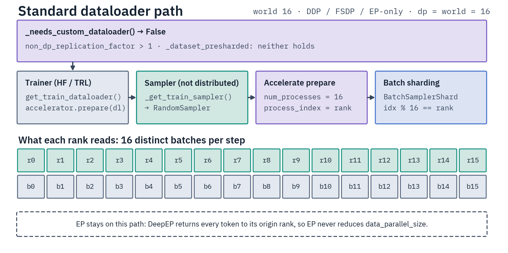
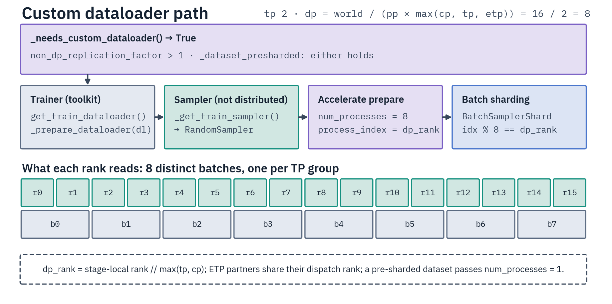

# Distributed Data Loading

Each parallelism mode shards data differently. The rule that drives every decision: which ranks need
the *same* batch.

| Mode | Data requirement | Reason |
|------|------------------|--------|
| DDP | Each rank gets different data | Standard data parallelism |
| EP | Each rank gets different data | EP is orthogonal to DP — it routes tokens to experts and returns them to the origin rank |
| TP | Ranks in a TP group get the **same** data | Weights are sharded; all shards need the same activations, combined by AllReduce |
| CP | Ranks in a CP group get the **same** sequence | The sequence is split across ranks (Ulysses) |
| Expert TP | Ranks in an expert-TP group get the **same** data | Expert FFN is sharded across the group |
| PP | The stages of one pipeline chain get the **same** batch | Stage 0 reads its `input_ids`, the last stage its `labels` |

Every rank reads its own copy of the source — a per-node S3 cache, a pre-staged directory, a cached
hub revision — so the load agrees the rows before any rank trains on them (`halo/data/sources/replica_identity.py`).
A replicated load compares each split's row count, schema and a digest of 16 evenly spaced rows across
the world (media columns excluded, decoded or not and at any depth: their stored paths can name a
node's own cache). A sharded load compares every split's `shard_index.json` across the world, and the
same row identity among the ranks sharing a DP rank (TP/CP/ETP siblings and pipeline chains). A disagreement
raises `ValueError` on every rank: the row-identity check names the ranks and nodes holding each
version, the shard-index check lists each split's distinct digests and rank 0's mapping. Unchecked, a stale
node trains other rows.

## Data parallel size

`data_parallel_size` is the number of distinct batches (= unique shards needed), derived in
[Stacking the dimensions](README.md#stacking-the-dimensions) and listed per mode in
[Supported combinations](README.md#supported-combinations).

Computed once in `ParallelismConfig.__post_init__` (`halo/distributed/parallelism_config.py`).
`get_data_parallel_rank()` derives the shard index from the stage-local rank, so every stage of a
pipeline chain gets the same one: TP/CP take `rank // group_size`, expert-TP reads its sub-group
membership (strided under node-local EP, contiguous under cross-node EP), so partners sharing a
dispatch rank process the same batch.

## How the DataLoader is built

`DataParallelLoaderMixin` (`halo/trainers/dataloaders.py`, composed into
`DistributedTrainerMixin`) takes the custom path when `uses_dp_sharded_loader` sees
`non_dp_replication_factor > 1` (more than one rank sees each batch: TP, CP, ETP or PP) or a
pre-sharded dataset; otherwise (DDP / EP-only / HSDP, not presharded) it uses the base Trainer flow.

On the custom path `_prepare_dataloader()` wraps the loader through Accelerate's
`prepare_data_loader` passing `num_processes=data_parallel_size` and
`process_index=data_parallel_rank` — **DP size/rank, not global world_size/rank**. For pre-sharded
datasets it passes `num_processes=1` (device placement only) so Accelerate does not re-shard the
already-disjoint slice. Prepared loaders are marked `_is_accelerate_prepared` to avoid double
preparation. The custom path never dispatches: accelerate's dispatching loader (its default for an
iterable dataset) slices rank 0's batches by global rank whatever size/rank it is handed, so
siblings would draw different rows. An iterable dataset is sharded by DP rank instead (online and
async GRPO refuse one here, since their prompt-group sampler needs a length), and an explicit
`accelerator_config.dispatch_batches: true` raises, as does `train_sampling_strategy: batch_rebalance`,
whose HF sampler shards over every process rather than over the DP replicas.

On the base flow (DDP, plain FSDP2 data parallel, pure EP) `train_sampling_strategy: batch_rebalance`
runs HF's `BatchRebalanceSampler`. It draws each optimizer step's rows from its own shuffle, seeded 42
plus the epoch: HF hands it no seed, so `seed` and `data_seed` do not move the data order, and the
steps hold other rows than under `random`. Within a step it only reassigns those rows among
(rank, accumulation slot), splitting them by length into groups of near-equal padded cost so the ranks
of a micro-step finish together. A rank's row count per micro-step varies whenever
`per_device_train_batch_size > 1`, so `per_device_train_batch_size × max_length` no longer bounds the
tokens one MoE forward presents (a cross-node dispatch past the Gin ceiling raises at that step). It reads each row's length from
`processing_class.model_input_names[0]`, which for a multimodal checkpoint's processor (Command A+,
Inkling, Gemma 4) is an image or audio input that a text row lacks, so on those checkpoints it raises
at loader build.

The samplers are not `DistributedSampler` — distribution happens in `prepare_data_loader` via
Accelerate's `BatchSamplerShard`, which yields batch `idx` to a process when
`idx % num_processes == process_index`. `data_seed` is passed through, so it owns the shuffle order
exactly as on the standard path; unset, the seedable sampler falls back to the ambient torch seed.
The custom-path train loader seeds its workers by **DP rank**, not global rank, so TP/CP/ETP
siblings and pipeline chains draw identical worker randomness; the eval loader sets no `worker_init_fn`.
Under CP every loader collates through `_loader_collate_fn` (offline GRPO's grouped and reference-sweep
loaders included), which refuses a left-padded batch on the host before it moves to the device
([CP requirements](context-parallelism.md#requirements)).

Every rank of one split must draw the same permutation, but a sampler without a generator shuffles
off the rank's own torch RNG, which EP ranks consume differently.
So on every path a train sampler left without a generator gets one seeded with `data_seed`, else
`seed` (`_get_train_sampler`). That covers the two shuffles accelerate's seedable sampler does not
reach: `train_sampling_strategy: group_by_length`, and a `RandomSampler` on a one-process loader
(`data_parallel_size == 1`, or a pre-sharded dataset) under
`accelerator_config.use_seedable_sampler: false`. The on-policy GRPO trainers' `RepeatSampler`
carries its own generator, seeded with `seed`.

**Sweeps over the dataset.** The `precompute_ref_log_probs` sweep builds its own loader and
prepares it with the world-keyed accelerator, so it would shard by global rank and let TP/CP/expert-TP
siblings forward *different* rows through a collective attention/expert path.

`data_parallel_sweep()` pins both ends of such a sweep to the DP axis for its duration:
`prepare_data_loader` routes to `_prepare_dataloader`, and the gather is deduplicated to one chunk
per DP rank in DP order. It is an identity when `dp_size == world_size`.

Pre-sharded datasets are rejected under `precompute_ref_log_probs`: the sweep gathers one set of
log-probs in dataset order, which each rank would attach to its own different shard. Offline GRPO's
full-finetuning KL sweep has the same restriction in every mode, CP included; it requires finite,
unsharded splits ([reference lifecycle](../training-methods/grpo/offline.md#reference-model)).

The two paths shard by different indices — the standard path by global rank (one distinct batch per
rank), the custom path by DP rank (ranks in a TP/CP group share a batch):

## Per-trainer sampling

| Trainer | Sampler | Handles DP itself | `_prepare_dataloader` |
|---------|---------|-------------------|----------------------|
| SFT / SMPO | `RandomSampler` | No | for TP / CP / ETP / PP |
| Classification | `RandomSampler` | No | for TP / ETP / PP (no CP) |
| Online GRPO | `RepeatSampler` (TRL) | No (same seed all ranks) | for TP / ETP (no CP) |
| Offline GRPO | `MultiGroupSampler` | Yes (DP rank/size) | uses `prepare_data_loader(num_processes=1)` |

**Online GRPO** uses TRL's `RepeatSampler`: same prompts to all GPUs (for reward normalization across
generations) and prompt reuse across updates, with `mini_repeat_count = num_generations` and
`repeat_count = num_iterations * steps_per_generation`.

Same seed on all ranks gives identical prompt ordering; each GPU generates different completions, so
an advantage centers each completion's reward
on its prompt-group statistics (`advantage[i] = (reward[i] - mean(group)) / (std(group) + eps)` under
TRL's default `scale_rewards="group"`). When TP or ETP reduces DP, `_prepare_dataloader` shards
prompts across DP groups while all ranks within a TP group share the same prompts.

On that custom-dataloader path the trainers override `_get_train_sampler`
(`GenerationRoundMixin` in `halo/trainers/grpo/on_policy.py`) to size the sampler at the
loader's real DP consumption rate. TRL's world-rate geometry would re-roll part of every prompt
block and silently skip the rest.

Two raises guard the shape. The DP-rate generation batch must be divisible by `num_generations`
(every round covers whole prompt groups). Under TP/ETP the *per-rank* rows must be divisible by it
too, because TP siblings inject duplicate blocks into TRL's world-order reward gather and only whole
per-rank groups regroup correctly. Pre-sharded datasets consume per DP rank, so the rate is one
rank's.

**Offline GRPO** uses `MultiGroupSampler` (`halo/trainers/grpo/offline/group_sampler.py`). Advantages are
pre-computed per example at tokenization time (`compute_group_advantages` normalizes a group's
rewards via `advantage_method`, default `quantile_norm`), so the sampler does not pack a group into
one batch. It emits each group's indices in group-appearance order, shards the sequence across DP
ranks itself, then seed-shuffles each rank's slice (re-shuffled per epoch).

The dataloader passes `num_processes=1` to skip Accelerate's sharding. Per-rank index counts differ
(the remainder goes to
the first ranks), so the loader all-reduce-MINs the per-rank batch count and truncates to the global
minimum, keeping every rank's optimizer-step count equal; a global minimum of 0 raises.

## Pre-processed (sharded) datasets

A sharded dataset (a `train/shard_index.json` layout) loads at the **shard level** before the
DataLoader is built. Every training script passes DP rank/size (not global rank/world_size) to its
loader (`load_script_datasets`, `halo/entrypoints/data_setup.py`), so CP/TP/ETP group members and a
pipeline chain's stages load the same shards; SFT additionally detects a pre-processed (tokenized) dataset via `load_datasets_auto()`.
Each DP rank takes a **contiguous** range of shards, remainder to the first ranks — 10 shards over 3
ranks gives `[4, 3, 3]` (`ShardedDatasetLoader`, `halo/data/sources/sharded_dataset.py`).

**Hard requirement:** `num_shards >= data_parallel_size`. A train split with fewer shards **raises**
at load time, since ranks with index `>= num_shards` would get zero examples; any other split warns.
A missing `train`/`test` split, or one empty on every rank, is rejected at load
(`halo/data/sources/loading.py`) — the sharded loader skips a split with no shard index, so the check
is what turns that into a failure.

The length-equalizer (`_equalize_presharded_length`, collective — every rank must reach it) runs for
**both train and eval**: unequal per-rank lengths make ranks run different step counts and hang at
the gradient sync or metrics gather, so each split is truncated to the global minimum. When ranks
differ, global rank 0 warns of the largest drop any rank takes: about a shard per rank when
`num_shards` is not a multiple of `data_parallel_size`, and up to one row per shard a rank holds when
it is, since shard sizes differ by one row.

A minimum of 0 raises instead of truncating every rank to empty. For eval this means a small test
split (sharding skips empty shards) must still yield at least `data_parallel_size` non-empty shards,
or evaluation must be disabled.

Downstream map/filter caches key on a forced deterministic fingerprint (`load_datasets` in
`halo/data/sources/loading.py`) that folds in a content signature of the freshly loaded data, so
an in-place re-push cannot serve stale mapped rows.

A tokenizer or processor in the map's `fn_kwargs` keys by **content**, not by path: the fast
backend's serialized state (vocab, merges, normalizer), else the sorted vocab table, plus the
chat-template hash and the special-token ids; `name_or_path` is the fallback only where no
content is readable. A resume that repoints the load at the run's own checkpoint therefore
reuses the map cache instead of re-tokenizing the corpus, and an edited vocab, template or
special-token id invalidates it. A content read that raises falls back to the path with a one-time
warning per tokenizer class: that key misses on every resume leg and survives an in-place edit.

For pre-sharded loads the key also carries the DP rank/size: each rank holds a disjoint slice, and
without the DP identity equal-length shards would
stamp identical keys and non-writer ranks would load rank 0's mapped shard. Replicated (non-sharded)
loads keep a shared key so single-writer caching works.

The map/filter runs on one rank per filesystem scope and the rest read its cache; the rank ordering,
the store joins and the never-nest rule are on
[Filesystem Handling](../data/filesystem-handling.md#coordination-primitives).

Whether a source is sharded at all is agreed across ranks (`is_sharded_dataset_across_ranks`, an all-reduce MAX): a
per-rank S3 probe errs only toward "not sharded" on a credentials flake, and a split verdict would load
different sizes on different ranks and hang the first collective.

A rank past the last shard is handed an empty split carrying the artifact's **schema** (read off the
split's first shard), never a column-less one: every downstream `column_names` test gates a
coordinated operation, so a rank whose split had no columns would skip a barrier its peers make.

## Common pitfalls

- **Double-sharding:** a sampler that already shards DP (e.g. `MultiGroupSampler`) must pass
  `num_processes=1, process_index=0` to `_prepare_dataloader`, not let it resolve DP itself.
- **Global rank instead of DP rank:** use `parallelism_config.get_data_parallel_rank()` / `.data_parallel_size` for
  samplers under TP/CP/ETP/PP, not `accelerator.process_index` / world_size.
- **Treating EP like TP:** EP does not reduce DP. `dp_size = world_size` for EP-only.
- **Expecting a dataset list to shard:** `load_datasets` deliberately does not pass DP rank/size for
  a list path, so every entry loads whole — a sharded entry would otherwise get `1/dp` of its own
  `1/dp` slice, silent data loss. Combine sharded corpora offline with
  `scripts/before_training/prepare_dataset.py` instead.
