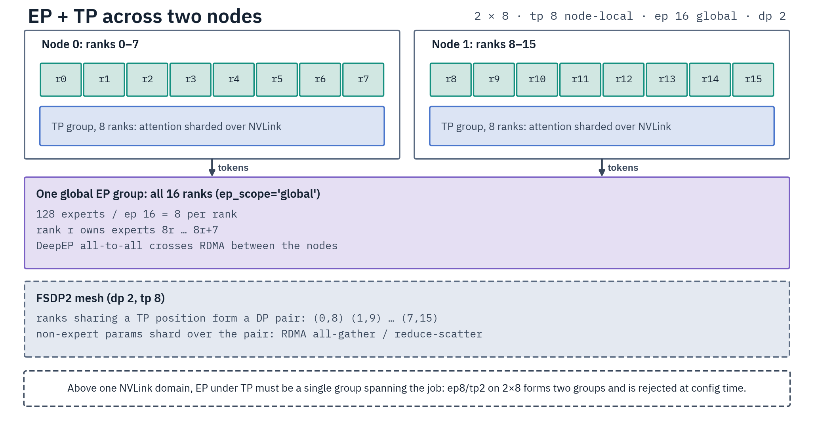

# Multi-Node Parallelism

Multi-node training spans DP, EP and PP across machines connected by InfiniBand/RDMA, with TP, CP
and ETP kept inside each NVLink domain. `ParallelismConfig` (`halo/distributed/parallelism_config.py`)
validates every combination against the [supported-axis allowlist](README.md#supported-combinations)
and the refusals in `halo/distributed/parallelism_rules.py`; this page adds the locality rules, the
storage split and what has run on real machines.

Runnable launches, SLURM, and troubleshooting live in [Launch Recipes](launch-recipes.md).

## Scope rules

| Dimension | Scope | Constraint |
|-----------|-------|------------|
| EP | node-local (`ep_scope="node"`) or cross-domain (`"global"`, needs RDMA) | — |
| TP | always NVLink-local | `tp_size <= nvlink_domain_size`, divides it evenly |
| ETP | always NVLink-local | `expert_tp_size` divides the domain |
| CP | always NVLink-local | `cp_size <= nvlink_domain_size` and divides it (Ulysses all-to-all is bandwidth-bound) |
| PP | cross-domain (the only axis meant to be) | stage boundaries fall on domain boundaries, so `pp_size` divides the domain count ([Pipeline Parallelism](pipeline-parallelism.md)) |
| DP | automatic | what the other axes leave ([Stacking the dimensions](README.md#stacking-the-dimensions)) |

EP is **orthogonal** to DP — it routes tokens to experts and returns them to their originating
ranks, so EP never reduces DP.

**NVLink domain vs OS node:** on a standard cluster the NVLink domain is the OS node (≤8 GPUs), so
`nvlink_domain_size == gpus_per_node` and "node-local" means the OS node. On GB200/GB300 NVL72 the
fabric spans the rack (up to 72 GPUs across ~18 OS nodes); set `NVLINK_DOMAIN_SIZE` to unlock
NVLink-wide TP/CP/EP — see [NVL72](#gb200gb300-nvl72-multi-node-nvlink).

| Term | Definition |
|------|------------|
| `ep_size` | Number of distinct expert subsets |
| `ep_group_size` | Full EP process group = `ep_size * expert_tp_size` (auto-computed) |
| `data_parallel_size` | Distinct batches per step (the DP row above); drives DataLoader sharding |
| `nvlink_domain_size` | GPUs reachable over NVLink (= `gpus_per_node`, or `NVLINK_DOMAIN_SIZE` on NVL72) |

Gradient-sync scope follows the mode — the world or the EP group
([below](#gradient-synchronization)).

## Node-local vs cross-node EP

| Mode | EP groups | Communication |
|------|-----------|---------------|
| Node-local (`ep_scope="node"`) | Within each NVLink domain (consecutive ranks) | NVLink |
| Cross-node (`ep_scope="global"`) | Span every NVLink domain, contiguous block per domain | NVLink + RDMA |

Cross-node EP uses the **column-block** layout (`CrossNodeLayout`, `halo/distributed/group_layout.py`): each group spans
every domain with a contiguous device block per domain, and the group-relative rank is
`rdma_rank * members_per_domain + nvl_rank` — what DeepEP's internode transport expects. Contiguity
is mandatory because DeepEP's intranode P2P kernel addresses CUDA IPC peers by device offset.

```text
world=16 (2 domains of 8), ep_group_size=8:
  EP group 0: [0, 1, 2, 3,  8,  9, 10, 11]
  EP group 1: [4, 5, 6, 7, 12, 13, 14, 15]
Single global group (ep_group_size == 16): [0 .. 15]
```

A group that cannot split into equal contiguous per-domain blocks is rejected at config time. The
reachable widths follow from that rule: `ep_group_size = num_domains × d`, where `d` (the members
per domain) divides `nvlink_domain_size`. On 4 domains of 8 that admits 4, 8, 16 and 32 only, and
with many small domains the narrowest cross-node group is `num_domains` wide.

When `ep_group_size < world_size` the EP groups are data-parallel replicas
(`num_ep_groups > 1`); that case, and node-local EP across domains, routes through the deferred sync
below. The **single global group** (`ep_group_size == world_size`) needs no cross-replica
deferral: every collective already spans the same ranks.

Cross-node EP runs DeepEP's hybrid RDMA dispatch, which has no deterministic mode, so `full_determinism`
on such a group is refused before the load ([Determinism](expert-parallelism.md#determinism)).

### Deferred cross-replica sync

**Every multi-EP-group topology defers**, single-node ones included, and so does every PP run.
`EPConfig.defer_grad_sync` is `num_ep_groups > 1` or `pp_size > 1`, minus the FSDP-managed-expert
case: `fsdp_shard_ep1_experts` at `ep_group_size == 1`, where FSDP2's reduce-scatter over the DTensor
experts is already the sole sync and deferring on top would double-sync it.

It carries no node-count term: single-domain `ep2` (four groups on 8 GPUs) and `ep2+tp2` defer
exactly as node-local `ep8×2` does. Under a deferred topology **no in-backward EP grad hook registers
at all**, expert and router alike, and every average runs in one post-backward sweep
(`DistributedTrainerMixin._sync_deferred_expert_grads`).

Two things keep the hooks out of it. A post-accumulate hook fires only where a grad accumulated, so a
rank whose dispatch delivered no tokens for a layer never enters the collective its replicas are
already waiting in. And an in-backward all-reduce of different membership races each group's
intra-group DeepEP combine: rank-inconsistent collective order deadlocks.

The sweep agrees each bucket's membership over that bucket's reduce group instead: a param some rank
of the group touched is zero-filled where absent, and one no rank touched keeps no gradient, so the
optimizer applies no weight decay to it. The TP and QLoRA sweeps agree theirs the same way. The hook
that survives on a single-group EP run carries no collective: it only divides by
`world_size / expert_tp_size`.

`EPConfig.is_deferred_dp` is narrower and **multi-domain only** — `num_ep_groups > 1`,
`ep_group_size > 1`, more than one NVLink domain, no expert-TP. (Attention TP needs no term of its
own: `ParallelismConfig` rejects multi-domain multi-group EP+TP at config time.) It does not gate the
sweep. It decides that FSDP shards the non-expert params over `process_group` (the EP group) instead
of the DP world, which is what adds the third leg below.

The sweep lands every grad at the `/world_size` DP average over the whole job (over the stage
under PP, whose ranks then stand for `world_size`):

- expert shards: `all_reduce(SUM)` over the `expert_replica_group`, then
  `/(world_size / expert_tp_size)`.

    The ETP factor drops out because expert-TP partners hold slices of one expert and consume the
    same batch, so they are not DP replicas; at `expert_tp_size == 1` the divisor is just
    `world_size`.

- router, replicated EP submodules and plain non-EP params: `all_reduce(AVG)` over the world.
- non-expert FSDP shards, **`is_deferred_dp` only**: `all_reduce(AVG)` over the replica group, since
  the reduce-scatter averaged them within the EP group alone. Everywhere else it already spanned the
  full DP scope, so they are left untouched.

`ep_group_size`-way FSDP × `num_ep_groups`-way replica average = `world_size`-way DP. The sweep is
enforced once per optimizer step — its expert `SUM / world_size` leg is not idempotent, so a second
pass raises rather than halving every expert gradient.

Deferral does not rescue single-domain multi-group EP wider than 2 ranks, which is refused instead
([why](expert-parallelism.md#single-domain-multi-group-ep-races-and-hangs)).

## Configuration matrix

**2 nodes × 8 GPUs (16 total)** (single-node DP sizes follow [Stacking the dimensions](README.md#stacking-the-dimensions)):

| Config | EP | CP | TP | ETP | EP scope | DP |
|--------|----|----|----|-----|----------|----|
| Node-local EP+CP | 8 | 8 | 1 | 1 | node | 2 |
| Cross-node EP | 16 | 1 | 1 | 1 | global | 16 |
| Node-local EP | 8 | 1 | 1 | 1 | node | 16 |
| Pure ETP per node | 1 | 1 | 1 | 8 | node | 2 |
| EP+TP | 16 | 1 | 2 | 1 | global | 8 |
| EP+ETP per domain | 2 | 1 | 1 | 8 | global | 2 |

Which other EP+TP, EP+CP and cross-domain EP+ETP layouts pass the config-time checks:
[Topology rules](README.md#topology-rules).

## Gradient synchronization

FSDP2 (`fully_shard`) syncs non-expert gradients; EP params go in `ignored_params`.

| Mode | Non-expert FSDP group | Expert gradients |
|------|----------------------|------------------|
| DP / CP / single-group EP / single-domain EP+CP | All ranks (1D, `world_size`) | The DeepEP combine already sums the group; the in-backward hook only rescales |
| Multi-group EP (no TP) — across domains (node-local EP, EP+CP) **or within one** (`ep_size=2`) | The **EP group** above one domain (`is_deferred_dp`), all ranks otherwise | One post-backward cross-replica sweep |
| EP+TP (DP>1) | `(dp, tp)` mesh — per-TP-position DP groups | The combine, plus the sweep once the world holds several EP groups |

**EP+TP groups:** TP params are DTensors with different shards per TP rank, so the world group would
mix gradient slices from different weight positions. Ranks sharing a TP position form a DP group:
`[0,8], [1,9], …` for 2 nodes × 8 GPUs at TP=8.

**CP:** syncs across all ranks whenever `cp_size > 1`, even at `data_parallel_size == 1` — each rank
holds partial gradients from its sequence chunk. The CP loss carries a `cp_size` factor that cancels
FSDP2's `1/world_size` average ([Context Parallelism → Loss computation](context-parallelism.md#loss-computation)).

**HSDP (`--use_hsdp`):** the default 1D full-shard path sends every shard collective over RDMA. `--use_hsdp`
switches to a 2D `(dp_replicate, dp_shard)` mesh that shards within each NVLink domain and
replicates across domains, so only one gradient all-reduce crosses RDMA per backward (per step with
[`fsdp_defer_grad_sync`](data-parallelism.md#deferred-gradient-reduce-fsdp_defer_grad_sync)). See
[Data Parallelism → HSDP](data-parallelism.md#hsdp-hybrid-sharded-data-parallel). Rejected with EP,
TP, EP+TP, and Expert-TP.

**Multi-EP-group expert grad norm:** with `num_ep_groups > 1`, expert grad norms sum within each EP
group only. The clip runs the deferred sweep first, so every replica already holds the same averaged
expert grads and no `expert_replica_group` reduce runs. Non-expert DTensor shards (TP) and
full-world FSDP shards are reduced over their own tiling group and counted once. The global norm is
`sqrt(expert² + non_expert²)`, computed in `_compute_global_grad_norm`
(`halo/trainers/parallelism/grad_clipping.py`).

## EP+TP mode

TP (DTensor) shards attention within each NVLink domain; EP (DeepEP) distributes experts; FSDP2
syncs DP across domains. Attention TP leaves `ep_group_size` at `ep_size`, so it adds no expert
sharding. DP = `world_size / tp_size`. Its rules: [Topology rules → EP+TP](README.md#topology-rules).

Mechanism and load path: [tensor-parallelism.md](tensor-parallelism.md#eptp-mode).



Valid shapes: single node — `ep8/tp8` (DP 1), `ep8/tp4` (DP 2, one 8-rank EP group spanning two TP
groups), `ep8/tp2` (DP 4) or `ep2/tp2` (DP 4); 2×8 — `ep16` global with `tp8` (DP 2), `tp4` (DP 4)
or `tp2` (DP 8). At DP=1 there is no inter-node FSDP sync.

## ParallelismConfig

```python
from halo.distributed.parallelism_config import ParallelismConfig

config = ParallelismConfig(ep_size=8, tp_size=8, ep_scope="node")
```

Fields, defaults and their `ParallelismArguments` spellings: [Configuration reference → ParallelismConfig](../reference/configuration-reference.md#parallelismconfig).

A hand-built config takes the same defaults as a YAML-built one. Derived fields: `data_parallel_size`,
`stage_world_size`, `num_ep_groups` (per stage), `requires_rdma` (True only when the EP group spans more
than one NVLink domain). `ep_config()` / `cp_config()` build the process groups.

## DeepEP inter-node communication

`DeepEPDispatcher` (`halo/distributed/expert_parallel/deepep/dispatcher.py`) shares one lazily built
`deep_ep.ElasticBuffer` across every MoE layer on an EP group (`HALO_EP_CAPACITY_DEDUP=0` gives each
layer its own) and selects the transport from the EP topology: within one NVLink domain it uses the
NVLink (non-Gin) path; across domains (`requires_rdma=True`, `EPConfig.spans_domains`) the NCCL Gin
backend (GPU-Initiated Networking / RDMA, e.g. AWS EFA). The backend sets `EP_DISABLE_GIN` (`0`
across domains, `1` within one) before its first buffer build; an explicit env value is honored.

NVLink carries the all-to-all several times faster than any RDMA fabric ([measured busbw by
interconnect](../reference/gpu-training-theory.md#interconnect-tiers)), so prefer `ep_scope="node"`
unless you need maximum expert distribution — cross-node EP buys per-GPU memory (GPT-OSS 20B on
2 nodes × 8 B300: `ep16` global holds 2 experts per GPU against `ep8` node-local's 4).

## RDMA fabrics

Cross-node EP and inter-node FSDP gradient sync ride the node's RDMA NIC. The toolkit sets **no**
fabric env vars in code: NCCL (and libfabric, on EFA) read them from the process environment, so
they belong in the launcher.

Every Halo image carries the `aws-ofi-nccl` plugin under NCCL's default plugin name, so it is tried
on every host and yields to NCCL's built-in transports (IB, sockets) where libfabric finds no
provider. The image also bakes `NCCL_IB_HCA=mlx5`.

The NGC base's `/etc/shinit_v2` sets `NCCL_NET_PLUGIN=ofi` when it detects EFA hardware, but only
for a shell that sources it. An EFA job therefore sets the variable itself, and `NCCL_NET=Libfabric`
with it so a missing plugin fails instead of falling back to sockets; that is what every multi-node
`launcher-configs/skypilot/aws/**` task does. The images do not bake either: they slow an IB cluster.

| Fabric | Verify (on the host) | Launch env (beyond image defaults) |
|--------|--------|------------------------------------|
| InfiniBand / RoCE (Mellanox) | `ibstat` → `State: Active` | none; set `NCCL_IB_HCA` only for a non-default HCA |
| AWS EFA | `fi_info -p efa` | `NCCL_NET_PLUGIN=ofi`, `NCCL_NET=Libfabric` |

- **InfiniBand and RoCE** share the NCCL IB path and run on the baked defaults.
- **AWS EFA is libfabric, not Mellanox.** On p6 instances the `mlx5` devices are no cross-node NCCL
  path (NCCL falls back to TCP sockets). Every Halo image, the vLLM and SGLang servers included,
  carries one pinned GIN-capable `aws-ofi-nccl` build ([Docker → RDMA](../infrastructure/docker.md#rdma-networking-infiniband-and-efa)).
  `FI_PROVIDER=efa` and `FI_EFA_USE_DEVICE_RDMA=1` are the plugin's and libfabric's defaults.

    `NCCL_PROTO=simple` is optional; if set, set it on every rank of a communicator, a rollout
    server joining a weight-sync group included
    ([why](../infrastructure/rollout-servers.md#servers-on-other-nodes-efa)). The **host** supplies
    the EFA kernel driver and `/dev/infiniband`; pass them into the container (`--device`, not a
    bind mount).

- **Rollout server on another node** — the server container takes the same fabric env through its
  compose EFA overlay (`docker-compose.vllm.efa.yml` / `docker-compose.sglang.efa.yml`), the trainer
  through `make ... EFA=1`; recipe, preflight and measured rates:
  [Rollout Servers → Servers on other nodes](../infrastructure/rollout-servers.md#servers-on-other-nodes-efa).

- **Cross-node EP over EFA** additionally needs proxy GIN: `NCCL_GIN_TYPE=2` plus
  `--device /dev/gdrdrv`. It is bound by proxy-GIN per-operation latency, not bandwidth, so a
  narrower dispatch group beats a wider one; use it for MoE too large for one node.

    Measured EFA collective ceilings and the full GIN prerequisites:
    [DeepEP → AWS EFA](../infrastructure/deepep.md#expert-parallelism-over-aws-efa).

- **Multi-homed nodes** — set `NCCL_SOCKET_IFNAME` to the fast NIC (the ENA interface on AWS, `ib0`
  on IB clusters) when the default route is the management network.

## Model loading

Every rank reads the checkpoint itself, so every rank must find the same one. Before the first weight
read, the policy load (the embedding backbone and the model-id load of SMPO, offline GRPO and the
teacher-distillation student included) and every frozen reference or teacher load run
`resolve_model_source` (`halo/model_loading/parallel/model_source.py`):

- The fetch runs main-rank-first under the input-filesystem scope: global rank 0 on a shared input
  filesystem, each node's local rank 0 under `DIST_INPUT_SHARED_FILESYSTEM=0`. It takes the
  repository's top-level files at the revision, where a model's config, tokenizer, weights and remote
  code sit, so the weight formats a repo also ships in subfolders (gpt-oss's `original/` and `metal/`)
  stay on the Hub. The default
  embedding backbone is the exception: a sentence-transformers pipeline keeps its modules in
  subfolders, so it takes the whole repository, `onnx/` and `openvino/` exports included.
  Offline (`HF_HUB_OFFLINE`) the fetching rank reads its cache like every other rank, so a pinned revision resolves from a complete cached snapshot.
- Every rank then resolves the source on its own node: the local directory, or the snapshot in its
  Hub cache (`HF_HUB_CACHE`, under `HF_HOME` by default). The verdicts join over the c10d store, so per-node fetch skew
  waits under `DIST_STORE_TIMEOUT_HOURS`, not the NCCL watchdog.
- A source some ranks cannot see raises on every rank and names them. The usual cause is a local
  checkpoint present on some nodes only; a shared input declaration over node-local `HF_HOME` is
  refused earlier, by the startup cache probe ([storage](#shared-vs-node-local-storage)).
- The config, tokenizer and processor reads ahead of the load query the Hub once per filesystem
  scope; the scope's other ranks read the cache its main rank filled.
- A per-rank EP-sharded directory (`save_sharded_ep` output) is refused as a source on every rank,
  naming `merge_ep_shards.py`.
- A Hub source loads its weights at the commit the ranks agreed on, straight from the cache, with no
  further hub request. Per-node caches holding different commits (staged at different times, loaded
  offline) raise instead of training different weights per node.
- Every rank's snapshot of that commit must hold the weight files global rank 0's snapshot names:
  the safetensors index and its shards, or the single weight file. The config and tokenizer reads
  ahead of the load leave a weightless snapshot in every node's cache, which raises instead of
  passing for a fetched one.
- The agreed source (`ModelSource`) carries the revision and the directory this rank reads: the lazy
  loaders stream from that directory, and the eager loads read the agreed commit from the cache.
- The text-vs-multimodal probe that names the run reads the config earlier, falling back per rank to
  the model name when the read fails. Its verdict is joined: ranks that disagree (a node missing the
  source among them) raise on every rank instead of building different model classes.

The weight load itself depends on the loader:

| Loader | Ranks reading at once | A failure on one rank |
|---|---|---|
| Lazy EP (`ep_lazy_loading`) | all; each streams its own slice to its GPU, one tensor in host memory at a time | fenced: every rank raises the real reason |
| Eager `from_pretrained` (`load_whole_model`: DDP/FSDP2, CP, TP on a MoE, the EP fallback; the default embedding backbone) | `max_concurrent_loading` per OS node | joined over the store: the failing rank re-raises its own error, every peer names it; an FP32-master restore failure raises on every rank |
| Native dense TP (`tp_plan`) | all; each places its own shards (its FP32-master restore: `max_concurrent_loading` per OS node, joined) | not fenced: the load runs DTensor collectives |
| Frozen reference / teacher, a trainer's model id | all | joined over the store |

The eager join also bounds the wait for a node's last batch by the store timeout. With
`max_concurrent_loading: 1`, eight serialized loads of a large checkpoint can outlast
`DIST_NCCL_TIMEOUT_MINUTES`. The lazy EP load needs no batching: its host-memory peak is one tensor
per rank, and the ranks of a node that read the same shard share its page cache, so a shared mount
serves each page once per node.

For remote-code families, the lazy meta shell fetches the modeling file at the commit its config was
read from. transformers' copies into `HF_MODULES_CACHE` land whole (`halo/model_loading/remote_code.py`),
so ranks sharing that cache never import a half-written module.

## Shared vs node-local storage

Nodes either share one filesystem (NFS, Lustre, GPFS) or keep their own. `DIST_SHARED_FILESYSTEM`
(default shared) declares it, and `DIST_INPUT_SHARED_FILESYSTEM` (model and dataset caches) and
`DIST_OUTPUT_SHARED_FILESYSTEM` (checkpoints, `run.log`) split the read and write sides. A multi-node
run checks both declarations against the filesystem at startup and refuses a contradiction
([Filesystem Handling](../data/filesystem-handling.md)). On per-node output storage:

- The save rank is each node's local rank 0 instead of global rank 0, so every node's directory holds
  the whole model ([Checkpoints → Multi-node](../reference/checkpoints.md#multi-node)), and `run.log`
  follows the same writer. Optimizer shards stay on the node of the rank that owns them.
- `save_sharded_ep` is refused ([EP → Checkpointing](expert-parallelism.md#checkpointing)).
- A PP save leaves each node only the parts of the stages it ran: merge the node directories with
  `merge_pp_stages.py` before export, and `push_to_hub` across nodes is refused
  ([Per-node export](pipeline-parallelism.md#per-node-export)).

## Verified topologies

What has run on real machines, and what only in simulation. Everything else on this page is enforced
in code and covered by one-host simulations (a `ParallelismConfig` built with `gpus_per_node` /
`nvlink_domain_size` below the world, so the domain-crossing branches execute over NVLink), which prove
the rank math and the gradient algebra, not the fabric. No 1.2.0 row ran on two machines.

| Shape | Evidence |
|---|---|
| 2-node RDMA (Blackwell, EFA): cross-node EP `ep8`/`ep16` and its 8192 tokens/rank Gin ceiling, node-local `ep8×2` matching single-group `ep16`; plain FSDP2, HSDP, multi-group EP, EP+TP, EP+CP, pure ETP and cross-node EP+ETP at 2/4/8 GPUs per node; trainer → rollout-server weight sync across nodes | real two-machine runs before 1.2.0, not repeated on it ([DeepEP → AWS EFA](../infrastructure/deepep.md#expert-parallelism-over-aws-efa), [Rollout Servers](../infrastructure/rollout-servers.md#servers-on-other-nodes-efa)) |
| Save, resume and merge on per-node output storage | two containers on one host (socket NCCL, per-node output directories): Qwen3-8B `pp2` trained, resumed, merged with `merge_pp_stages.py`, loaded with `from_pretrained`, then resumed from the merged directory with the optimizer restored exactly. Two-process CPU simulations cover per-node optimizer shards, a torn shard set refused everywhere (`tests/cpu/checkpoint/test_nonshared_fs_resume.py`) and an interrupted save passed over by resume detection (`test_interrupted_save_resume.py`) |
| Cross-domain EP+ETP | a two-domain simulation on one host builds the groups and shards the experts; training needs DeepEP's cross-node path on two machines |
| PP across machines (gpt-oss-20b `pp2 × ep8` on 16 GPUs, `pp2 × etp2`, SMPO and Bradley-Terry `pp2 × ep2` resumes), two-node CP | not run; the PP tier runs on one 8-GPU host split into simulated NVLink domains |
| **Wider layouts** (4-node, 8-node, the 512-GPU layouts in [Large-Scale Scenarios](large-scale-scenarios.md)) | rank math only: `ParallelismConfig` is exercised at world 8/16/32, no recorded run |
| **NVL72 / MNNVL rack-wide domains** | simulated domain sizes only; see the warning below and [Scale & Limits](../reference/scale-and-limitations.md) |
| **InfiniBand/RoCE as a multi-node fabric** | EFA only; the IB path is config guidance, not a measurement |
| **Cross-node gathered EP save** on a shared filesystem | hand-run recipe in `tests/gpu/parallelism/ep/test_ep_save_reload_roundtrip.py`, not exercised multi-node |

## GB200/GB300 NVL72 (multi-node NVLink)

An NVL72 rack spans the NVLink/NVSwitch fabric across up to 72 GPUs on ~18 OS nodes (4 GPUs each) as
a single NVLink domain with direct GPU-to-GPU P2P across OS-node boundaries (MNNVL, 130 TB/s
aggregate). TP, EP, and CP can run NVLink-wide with no RDMA. The rack's Grace hosts are aarch64, and
the published images are x86_64-only ([Docker](../infrastructure/docker.md)).

Here the NVLink domain exceeds the OS node, so the two units diverge: `gpus_per_node`
(`LOCAL_WORLD_SIZE`, 4) keys filesystem coordination, while `nvlink_domain_size` keys node-local
TP/CP/EP/ETP grouping, EP's locality unit and `requires_rdma`. Set it to the NVLink partition size
(72 for a full rack, or the clique size; on Kubernetes the `nvidia.com/gpu.clique` partition):

```bash
export NVLINK_DOMAIN_SIZE=72
```

The toolkit then builds node-local EP/CP groups as contiguous blocks across the domain and sets
`requires_rdma=False` for EP within the domain. Leaving it unset caps node-local TP/CP/EP at
`gpus_per_node=4`, and warns if it detects an NVLink fabric anyway. `requested_nvlink_domain_size`
(`halo/distributed/nvlink.py`) is the variable's one reader: a malformed value warns, a non-positive
one warns once, and either reads as unset.

**The domain is the tiling unit, so every node-local width must divide it.** `tp_size`, `cp_size`,
`expert_tp_size` and a node-scope `ep_group_size` are each required to divide `nvlink_domain_size`
exactly (`_reject_tp`, `_reject_cp_locality`, `_reject_expert_tp`, `_reject_ep_group`). Groups
are contiguous rank blocks, and a non-dividing width straddles a domain boundary while
`requires_rdma` still reports False.

At `NVLINK_DOMAIN_SIZE=72` the legal widths are the divisors of 72
(1, 2, 3, 4, 6, 8, 9, 12, 18, 24, 36, 72); 16, 32 and 64 are rejected at config time. Pure EP is
narrower still: on a single 72-GPU domain only `ep_size=2` and `ep_size=72` pass
([single-domain rule](expert-parallelism.md#single-domain-multi-group-ep-races-and-hangs)).

On a rack whose GPU count is not a power of two, declare the largest power-of-two divisor your model
can use (`NVLINK_DOMAIN_SIZE=64` over 16 of the rack's 18 compute trays) and leave the remainder
idle.

Ranks disagreeing on `NVLINK_DOMAIN_SIZE` (a per-node drift builds different groups on different
ranks) are rejected by `ParallelismConfig` itself, before any fabric read.
`validate_nvlink_domain_against_fabric` (`halo/distributed/nvlink.py`) then cross-checks
the declaration against hardware at config time.

Both verdicts are per **domain**, taken from the gathered clique ids and node widths so every rank
reaches the same one. A domain block spanning more than one fabric clique **raises**.

So does a block whose ranks all report no fabric while the declared domain exceeds their node: the
case no clique comparison can see, since every fabric-less GPU reports the same sentinel (a mixed
job, an NVL72 rack beside plain NVL8 trays, has both kinds).

A clique wider than the declared domain **warns**: node-local parallelism is capped below the
available NVLink width. If any rank cannot read its clique the check no-ops, keeping it rank-uniform.

Each rank reads its clique id out of process through `nvidia-smi -q -i <pci_bus_id>`, never through
NVML's Python binding — the binding's versioned out-param struct segfaults inside the C call on a
driver mismatch, killing every rank inside `ParallelismConfig.__post_init__`. Keying on the PCI bus
id rather than the device index keeps `CUDA_VISIBLE_DEVICES` masking from making a rank read another
GPU's clique.

**Prerequisites (must already run on the rack):**

| Component | Why |
|-----------|-----|
| NVIDIA Fabric Manager | NVSwitch routing / NVLink partition |
| IMEX service + channels (`/dev/nvidia-caps-imex-channels/`) | GPU-memory export/import for cross-OS-image NVLink P2P; jobs fail without it |
| NCCL ≥ 2.25.2 | MNNVL support; leave `NCCL_MNNVL_ENABLE` at its default (on). A domain-local EP group is classified intranode, so the dispatcher sets `EP_DISABLE_GIN=1` even when the domain spans OS nodes — export `EP_DISABLE_GIN=0` to A/B the Gin backend over MNNVL |
| NVSHMEM (`nvidia-nvshmem-cu13`) | DeepEP device linking only — not the V2 transport |

The first two are **enforced, not advisory**. Whenever `nvlink_domain_size > gpus_per_node`, every
rank of a live multi-rank job runs `verify_mnnvl_prerequisites`, and the job raises (`ValueError`,
naming the first failing rank) if any rank has no IMEX channels, reports an NVLink fabric
registration other than `COMPLETED` (`nvidia-smi` "Fabric State"), or sees no fabric clique at all.

Without them the declaration promises cross-OS-node NVLink P2P that fails deep inside the first
collective instead. At or below the threshold only the unset-`NVLINK_DOMAIN_SIZE` warning runs;
outside a live job the same verdict only logs.

> [!WARNING]
> **DeepEP on NVL72**
>
> NVLink-wide EP across OS-node boundaries depends on the NCCL Gin / NVSHMEM build targeting
> MNNVL on Blackwell. Validate before relying on rack-wide EP all-to-all.

Each compute tray is an OS node with 4 GPUs: launch with `--nproc_per_node=4` and ~18 nodes per
rack. With SLURM use the `topology/block` plugin with one block per NVL72 domain and `--segment` to
keep a job in one rack.

| Goal | Layout |
|------|--------|
| Large MoE | Wide node-scope EP at a divisor of the declared domain — `ep_size=72` at `NVLINK_DOMAIN_SIZE=72`, or `ep_size=64` at `NVLINK_DOMAIN_SIZE=64` when the expert count is a power of two |
| Long sequences | CP up to the domain width, at a divisor of it |
| Dense / attention-heavy | TP at a divisor of the domain — 8, 9, 12, 18, 24 or 36 at domain 72; `tp_size=16` is rejected |
| Multi-rack | TP/EP inside each rack, DP across racks; [PP](pipeline-parallelism.md) is the one axis meant to cross racks |
