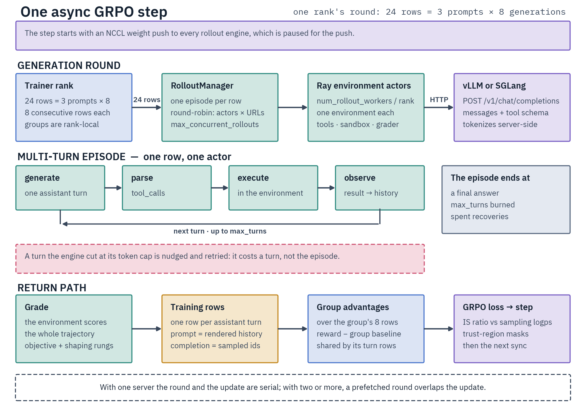

# Async GRPO with Environments

Multi-turn RL: the model converses with an environment (tools, code, repositories, search) until a final reward, then
trains with GRPO. For pre-collected rewards use [Offline GRPO](../grpo/offline.md); for single-turn verifiable rewards,
[Online GRPO](../grpo/online.md); for pairwise preferences, [SMPO](../preference/smpo.md) or
[DPO](../preference/dpo.md).

- Trainer `DistributedAsyncEnvironmentalGRPOTrainer`, script `scripts/training/environmental_grpo.py`.
- Pick an environment with `environment_type` or register your own ([Environments](environments/README.md)).
- [Reward Terms](../grpo/rewards/README.md#environment-arm) defines how the episode reward is composed.
- A [rollout server](../../infrastructure/rollout-servers.md) must be serving before you launch;
  [Ray](../../infrastructure/ray.md) configures itself on one node.

## How a step works

1. The trainer pushes its weights to the engines over NCCL, then hands one prompt per batch row to `RolloutManager`, which dispatches round-robin across Ray actors and server URLs.
2. Each actor holds its own environment instance: POST `/v1/chat/completions`, parse the reply and its `tool_calls`, run the step, repeat until done or `max_turns`.
3. The environment grades each trajectory; the trainer builds training rows from the engine's sampled tokens and computes the GRPO loss.



## Configuration surface

One YAML, six dataclasses.

| Knob family | Class |
|---|---|
| `environment_type`, `rewards`, `max_turns`, `environment_kwargs` | `EnvironmentConfig` ([fields](../../reference/configuration-reference.md#environmentconfig)) |
| Ray, servers, sync cadence, prefetch, rollout sampling, trust region | `AsyncTrainingConfig` ([fields](../../reference/configuration-reference.md#asynctrainingconfig)) |
| Dataset columns, prompt filter, `save_completions` | `EnvironmentalGRPOScriptArguments` |
| Optimizer, batch, `beta`, `num_generations`, `vllm_group_port` | TRL `GRPOConfig` |
| Model id, LoRA | `ModelConfig` |
| Parallel sizes, `reset_sinks` | `DistributedArguments` |

## Dataset

`prompt` is the row; `answer` is carried whenever the dataset has it. Where the environment requires `answer`, a
dataset without it is refused at trainer construction:

- `code_contests` / `codeforces` (hidden-test payload), `exam_qa`, `qa_search` and the `react_*` presets (graded
  final answer) require it, as does [`swe`](environments/tasks/swe.md#reward) without a `test_function`, unless
  judge-only;
- `native_*` and `mcp` need none.

Rename columns with `prompt_field` / `answer_field` and forward extras with `context_fields`. A `context_fields`
entry, or an `answer_field` renamed away from `answer`, that names no column raises at startup.

- A message-list `prompt` reduces to its **last `user` turn** in training and the eval runner alike, since the
  environment builds the conversation itself. A content-part list hands over its `text` parts concatenated. A
  conversation with no `user` turn, or whose last `user` turn carries any other part, fails the batch on every rank;
  the script refuses an image part earlier, while it processes the dataset.
- The trainer forces `remove_unused_columns: false` (warning when a config sets it true): pruning would strip `answer`
  and the `context_fields` columns.
- The environment owns the system turn and the tool schema: there is no `system_prompt` field and `tools_field` is
  rejected. An override, where accepted, is `environment_kwargs.system_prompt`; the ReAct presets refuse it.

## Quickstart

Point the template's `dataset:` at your data, start a server on a GPU the trainer will not use, wait for `/health`,
launch. The template runs a ReAct environment, which is served without a tool-call parser
(`VLLM_TOOL_CALLING_FLAGS=`):

```bash
VLLM_MODEL=Qwen/Qwen3-4B-Instruct-2507 VLLM_CUDA_DEVICES=7 VLLM_TOOL_CALLING_FLAGS= \
    docker compose -f docker-compose.vllm.yml up -d vllm-server

CUDA_VISIBLE_DEVICES=0,1,2,3,4,5,6 torchrun --nproc_per_node=7 \
    scripts/training/environmental_grpo.py \
    examples/grpo/environmental/environmental-grpo-template.yaml
```

Checkpoints land in `<output_dir>/checkpoint-<step>/`, rollouts in `<output_dir>/completions/`
([Saved trajectories](monitoring.md#saved-trajectories)). Launch options: [Servers and Launch](setup.md).

## From Python

```python
trainer = DistributedAsyncEnvironmentalGRPOTrainer(
    model=model,
    args=grpo_config,                                # TRL GRPOConfig
    train_dataset=train_dataset,
    processing_class=tokenizer,
    environment_config=EnvironmentConfig(environment_type="react_math"),
    async_config=AsyncTrainingConfig(rollout_server_url="http://localhost:8000"),
    parallelism_config=ParallelismConfig(),          # required; the default is plain data parallelism
    peft_config=lora_config,                         # optional
)
```

For an unregistered `BaseEnvironment` subclass, pass `environment_cls=MyEnvironment` with `environment_kwargs={...}`
instead. One of the two is required.

## Testing a setup

Run the environment on a few rows first. `--training_config` samples under the training YAML's own contract
([Smoke-testing a config](evaluation.md#smoke-testing-a-config)).

```bash
python scripts/environments/inference/run_env.py \
    --training_config examples/grpo/environmental/environmental-grpo-template.yaml \
    --dataset <hub-id> --split test --num_examples 20 \
    --base_url http://localhost:8000/v1 --model <served-model-id>
```

- `pytest tests/cpu/environments tests/cpu/grpo -m cpu` covers the construction gates and row accounting.
- `make test-gpu-vllm` / `make test-gpu-sglang` run the end-to-end suites against a live server.

## Pages

- [Servers and Launch](setup.md): GPU split, backends, weight sync, multi-node
- [Episodes](episodes.md): sampling, turn and episode budgets, tool calls, unproductive turns
- [Reasoning Budgets](reasoning.md): effort levels, reasoning budgets, the reasoning length reward
- [Objective and Stability](objective.md): training rows, importance sampling, advantages, KL
- [Memory and Throughput](performance.md): the logits wall, chunked log-probs, sizing
- [Monitoring](monitoring.md): logged metrics, saved trajectories, early stop
- [Evaluation](evaluation.md): eval during training, the offline runner, re-grading
- [Troubleshooting](troubleshooting.md): symptoms and fixes
- [Environments](environments/README.md): the registered tasks, tools and rewards
