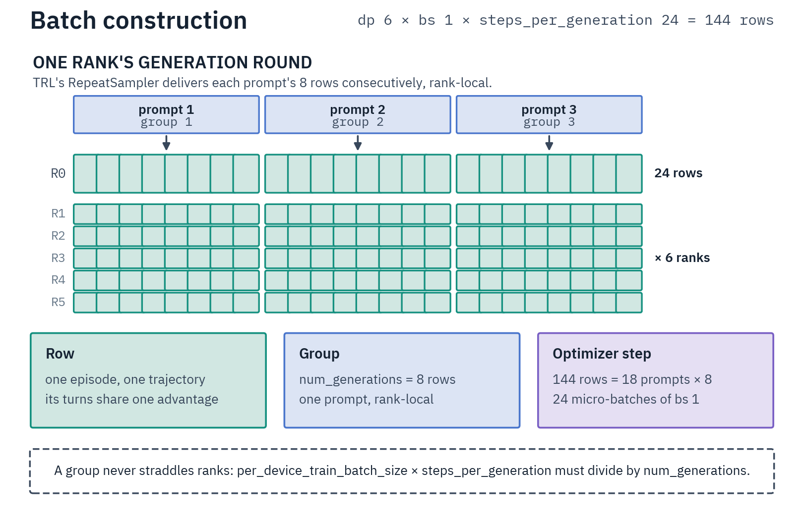

# Objective and Stability

The loss is TRL's GRPO objective ([Online GRPO](../grpo/online.md#grpo-objective-for-verifiable-rewards)) at TRL's default `loss_type: dapo`: a token-sum loss divided by the step's loss-token count (the DAPO normalizer). Its `epsilon` clip (`0.2`; no recipe sets `epsilon_high`) is inert at `num_iterations: 1` and the default `steps_per_generation`.

Rollouts differ from the trainer's policy by the engine↔trainer [numerics gap](#trainer-and-engine-noise), plus a weight lag: up to `prefetch_depth` rounds under prefetch (one round per optimizer step at the default `steps_per_generation`), and up to `sync_weights_every_n_steps − 1` more between syncs. An importance ratio corrects that; the trust region is masks on the ratio, not a KL term.

## Training rows

`train_on_sampled_tokens` (default on) trains on the ids the model sampled, which removes every re-tokenization mismatch (tool-call rendering, argument whitespace, reasoning re-render). Each assistant turn is its own row (the engine's rendered prompt ids, then the turn's sampled ids), sharing the trajectory's advantage.

vLLM returns the ids under `--return-tokens-as-token-ids` (SGLang needs no flag); the [importance-sampling correction](#importance-sampling-correction) also needs `--logprobs-mode processed_logprobs`.

### Tagged rows

Three kinds of turn are tagged untrainable ([Untrainable turns](#untrainable-turns)):

- `truncated`: the engine cut the turn.
- `empty`: neither a tool call nor visible content.
- `calls_rejected`: every tool call named a nonexistent tool or was refused unrun.

A tagged turn stays in the next turn's prompt.

A tagged row needs the turn's sampled ids; without them, or on the single-row path, the turn trains on nothing. `sampling/untrainable_turns_rowless_frac` is the share of untrainable turns left with no row (missing ids, over `max_train_row_tokens`, a rejected re-render, or the single-row path).

### Single-row fallback

- **Lost completion ids** on any untagged turn drop the whole trajectory to one re-tokenized row, warned once with the remedy.
- **Lost prompt ids** alone re-render that prompt through the serving template, silently. A prefix the template rejects invalidates the episode (on an untrainable turn, only that row).
- **A span boundary** the single-row path cannot pin **invalidates the episode** rather than training a guessed span.

The single-row path locates every assistant span inside one full-conversation render, because chat templates are not prefix-monotone (harmony rewrites an archived turn's terminator and drops its reasoning; Qwen3 drops reasoning once a later user message arrives). A boundary is a prefix render verified to be an exact prefix, or the block's own length, measured by re-rendering with the message duplicated. The trained span starts where the engine's generation prompt stops agreeing with the render. No boundary carries across turns, since BPE merges a role header with each turn's first token differently.

`train_on_sampled_tokens: false` forces the single-row path and disables the importance-sampling correction (batches train uncorrected, with a warning), so it is refused wherever [forced reasoning closes](#forced-reasoning-closes) need the correction.

## Importance sampling correction

The trainer recomputes the sampled tokens' log-probs and multiplies the per-token loss by `clamp(exp(logπ_recompute − logπ_sampling), max=vllm_importance_sampling_clip_max)` (TRL default `3.0`). On by default; without the log-probs [training rows](#training-rows) capture, it is disabled with a warning. `logπ_recompute` comes from a no-grad pass over the round's rows, or from the loss forward's own detached log-probs where nothing needs the round's log-probs earlier ([Weight from the loss forward](performance.md#weight-from-the-loss-forward)).

- Truncation is token-level, from above only: TRL's `token_truncate` at an unset lower clip. `vllm_importance_sampling_mode` passes at TRL's default or `token_truncate`; any other value, or a set `vllm_importance_sampling_clip_min`, is refused at trainer construction.
- `loss_type: vespo` is refused at trainer construction, in every config. VESPO weighs each turn row by the sum of its per-token log-ratios, so one token at ratio 0 (a [mask stage](#trust-region-masks), a [forced reasoning close](#forced-reasoning-closes)) takes the whole row's weight to ~1e-15 with no error. Use a per-token loss: `dapo`, `dr_grpo`, `cispo` or `grpo`.
- Under the geometric band or the negative-advantage drift mask (`isr_opsm_delta`; both in [Trust region masks](#trust-region-masks)), set `rollout_top_p: 1.0` (default `0.95`) and leave `rollout_top_k` and `rollout_min_p` off: a cut shifts every uncertain position, which the band reads as drift. A server that renormalizes log-probs over the cut raises at startup.

Watch `sampling/logratio_mean` first: the unclamped mean log-ratio in nats, near 0 when healthy. A growing negative drift means either:

- **Broken weight sync** ([Weight synchronization](setup.md#weight-synchronization)).
- **A KL-free run drifting**, widening ahead of a climbing `entropy` while `advantage/net_token_mass` stays negative ([early stop](monitoring.md#early-stop); [`balance_token_mass`](#token-mass-balance) cancels the net push, whose measured entropy effect is small).

### Forced reasoning closes

A reasoning close the engine forced at a turn's reasoning cap ([Reasoning cap](reasoning.md#reasoning-cap)) gets ratio 0, keeping the DAPO normalizer. The policy did not choose it, so training it would shift the model's own probability of ending its reasoning.

- **Detection.** A forced close is a run of `rollout_reasoning_end_token` ids, each at sampling log-prob exactly 0: one token for Qwen3.x `</think>` and Gemma 4 `<channel|>`, six for gpt-oss's `<|end|><|start|>assistant<|channel|>final<|message|>`. `sampling/forced_close_frac` is their share of the tokens carrying sampling log-probs.
- **Required correction.** A run whose vLLM reasoning cap can bind (`rollout_max_thinking_tokens`, or `rollout_max_tokens` less `rollout_max_answer_tokens`) and whose tokenizer resolves the marker is refused at construction without the correction.
- **Unresolved marker.** A marker the tokenizer does not write (`</think>` on Gemma 4 or gpt-oss) is refused at construction where a cap can bind, since the forced closes could not leave the loss; a soft-only run only warns.

## Trust region masks

The `isr_*` stages mask rather than reweight: a masked token loses its policy-gradient term but keeps its KL anchor. All default off, raise without the IS correction, compose, and pool a trajectory's turn rows.

| Knobs | Stage | Metric |
|---|---|---|
| `isr_geo_band_min` / `isr_geo_band_max` | Mask a trajectory whose `exp(mean log-ratio)` leaves it. | `sampling/is_geo_band_masked_frac` |
| `isr_veto_min` | Mask a trajectory if any corrected token's raw ratio drops below it. | `sampling/is_veto_masked_frac` |
| `isr_opsm_delta` | Mask negative-advantage trajectories drifting past N nats. | `sampling/is_opsm_masked_frac` |

The geometric band (NeMo-RL's seq-mask-tis, slime's MIS) needs both bounds, `0 < min < 1 < max`; `[0.99, 1.01]` is a starting point. The veto follows verl and slime (~`1e-4`), and the negative-advantage mask is DeepSeek-V3.2's off-policy sequence masking. The code-contests recipes run it at `[0.95, 1.05]` with `isr_veto_min: 1.0e-4` and `isr_opsm_delta: 0.05`.

**Size the geometric band above the numerical floor.** Trainer and engine are different bf16 stacks ([Trainer and engine noise](#trainer-and-engine-noise)), so their mean log-ratio is not zero at identical weights. Read `sampling/logratio_mean` on your serving shape before setting a band: one inside that floor masks every step. Sustained masking at low entropy is a disagreement to fix, not a band to widen.

TRL's `off_policy_mask_threshold` is refused: this trainer never emits the batch key it reads.

### Breaker

`skip_update_masked_frac` (`(0, 1]`, off by default) needs at least one stage. It trips when `sampling/is_masked_traj_frac` or `sampling/is_masked_token_frac` passes it. A tripped round zeroes its advantages and drops its gradients (`sampling/update_skipped`).

Past a high masked fraction the survivors are a selection-biased sample, the rows where the drifted policy still agrees with the rollout, so training on them amplifies the drift; skipping holds the policy still until the next weight sync re-anchors the rollouts. `0.3`–`0.5` is a sane range.

### Engine reference

`isr_engine_reference: true` (off in the recipes) takes the trainer↔engine floor out of the stages: each training round the engine re-scores every train row that carries sampling log-probs, under the weights it last received, and the stages read that log-ratio. The engine's own decode-vs-prefill gap stays in it, so the band still needs room: read `sampling/engine_logratio_mean` on your serving shape (`sampling/numerics_logratio_mean` logs the trainer-vs-engine part it leaves out, `sampling/engine_rescore_coverage` the corrected tokens re-scored).

It needs `rollout_temperature` and `rollout_top_p` of `1.0`, with `rollout_top_k`, `rollout_min_p` and `rollout_repetition_penalty` off, and costs one prefill per row, for which a vLLM server needs memory headroom ([Throughput](../../infrastructure/rollout-servers.md#throughput)). `isr_engine_rescore_per_server` (default 128) bounds the prefills in flight on each server across all ranks; a row whose re-score misses its deadline reads the trainer's log-ratio, counted in `sampling/engine_rescore_miss_frac`. A startup probe refuses a server whose prompt log-probs differ between an eager prefill and CUDA-graph prefills of its prefixes at the positions the model scores above −1.0 log-prob (bf16 noise alone reaches several nats at low-probability ones), as vLLM's V1 runner's do under MTP speculative decoding; the image's Model Runner V2 passes ([vLLM server patches](../../infrastructure/rollout-servers.md#vllm-server-patches)).

## Score centering

A sampler that differs from the trainer (low-precision rollouts, a stale policy) makes the plain gradient drift: on a constant reward the sampled tokens' scores still sum to `q − p` in logit space, so the policy moves with nothing to learn. Score centering ([arXiv:2609.20807](https://arxiv.org/abs/2609.20807), App. A) subtracts, per token, the importance-weighted score-function mean of the sampler's top-`K` candidates, and models the mass outside them by the trainer's own tail rescaled to the sampler's. At `K` equal to the vocabulary the expected update on a constant reward is exactly zero; a truncated head cancels the drift where the candidates hold nearly all of the sampler's mass on the tokens where sampler and trainer disagree. Under `tis` with clip `c`, `α = min(1, ρ·c)`: once the sampler's mass outside the candidates reaches `1/c` of the trainer's, `α` stays at 1, the tail no longer cancels, and that token's expected update is plain TIS's apart from what the candidates cover, so a truncated head may remove little of the drift. Set `score_centering_top_k` to turn it on ([fields](../../reference/configuration-reference.md#asyncrolloutconfig)) and raise it until `score_centering/sampler_head_mass_mean` is near 1 and `tail_ratio_mean` stays below `1/c`. The candidates come from an SGLang rollout server ([Candidate log-probs](../../infrastructure/rollout-servers.md#candidate-log-probs)).

- **Estimator.** With `p` the trainer's and `q` the sampler's probabilities, `H` the candidates and `f` the weight, a token's term is `w_y·logπ(y) − Σ_{v∈H} c_v·logπ(v)`, where `w_y = f(p_y/q_y)`, `c_v = q_v·f(p_v/q_v) − α·p_v`, `α = ρ·f(1/ρ)` and `ρ` the ratio of the sampler's to the trainer's mass outside `H`. Every weight is detached. The sampled token need not be a candidate.
- **Weight `f`.** `score_centering_weights`: `none` (1), `tis` (truncated at `vllm_importance_sampling_clip_max`) or `mis` (the ratio inside `[score_centering_mis_low, score_centering_mis_high]`, else 0). It replaces the token ratio of the [correction](#importance-sampling-correction): leave `vllm_importance_sampling_correction` on only to feed the [mask stages](#trust-region-masks) and forced-close zeroing, whose 0/1 verdict then drops a masked token's whole term, centering included, and counts in the [breaker](#breaker). `sampling/is_ratio_mean` and `is_ratio_max` read that verdict (1 on kept tokens).
- **Where it runs.** The loss forward scores the candidates beside the sampled token in one chunked head sweep and returns a surrogate log-prob whose value is the policy's and whose gradient is the term above, so TRL's coefficient, masks, normalizers and the packed loss scale apply unchanged. A sampler-certain token (a [forced close](#forced-reasoning-closes)) trains on its plain score. The head costs `1 + K` log-probs per position and the batch carries 8 B per candidate per token.
- **Metrics.** `score_centering/active_frac`, `score_centering/head_mass_mean` (trainer) and `sampler_head_mass_mean`, `tail_ratio_mean` (`ρ`), `weight_mean`, `weight_zero_frac` (tokens `mis` zeroed) and `correction_mean`, over the centered loss tokens of all ranks, once per generation round.
- **Refused** at construction, and by the script before its server preflights: `rollout_backend: vllm`, `train_on_sampled_tokens: false`, a filtered sampler (`rollout_top_p < 1`, `rollout_top_k`, `rollout_min_p`, a `rollout_repetition_penalty` other than 1), `use_chunked_grpo_logprobs: false`, `loss_forward_importance_weights`, `balance_token_mass` and `isr_engine_reference`. At construction also `num_iterations > 1` or accumulation that straddles a generation round (TRL's PPO clip would replace the gradient), `beta != 0` and `importance_sampling_level` other than `token`. Online GRPO rolls out through vLLM only and offline GRPO has no sampler: neither has the knob.
- **Advantage scale.** Group-std scaling composes, since the cancellation holds for any per-group detached scale; `scale_rewards: none` is the paper's setting.

## Advantages

A trajectory's advantage is its total reward minus the mean over its group's valid members. `scale_rewards` picks the divisor:

| Value | Effect |
|---|---|
| `batch` | Global batch std (the recipes' choice): degenerate groups stay near zero. |
| `none` | Unscaled (Dr.GRPO): gradient magnitude tracks the raw reward spread. |
| `group` | Per-group std (TRL's default): a near-zero std on a sparse reward amplifies noise. |

`scale_rewards_std_floor` (default `0`, `0.2` in the code-contests recipes) divides by `max(std, floor)`, so a degenerate batch cannot inflate its noise into full-scale advantages. Set it below the healthy batch std. A floor above `0` under `scale_rewards: none` is refused.

A non-finite reward or advantage fails the step on every rank.

`drop_degenerate_groups` defaults **on** here (off for online GRPO): it drops a group whose members all settled the same environment reward, which would only inflate the DAPO normalizer (`sampling/degenerate_group_frac`), the cheap half of DAPO's dynamic sampling (drop, without resampling replacements). The trainer's [reasoning floor and price](reasoning.md#reasoning-length-reward) are left out of that comparison, so reasoning length alone never breaks a tie.

`mask_truncated_completions` is enforced here, not in TRL's generation path; the recipes leave it off.

### Token-mass balance

`balance_token_mass` (default off, on in the code-contests recipes) cancels each generation round's net push on the sampled tokens.

A group's advantages sum to zero, but their token-weighted sum does not: where failures run longer than solves, each round pushes down the sampled tokens; where solves run longer, it pushes them up. The net push is real and its sign follows the length asymmetry. In measured runs (Qwen3.5-2B GRPO on GPU and a CPU model) its entropy effect is small and the balance did not beat a matched smaller learning rate.

- The balance sums the trainable rows' positive and negative mass, `P` and `N` (advantage × IS-weighted trained tokens), and the [untrainable-turn](#untrainable-turns) rows' negative mass `U`, over every rank. It shrinks the heavier side, `P` or `N + U`, by their ratio, never up, keeping every row's sign and within-sign order, so the whole round nets to zero.
- Where cut turns carry much of the negative mass, the balance shrinks their negative advantage with the rest, and the trainable rows alone keep a push up.
- The scale falls continuously to 0 as the lighter side empties, so a one-sign round trains nothing on those advantages. Balanced rows pull at `1 - |net|` of their unbalanced strength.

| Metric | Meaning |
|---|---|
| `advantage/net_token_mass` | `(P - N) / (P + N)` before balancing, the trainable rows only; logged with the knob off too. With the knob off and `s` the `negative_only_mass`, the whole round's push is `(1 - s) × net - s`. Under a token-sum loss, a negative push raises entropy, a positive one lowers it |
| `advantage/token_mass_scale` | The applied factor |
| `advantage/negative_only_mass` | The untrainable rows' share of the trained mass |

A non-finite mass raises on every rank, knob on or off. The balance raises unless `loss_type` is `cispo`, `dapo` or `dr_grpo` (one normalizer for every loss token of a step) and `top_entropy_quantile` is `1.0`.

## Untrainable turns

[Tagged](#tagged-rows) turns (cut, empty, or all calls rejected) train only on a negative advantage (strictly below 0), as per-turn rows of their sampled ids.

- A tagged row on a non-negative advantage has its `tool_mask` cleared before the DAPO normalizer is taken, in train and eval alike, so it counts in neither.
- A forced reasoning close inside a kept row still gets ratio 0.
- `sampling/untrainable_rows_frac` is the share of rows tagged; `sampling/untrainable_rows_trained_frac` the share of those that reached the loss.

## KL and template protection

`beta > 0` adds TRL's k3 KL term, weighted by the importance-sampling ratio (`use_bias_correction_kl`, on by default), which changes its gradient even on-policy; `use_bias_correction_kl: false` keeps the plain term. An unconditional clamp (`clamp_ref_logps`) caps its log-ratio at 5 nats, bounding per-token KL at `exp(5) ≈ 148`. A persistently non-zero `kl_clamp_frac` (the clamped share of real loss tokens) means the policy sits far from the reference.

`top_entropy_quantile < 1.0` trains only the highest-entropy tokens, which alone starves the low-entropy structural tokens (role markers, tool delimiters, BOS/EOS) until tool calls stop parsing. `ProtectedTokenEntropyMixin` unions the tokenizer's special and added tokens back in, and a mask whose shape does not match the last log-prob forward's completion ids **raises**. The code-contests recipes leave `top_entropy_quantile: 1.0` and set `tool_error_penalty: 0.05` on the reward side.

## Routing replay

`routing_replay` pins the top-k expert selection to a recorded mask, so the gradient forward trains through the routing the IS ratios were computed on. Gate weights are re-derived from the live router scores, so replay removes only the discontinuous routing-flip part of the divergence (Qwen's Routing Replay, DeepSeek's Keep Routing).

- `recompute` (R2) captures the mask in the trainer's no-grad log-prob pass and replays it in the update. Both passes are the trainer's, so it leaves the trainer-versus-engine gap where it was. It needs a config that runs that pass: the IS correction, a nonzero `beta`, `num_iterations > 1`, or misaligned gradient accumulation. It keeps the pass: `loss_forward_importance_weights` is a blocker for it, as with one forward there is no pass to pin the update to.
- `rollout` (R3, experimental) replays the engine's own selection through the update and, where it runs, the no-grad pass, so it can narrow that gap. It needs `train_on_sampled_tokens` and a capture-capable server. Positions the engine did not cover (prefix-cache hits) keep natural routing, so check the capture coverage on your serving shape before a long run.

Both need MoE EP layers; Gemma 4 and Zaya are rejected at construction. The mask costs 2 bytes per token per MoE layer per top-k slot. Under both modes the host holds each row's covered positions only, ragged, for the whole train round (`recompute` copies each row's captured tokens off the device when the no-grad pass ends); every gradient micro-batch pads just the rows it forwards, on the device, and frees them with its forward. The batch carries row ids in place of a dense mask, which follow the rows through TRL's shuffle and the length-ordered deal, so no tensor of the whole round's width ever exists, on the host or the device. Under `rollout` the no-grad pass scores `per_device_train_batch_size` rows per call (one call per bin under packed micro-batches) and pads just those, so a call's padded routing never exceeds that. `routing/replay_flip_rate` is the share of (token, layer) pairs on which the live top-k would have flipped a selection.

To run R3, set `routing_replay: rollout` and serve with `VLLM_ENABLE_R3=1` or `SGLANG_ENABLE_R3=1` ([R3 flags](../../infrastructure/rollout-servers.md)). Capture and replay pass in two-step rows on GPT-OSS, Qwen3 MoE, Qwen3.5/3.6, GLM-4 MoE Lite, LFM-2 and Ling 2.0 on both engines and on Laguna on vLLM ([Coverage](../../infrastructure/rollout-servers.md#coverage)). Only the gpt-oss `-ep1` recipes ship it: no long run compares it with `none`.

The gradient forward replays only the positions it attends, and the flip rate counts only those, in both modes and on every loss path. Padding routes naturally, and so does the completion of a row dropped from the loss (a degenerate group, an invalid episode, a masked truncation): it rides the forward as attention padding, in a context other than the one its mask was recorded in.

Under `rollout`, the step fails on every rank when a trainable batch carries no mask, or when no routed row on some rank matches an engine coverage convention. `routing/rollout_unresolved_frac` is a world share: a rank can fail the step while the share last logged sat below 1.

### Trainer and engine noise

Trainer and engine disagree on identical weights. bf16 round-off flips near-tie MoE top-k selections, and each flip compounds through the later layers. This is numerics, not a sync error: an unchanged push leaves the served log-probs bit-identical ([Coverage](../../infrastructure/rollout-servers.md#coverage)).

Forcing the routing closes most of that floor on gpt-oss, Laguna and LFM-2, and not on GLM-4.7 or Gemma 4. Measured with no engine, on CPU kernels and fixed text, forcing the top-k takes Laguna-XS from 0.679 nats to 0.058 and LFM-2 from 0.375 to 0.050, but GLM-4.7, whose logits reach 140, only from 0.095 to 0.072 and Gemma 4 from 0.683 to 0.623. On those two most of the gap is not routing.

On gpt-oss-20b, on six untemplated rows of 32 to 1,024 tokens (2,010 positions, mean log-prob −7.5), stock transformers' bf16 forward sits 0.400 nats (mean absolute) from its fp32 forward, and 0.079 with the fp32 forward's top-k forced. 11.8% of its token-layer selections differ, from 2.7% at the first layer to 23.5% at the last. The served model sits at 0.319 and Halo's FA4 forward at 0.392 on the same rows.

Sampled tokens carry far less. Mean absolute log-ratio over the tokens the IS correction scores, at step 1 before any update: one short tool-call task, two ranks at `ep1`, 8 rows per rank, one run per arm, each arm its own rollouts. The vLLM rows run `rollout_top_p: 1.0` and `rollout_max_tokens: 128`. The SGLang row runs `rollout_top_p: 0.95`, which SGLang's reported log-probs do not see ([SGLang](../../infrastructure/rollout-servers.md#sglang)).

| Engine, checkpoint | `none` | R2 | R3 | R3 `replay_flip_rate` | Tokens scored per arm |
|---|:--:|:--:|:--:|:--:|:--:|
| vLLM, gpt-oss-20b | 0.0300 | 0.0288 | 0.0158 | 0.027 | 1,190–1,280 |
| vLLM, Qwen3.6-35B-A3B | 0.0279 | 0.0304 | 0.0111 | 0.148 | 2,801–2,998 |
| vLLM, GLM-4.7-Flash | 0.0375 | 0.0388 | 0.0318 | 0.036 | 1,318–1,412 |
| SGLang, gpt-oss-20b | 0.0289 | 0.0299 | 0.0147 | 0.027 | 1,134–1,246 |

- On vLLM, R3 sits about 1.9× below `none` on gpt-oss-20b, 2.5× on Qwen3.6-35B and 1.2× on GLM-4.7, where most of the gap is not routing. Its p99 falls from 0.2918 to 0.1639, 0.3485 to 0.1532 and 0.5898 to 0.5383.
- R2 does not separate from `none`, as its two trainer passes predict: 4% under it on vLLM's gpt-oss-20b row and above it on the others.
- Qwen3.6-35B's tokens are mostly reasoning: 87.5% of its rollouts hit `rollout_max_tokens`.
- `routing/replay_flip_rate` counts flips per token and layer with upstream layers already forced, so it understates free-running disagreement.
- `sampling/logratio_mean`, the signed mean, stays within 0.003 of zero on vLLM's gpt-oss-20b and Qwen3.6-35B rows in every arm.
- vLLM reports log-probs after a top-p cut, so a vLLM row below `rollout_top_p: 1.0` carries that renormalization, which no replay touches, and does not compare with these.
- No other family has a usable number: the LFM-2 and Laguna rows scored too few tokens to quote.

This is one short task at step 1, not a training result. No row compares the modes over a long run, neither mode makes training exactly on-policy, and R3 stays experimental.

## Batch construction

TRL's `RepeatSampler` delivers each prompt `num_generations` consecutive times, rank-local, and the trainer rolls out one trajectory per row. Advantages normalize within each group, so `per_device_train_batch_size × steps_per_generation` must divide by `num_generations`, stricter than TRL's global rule.

A rollout with no learning signal (a raised episode, an `episode_timeout` cancellation, an invalid one) enters as a zero-masked row outside its group's baseline (`sampling/invalid_episode_frac`). A step where no episode survived warns once, then **halts the run on the second consecutive one**.

Rows carry two masks, and the loss and the DAPO normalizer use their intersection: `completion_mask` covers every real completion token (tool results and generation-prompt headers included), `tool_mask` only the assistant spans. The batch is never packed into shared rows unless `packed_microbatch_tokens` is set ([Packed micro-batches](performance.md#packed-micro-batches)). A round's rows reach its micro-batches dealt by length rather than shuffled where only the order changes ([Length-ordered micro-batches](performance.md#length-ordered-micro-batches)).

`per_device_train_batch_size` counts rows (completions); unique prompts per step are the rollout total ÷ `num_generations` ([online-GRPO count](../grpo/online.md#data-flow-and-batch-construction)).

| Knob | Sets | Sizing rule |
|---|---|---|
| `num_generations` | GRPO group size | 8 in most recipes, 12 in curriculum stages 2–3, 4 in the template and exam-QA. Trades unique prompts for samples each. |
| `max_concurrent_rollouts` | Per-rank cap on one round's rollouts in flight | Defaults to the larger of a train and an eval round's rows, one wave; above the round's count it never binds. |
| `rollout_actor_budget` | Ray actor budget per node (cluster-wide with `ray_address`), split over the rollout ranks | The environment's blocking per-episode cost ([Pool sizing](../../infrastructure/ray.md#pool-sizing)). |

## Learning rate

Learning rates sit near the SFT floor: `2e-7` on the code-contests full fine-tunes, `3e-6` on their LoRA siblings, `1e-6` on the lighter single-answer tasks, `5e-6` on the template. The code-contests recipes cap their cosine at `max_steps: 300`, the run's useful length; curriculum stage 1, the single-answer tasks and the template run it over `num_train_epochs`; stages 2 and 3 use `constant_with_warmup` ([SFT](../sft.md#learning-rate-and-global-batch-size)).
