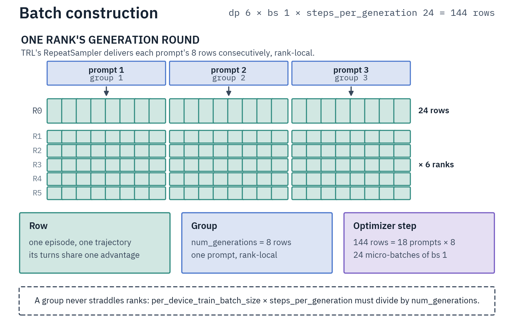

# Objective and Stability

The loss is TRL's GRPO objective ([Online GRPO](../grpo/online.md#grpo-objective-for-verifiable-rewards)) at TRL's default `loss_type: dapo`: a token-sum loss divided by the step's loss-token count (the DAPO normalizer). Its `epsilon` clip (`0.2`; no recipe sets `epsilon_high`) is inert at `num_iterations: 1` and the default `steps_per_generation`.

Rollouts differ from the trainer's policy by the engine↔trainer numerics gap, plus up to one sync interval under prefetch or `sync_weights_every_n_steps > 1`. An importance ratio corrects that; the trust region is masks on the ratio, not a KL term.

## Training rows

`train_on_sampled_tokens` (default on) trains on the ids the model sampled. Each assistant turn is its own row (the engine's rendered prompt ids, then the turn's sampled ids), sharing the trajectory's advantage.

vLLM returns the ids under `--return-tokens-as-token-ids` (SGLang needs no flag); the [importance-sampling correction](#importance-sampling-correction) also needs `--logprobs-mode processed_logprobs`.

### Tagged rows

Three kinds of turn are tagged untrainable ([Untrainable turns](#untrainable-turns)):

- `truncated`: the engine cut the turn.
- `empty`: neither a tool call nor visible content.
- `calls_rejected`: every tool call named a nonexistent tool (under native tool calls, also every call refused unrun).

A tagged turn stays in the next turn's prompt.

A tagged row needs the turn's sampled ids; without them, or on the single-row path, the turn trains on nothing. `sampling/untrainable_turns_rowless_frac` is the share of untrainable turns left with no row (missing ids, over `max_train_row_tokens`, a rejected re-render, or the single-row path).

### Single-row fallback

- **Lost completion ids** on any untagged turn drop the whole trajectory to one re-tokenized row, warned once with the remedy.
- **Lost prompt ids** alone re-render that prompt through the serving template, silently. A prefix the template rejects invalidates the episode (on an untrainable turn, only that row).
- **A span boundary** the single-row path cannot pin **invalidates the episode** rather than training a guessed span.

`train_on_sampled_tokens: false` forces the single-row path and disables the importance-sampling correction (batches train uncorrected, with a warning), so it is refused wherever [forced reasoning closes](#forced-reasoning-closes) need the correction.

## Importance sampling correction

The trainer recomputes the sampled tokens' log-probs and multiplies the per-token loss by `clamp(exp(logπ_recompute − logπ_sampling), max=vllm_importance_sampling_clip_max)` (TRL default `3.0`). On by default; without the log-probs [training rows](#training-rows) capture, it is disabled with a warning.

- Truncation is token-level, from above only: TRL's `token_truncate` at an unset lower clip. `vllm_importance_sampling_mode` passes at TRL's default or `token_truncate`; any other value, or a set `vllm_importance_sampling_clip_min`, is refused at trainer construction.
- `loss_type: vespo` is refused at trainer construction, in every config. VESPO weighs each turn row by the sum of its per-token log-ratios, so one token at ratio 0 (a [mask stage](#trust-region-masks), a [forced reasoning close](#forced-reasoning-closes)) takes the whole row's weight to ~1e-15 with no error. Use a per-token loss: `dapo`, `dr_grpo`, `cispo` or `grpo`.
- Under the geometric band or the negative-advantage drift mask (`isr_opsm_delta`; both in [Trust region masks](#trust-region-masks)), set `rollout_top_p: 1.0` (default `0.95`) and leave `rollout_top_k` and `rollout_min_p` off: a cut shifts every uncertain position, which the band reads as drift. A server that renormalizes log-probs over the cut raises at startup.

Watch `sampling/logratio_mean` first: the unclamped mean log-ratio in nats, near 0 when healthy. A growing negative drift means either:

- **Broken weight sync** ([Weight synchronization](setup.md#weight-synchronization)).
- **A KL-free run drifting**, widening ahead of a climbing `entropy` while `advantage/net_token_mass` stays negative ([`balance_token_mass`](#token-mass-balance), [early stop](monitoring.md#early-stop)).

### Forced reasoning closes

A reasoning close the engine forced at a turn's reasoning cap ([Reasoning budget](reasoning.md#reasoning-budget)) gets ratio 0, keeping the DAPO normalizer. The policy did not choose it, so training it would shift the model's own probability of ending its reasoning.

- **Detection.** A forced close is a run of `rollout_reasoning_end_token` ids, each at sampling log-prob exactly 0: one token for Qwen3.x `</think>` and Gemma 4 `<channel|>`, five for gpt-oss's `<|start|>assistant<|channel|>final<|message|>`. `sampling/forced_close_frac` is their share of the tokens carrying sampling log-probs.
- **Required correction.** A run whose vLLM reasoning cap can bind (a drawable level's `thinking_tokens`, soft ones included, or `rollout_max_thinking_tokens`) and whose tokenizer resolves the marker is refused at construction without the correction.
- **Unresolved marker.** A marker the tokenizer does not write (`</think>` on Gemma 4 or gpt-oss) leaves forced closes in the loss, with a warning.

## Trust region masks

The `isr_*` stages mask rather than reweight: a masked token loses its policy-gradient term but keeps its KL anchor. All default off, raise without the IS correction, compose, and pool a trajectory's turn rows.

| Knobs | Stage | Metric |
|---|---|---|
| `isr_geo_band_min` / `isr_geo_band_max` | Mask a trajectory whose `exp(mean log-ratio)` leaves it. | `sampling/is_geo_band_masked_frac` |
| `isr_veto_min` | Mask a trajectory if any corrected token's raw ratio drops below it. | `sampling/is_veto_masked_frac` |
| `isr_opsm_delta` | Mask negative-advantage trajectories drifting past N nats. | `sampling/is_opsm_masked_frac` |

The geometric band needs both bounds, `0 < min < 1 < max`. The code-contests recipes run it at `[0.95, 1.05]` with `isr_veto_min: 1.0e-4` and `isr_opsm_delta: 0.05`.

**Size the geometric band above the numerical floor.** Trainer and engine are different bf16 stacks, so their mean log-ratio is negative at identical weights: ~0.002 nats/token at sampling entropy 0.4, ~0.04 at 1.0. A band inside that floor masks every step. Sustained masking at low entropy is a disagreement to fix, not a band to widen.

TRL's `off_policy_mask_threshold` is refused: this trainer never emits the batch key it reads.

### Breaker

`skip_update_masked_frac` (`(0, 1]`, off by default) needs at least one stage. It trips when `sampling/is_masked_traj_frac` or `sampling/is_masked_token_frac` passes it. A tripped round zeroes its advantages and drops its gradients (`sampling/update_skipped`).

### Engine reference

`isr_engine_reference: true` (off in the recipes) takes the trainer↔engine floor out of the stages: each training round the engine re-scores every train row that carries sampling log-probs, under the weights it last received, and the stages read that log-ratio. The engine's own decode-vs-prefill gap stays in it, so the band still needs room.

It needs `rollout_temperature` and `rollout_top_p` of `1.0`, with `rollout_top_k`, `rollout_min_p` and `rollout_repetition_penalty` off, and costs one prefill per row ([Throughput](../../infrastructure/rollout-servers.md#throughput)). A startup probe refuses a server whose prompt log-probs are inconsistent across CUDA-graph prefill sizes, the garbage unpatched vLLM 0.26.0 returns under MTP ([vLLM server patches](../../infrastructure/rollout-servers.md#vllm-server-patches)).

## Advantages

A trajectory's advantage is its total reward minus the mean over its group's valid members. `scale_rewards` picks the divisor:

| Value | Effect |
|---|---|
| `batch` | Global batch std (the recipes' choice): degenerate groups stay near zero. |
| `none` | Unscaled (Dr.GRPO): gradient magnitude tracks the raw reward spread. |
| `group` | Per-group std (TRL's default): a near-zero std on a sparse reward amplifies noise. |

`scale_rewards_std_floor` (default `0`, `0.2` in the code-contests recipes) divides by `max(std, floor)`, so a degenerate batch cannot inflate its noise into full-scale advantages. Set it below the healthy batch std. A floor above `0` under `scale_rewards: none` is refused.

A non-finite reward or advantage fails the step on every rank.

`drop_degenerate_groups` defaults **on** here (off for online GRPO): it drops a group whose members all settled the same environment reward, which would only inflate the DAPO normalizer (`sampling/degenerate_group_frac`). The trainer's [reasoning floor and price](reasoning.md#reasoning-length-reward) are left out of that comparison, so reasoning length alone never breaks a tie.

`mask_truncated_completions` is enforced here, not in TRL's generation path; the recipes leave it off.

### Token-mass balance

`balance_token_mass` (default off, on in the code-contests recipes) cancels each generation round's net push on the sampled tokens.

A group's advantages sum to zero, but their token-weighted sum does not: where failures run longer than solves, each round pushes down the sampled tokens and, without a KL anchor, entropy climbs; where solves run longer, it sharpens the policy and entropy falls.

- The balance sums the trainable rows' positive and negative mass, `P` and `N` (advantage × IS-weighted trained tokens), over every rank. It shrinks the heavier sign by their ratio, never up, keeping every row's sign and within-sign order.
- [Untrainable-turn](#untrainable-turns) rows stay out of both sums with their raw advantage, so their mass is the round's whole net push.
- The scale falls continuously to 0 as the lighter side empties, so a one-sign round trains nothing on those advantages. Balanced rows pull at `1 - |net|` of their unbalanced strength.

| Metric | Meaning |
|---|---|
| `advantage/net_token_mass` | `(P - N) / (P + N)` before balancing; logged with the knob off too. Under a token-sum loss, staying negative pushes entropy up, staying positive pulls it down |
| `advantage/token_mass_scale` | The applied factor |
| `advantage/negative_only_mass` | The untrainable rows' share of the trained mass |

A non-finite mass raises on every rank, knob on or off. The balance raises unless `loss_type` is `cispo`, `dapo` or `dr_grpo` (one normalizer for every loss token of a step) and `top_entropy_quantile` is `1.0`.

## Untrainable turns

[Tagged](#tagged-rows) turns (cut, empty, or all calls rejected) train only on a negative advantage (strictly below 0), as per-turn rows of their sampled ids.

- A tagged row on a non-negative advantage has its `tool_mask` cleared before the DAPO normalizer is taken, in train and eval alike, so it counts in neither.
- A forced reasoning close inside a kept row still gets ratio 0.
- `sampling/untrainable_rows_frac` is the share of rows tagged; `sampling/untrainable_rows_trained_frac` the share of those that reached the loss.

## KL and template protection

`beta > 0` adds TRL's k3 KL term. An unconditional clamp (`clamp_ref_logps`) caps its log-ratio at 5 nats, bounding per-token KL at `exp(5) ≈ 148`. A persistently non-zero `kl_clamp_frac` (the clamped share of real loss tokens) means the policy sits far from the reference.

`top_entropy_quantile < 1.0` trains only the highest-entropy tokens, which alone starves the low-entropy structural tokens (role markers, tool delimiters, BOS/EOS) until tool calls stop parsing. `ProtectedTokenEntropyMixin` unions the tokenizer's special and added tokens back in, and a mask whose shape does not match the last log-prob forward's completion ids **raises**. The code-contests recipes leave `top_entropy_quantile: 1.0` and set `tool_error_penalty: 0.05` on the reward side.

## Routing replay

`routing_replay` pins the update pass's top-k expert selection to a recorded mask, so the gradient forward trains through the routing the IS ratios were computed on.

- `recompute` (R2) captures the mask in the trainer's no-grad log-prob pass, so it needs a config that runs that pass: the IS correction, a nonzero `beta`, `num_iterations > 1`, or misaligned gradient accumulation.
- `rollout` (R3) replays the engine's own selection; it needs `train_on_sampled_tokens` and a capture-capable server. The gpt-oss `-ep1` recipes ship it.

Both need MoE EP wrappers; Gemma 4 and Zaya are rejected at construction. The mask costs 2 bytes per token per MoE layer per top-k slot. `routing/replay_flip_rate` is the share of selections the live top-k would have flipped.

Under `rollout`, the step fails on every rank when a trainable batch carries no mask, or when no routed row on some rank matches an engine coverage convention. `routing/rollout_unresolved_frac` is a world share: a rank can fail the step while the share last logged sat below 1.

## Batch construction

TRL's `RepeatSampler` delivers each prompt `num_generations` consecutive times, rank-local, and the trainer rolls out one trajectory per row. Advantages normalize within each group, so `per_device_train_batch_size × steps_per_generation` must divide by `num_generations`, stricter than TRL's global rule.

A rollout with no learning signal (a raised episode, an `episode_timeout` cancellation, an invalid one) enters as a zero-masked row outside its group's baseline (`sampling/invalid_episode_frac`). A step where no episode survived warns once, then **halts the run on the second consecutive one**.

Rows carry two masks, and the loss and the DAPO normalizer use their intersection: `completion_mask` covers every real completion token (tool results and generation-prompt headers included), `tool_mask` only the assistant spans. The batch is never packed.

`per_device_train_batch_size` counts rows (completions); unique prompts per step are the rollout total ÷ `num_generations` ([online-GRPO count](../grpo/online.md#data-flow-and-batch-construction)).

| Knob | Sets | Sizing rule |
|---|---|---|
| `num_generations` | GRPO group size | 8 in most recipes, 12 in curriculum stages 2–3, 4 in the template and exam-QA. Trades unique prompts for samples each. |
| `max_concurrent_rollouts` | Per-rank cap on rollouts in flight | Defaults to 4× this rank's actor share; above the round's count it never binds. |
| `num_rollout_workers` | Ray actor pool per rank (default `64`) | The environment's blocking per-episode cost ([Pool sizing](../../infrastructure/ray.md#pool-sizing)). |

## Learning rate

Learning rates sit near the SFT floor: `2e-7` on the code-contests full fine-tunes, `3e-6` on their LoRA siblings, `1e-6` on the lighter single-answer tasks, `5e-6` on the template. The code-contests recipes cap their cosine at `max_steps: 300`, the run's useful length; curriculum stage 1, the single-answer tasks and the template run it over `num_train_epochs`; stages 2 and 3 use `constant_with_warmup` ([SFT](../sft.md#learning-rate-and-global-batch-size)).
