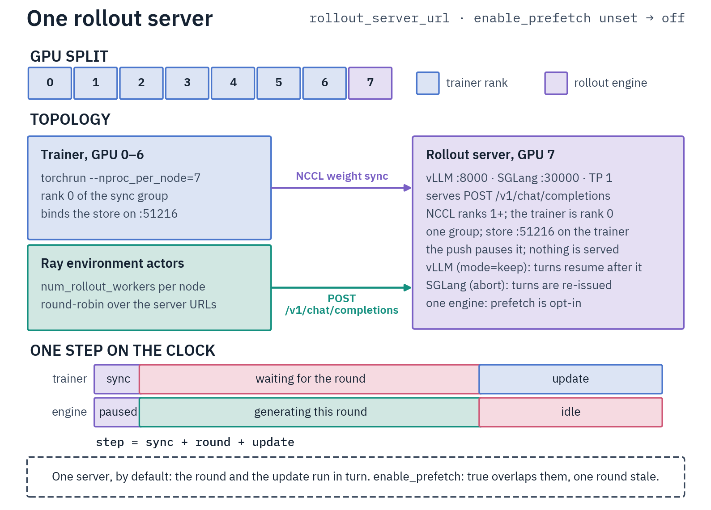
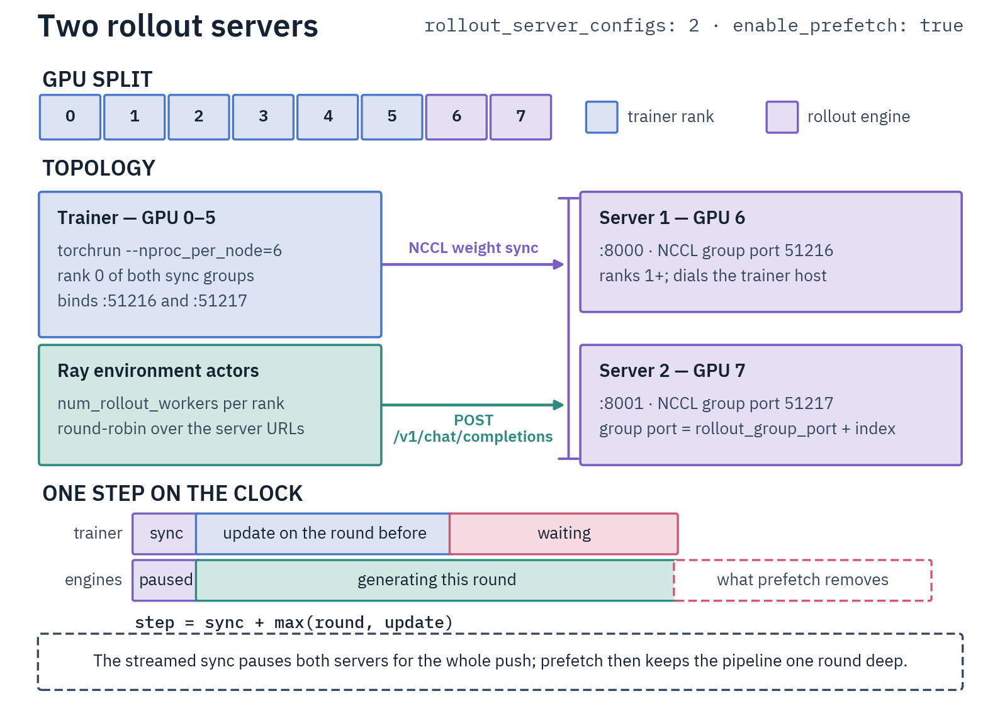
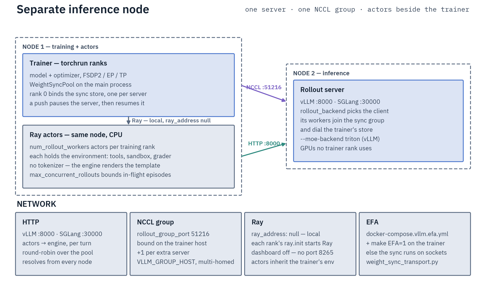
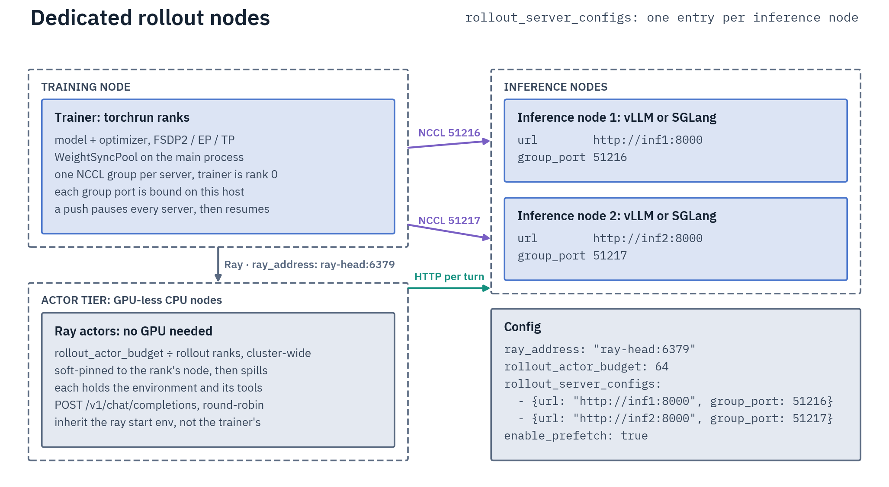

# Servers and Launch

## GPU split

Trainer GPUs must not overlap the server's: NCCL needs a distinct device for every rank of the sync group. Nothing
checks it up front; `CUDA_VISIBLE_DEVICES` enforces it, and the compose files put the server on GPU 7
(`docker-compose.vllm.yml` puts its trainer on 0–6). An overlap fails group formation in `init_communicator()` within
its 120 s deadline (the INFO line logged just before it names the trainer device); a server that never joins fails
the rendezvous after 120 s on SGLang, 300 s on vLLM.

## Rollout backend

`rollout_backend: vllm` (default) or `sglang`.

- A model the engine cannot update online is refused at construction
  ([which families each serves](../../infrastructure/rollout-servers.md#which-families-each-engine-serves)).
- SGLang also refuses `rollout_max_thinking_tokens` ([SGLang](reasoning.md#sglang)) and
  [`carry_reasoning`](episodes.md#carried-reasoning).
- TRL's `top_p`, `top_k`, `min_p`, `repetition_penalty` and `generation_kwargs` reach no sampler, so one set away
  from its TRL default is refused at trainer construction; the first four have `rollout_*` equivalents
  ([Sampling](episodes.md#sampling)). `temperature` is force-set to `rollout_temperature`, so log-probs are scored at
  the sampling temperature.

Rank 0 waits for each server at startup, up to `rollout_connection_timeout`, and raises past it, so a server still
loading is read rather than passed. Then it probes each one:

- It **raises** when one turn cannot fit the served window: `max_prompt_length` + the environment's measured prompt
  overhead + `rollout_max_tokens`.
- It warns when the multi-turn worst case does not fit: that prompt budget plus the smaller of
  `max_turns × rollout_max_tokens` and `rollout_max_episode_tokens`.
- It **raises** on a server off the toolkit's image or launched with a flag the run needs
  ([Startup preflight](../../infrastructure/rollout-servers.md#startup-preflight)).
- `verify_backend()` fails the launch on an unreachable external judge.

## Starting a server

```bash
make build-vllm
VLLM_MODEL=<hub-id-or-path> VLLM_CUDA_DEVICES=7 \
    docker compose -f docker-compose.vllm.yml up -d vllm-server

make build-sglang
SGLANG_MODEL=<hub-id-or-path> SGLANG_CUDA_DEVICES=7 \
    docker compose -f docker-compose.sglang.yml up -d sglang-server
```

Compose refuses to start either file without its host path: `HALO_SCRATCH` (vLLM, the training service's scratch
volume) and `SGLANG_MODEL_DIR` (SGLang, the directory it mounts read-only). Export them, or set them once in the
repo-root `.env`, which compose reads.

Confirm `/health` (`:8000` vLLM, `:30000` SGLang) first: rank 0 waits only `rollout_connection_timeout` (default
120 s, 180 in the code-contests recipes) for a server still loading. Parsers, `--moe-backend triton` and the rest:
[Rollout Servers](../../infrastructure/rollout-servers.md#vllm).

## Launching the trainer

```bash
CUDA_VISIBLE_DEVICES=0,1,2,3 DIST_NCCL_TIMEOUT_MINUTES=60 torchrun --nproc_per_node=4 \
    scripts/training/grpo/environmental.py <config>
```

- Add `--expert_parallel_size=4` for MoE expert distribution.
- `halo launch grpo/environmental <config> --nproc 4` builds the same `torchrun` line; the device split and
  `DIST_NCCL_TIMEOUT_MINUTES` stay yours.
- `accelerate launch` works only for plain data parallelism on a dense model; on a MoE it refuses the EP
  layers weight sync needs.
- Context and Pipeline Parallelism are rejected at config time.

## Expert parallelism group size

Dense models and `ep1` configs (no expert distribution) skip this. Set `expert_parallel_size` to the trainer-GPU count to
form one DeepEP dispatch group, as the recipes do. `ep_size: 2` also runs as several 2-rank groups, and node-local groups
repeat across NVLink domains. Within one domain, a group above `ep_size: 2` narrower than the domain is
rejected at config time: `ep4` on 4 trainer GPUs passes, on 8 it does not
([DeepEP](../../infrastructure/deepep.md#ep-grouping-what-is-reliable)).

- `ep_size: 8` needs 9 GPUs or a second node, since the server holds one.
- ZeRO-3 (`fsdp_reshard_after_forward: true`) is rejected wherever an expert-distribution group exists, since its
  backward all-gather races the DeepEP combine. It runs only at `ep_size: 1` with no expert TP
  ([ZeRO-2 vs ZeRO-3](../../parallelism/data-parallelism.md#zero-2-vs-zero-3-reshard_after_forward)).
- `beta > 0` without PEFT holds a frozen reference: the script loads it like the policy (run dtype, `model_revision`,
  attention, `reset_sinks`), from `model_name_or_path` and never a resume checkpoint, and hands it to TRL in place of
  TRL's fp32 copy ([Online GRPO](../grpo/online.md#grpo-objective-for-verifiable-rewards)). It is an unsharded dense
  replica per rank, warned about under EP, ETP and TP. Use `beta: 0`, or `use_peft: true` with an attention target
  off TP (which refuses adapters), to hold none.

## Weight synchronization

A forced sync runs at train-begin, after the resume restore and before the first rollout or `eval_on_start`; prefetch
starts there too, so no rollout uses pre-restore weights. Later syncs run at the **start** of a step, before that
round's generation.

- `sync_weights_every_n_steps` (default `1`) trades freshness for pause time; on slow environments sync every 2–4
  steps.
- `rollout_group_port` (default `51216`, either backend) is bound on the **trainer** host, one listener per server, so
  two servers sharing a port collide even on distinct hosts. With several servers it is the base: an entry with no
  `group_port` binds `rollout_group_port + index`, or its own kernel-assigned port when the base is `0` (under `single_group` it is the one port of the one group). TRL's `vllm_group_port` is refused here; Online GRPO reads it.
- Startup and every push fail fast: an error on any rank raises on all ranks together. An engine restarted between
  syncs is the exception: the client reconnects and re-sends, with a warning
  ([Streaming and quiesce](../../infrastructure/rollout-servers.md#streaming-and-quiesce)).
- Each EP layer's expert gather transiently materializes the **full expert set** on every rank, so its cost scales
  with total expert count, not `ep_size`.

## Multiple servers and prefetch

Prefetch rolls the next rounds out while the current one trains, so each round trains `prefetch_depth` rounds stale
(one optimizer step each at the default `steps_per_generation`) and the
[importance sampling correction](objective.md#importance-sampling-correction) covers the lag. `enable_prefetch` unset
turns it on with two or more servers and off with a **single** one (`rollout_server_url`, default
`http://localhost:8000`, or a one-entry `rollout_server_configs`), whose step stays serial with no weight lag. `true`
prefetches on a single server too; `false` never prefetches.

```yaml
rollout_server_configs:
  - {url: "http://localhost:8000", group_port: 51216}
  - {url: "http://localhost:8001", group_port: 51217}
```

- `rollout_sync_topology: single_group` forms one weight-sync group over every server and broadcasts each chunk once,
  where the default `per_server` sends each chunk to each server over its own group; `auto` picks `single_group` for
  two or more servers that report one model and one set of weight-loading flags
  ([One group over every server](../../infrastructure/rollout-servers.md#one-group-over-every-server)). `single_group` takes one
  `rollout_group_port` and no per-entry `group_port`. Online GRPO talks to one server and has no such field.
- Every push pauses all servers together, so one server overlaps a round with the update the way several do: the
  rounds in flight wait out the push. vLLM resumes them under the new weights; SGLang aborts their in-flight turns
  and the actors re-issue them, losing the decode they had done.
- Prefetch runs **`prefetch_depth` rounds deep** (default `1`): a step pops the oldest submitted round, then submits
  its own prompts. The worker collects every pending round at once and delivers them in submission order, so a round
  trains `prefetch_depth` rounds after it was drawn.
- Until the pipeline is full a step is a cold round: it collects its own prompts synchronously and submits them too.
  A run opens with `prefetch_depth` cold rounds, each trained twice.
- Raise `prefetch_depth` when every step misses while the servers drain at each round's tail; the next round's
  episodes fill them. Each round in flight holds its own `max_concurrent_rollouts`, so the servers carry up to
  `prefetch_depth` rounds' KV, every sync lands on all of them, and an eval round shares the servers with them.
- A round spans up to `ceil(prefetch_depth × steps_per_generation × num_iterations ÷ (gradient_accumulation_steps ×
  sync_weights_every_n_steps))` syncs, a bound never below 1, plus one for an eval between cadence pushes when
  `sync_weights_every_n_steps` is above 1. On SGLang a turn aborted at each of them needs that
  many re-issues, so a span above `max_retries` is refused before the model load, and again at trainer
  construction, on one server that opts in as on several: the shipped SGLang recipes (`max_retries: 1`) take
  `prefetch_depth: 1`. Deepen one by syncing less often, or raise `max_retries` to the span with
  `(1 + max_retries) × request_timeout` still within `episode_timeout`.
- `num_rollout_workers` and an explicit `max_concurrent_rollouts` are refused below `1`. A `prefetch_depth` above
  `1` is refused where prefetch is off, naming `enable_prefetch: false` or the opt-in a one-server run left unset.

`async/prefetch_hit_rate` shows which phase bounds the step, not server health. On a short single-turn environment it
should approach 1; below ~0.8, add servers or raise `max_concurrent_rollouts` / `num_rollout_workers`. On a multi-turn
one the round outlasts the update, so it sits near 0 at `prefetch_depth: 1`; a deeper pipeline raises it.

### Prefetch across a resume

A checkpoint stores each rank's submitted-but-untrained rounds, oldest first (`prefetch_pending-<rank>-of-<world>.pt`),
and a resume resubmits them in order before its first round.

- A save on a generation boundary (every save by default, since `steps_per_generation` equals the accumulation
  steps) resumes onto the batches an uninterrupted run trains. A save inside a round that feeds several optimizer
  steps trains that round twice.
- A resume under a smaller `prefetch_depth` resubmits the oldest rounds that depth holds and warns; the newer ones
  are not trained. Under a larger one it opens with cold rounds until the pipeline is full.
- No file for this world size, or one drawn under another group size, round size or DP slice, resumes with cold
  rounds: those batches are skipped and the next ones train twice.
- Under TP or ETP only each group's leader prefetches: a follower's file holds no rounds, and a resume gives it none to
  resubmit, whatever the checkpoint's file held.
- A file present on some ranks only (a non-shared filesystem under another rank-to-node placement, or a torn copy)
  raises. Resume with the saving placement, or delete the `prefetch_pending-*` files for cold rounds.





## Multi-node

Point `ray_address` at the cluster head ([Ray Cluster](../../infrastructure/ray.md#multi-node)) and give each
inference node its own `rollout_server_configs` entry and `group_port`, plus `group_host` where the trainer's routable
address differs per server.

- Use resolvable host names. A loopback URL in a run spanning several nodes is refused at startup: it reaches a
  different engine, or none, per node, and only the forwarding rank's node takes weight pushes. A launch on one node
  with a `ray_address` head on it keeps its loopback URL.
- `num_rollout_workers` is a per-node budget on a local Ray, split over the node's rollout ranks, and the cluster-wide
  total on a shared one, split over every rollout rank; actors are soft-pinned to the rank's node ([pool sizing](../../infrastructure/ray.md#pool-sizing)).
- The trainer's NCCL address must be routable from the serving nodes: it defaults to the trainer's address on the route
  to each server; set `VLLM_GROUP_HOST` or `SGLANG_GROUP_HOST` where the server cannot dial that back (NAT, asymmetric
  routing) ([Group rendezvous](../../infrastructure/rollout-servers.md#group-rendezvous)).
- The sync runs over EFA when both sides use their EFA overlays
  ([Servers on other nodes](../../infrastructure/rollout-servers.md#servers-on-other-nodes-efa)), over sockets
  otherwise.
- Co-located on one host, run the trainer container with `--network=host` too, or `localhost:8000` resolves inside its
  own namespace.





## Shipped recipes

`examples/grpo/environmental/<family>/<backend>/`: `gemma4`, `gptoss` and `qwen3_5`, each with `vllm/` and `sglang/`
(`sglang/` ships ep1 files only). In a filename, `-lora-` / `-full-` is the adapter and `-ep1` / `-ep4` the expert distribution
(none, or a 4-rank DeepEP group). Each header carries its launch line and server flags. One template sits at the root:
`environmental-grpo-template.yaml` (`react_math`). `code-contests-judge/` holds the audit judge's `context_file`s the
code-contests recipes share ([Reward](environments/tasks/code-contests/reward.md)).

Start from `gptoss/vllm/gptoss-20b-code-contests-lora-ep1.yaml` for a tool-heavy graded environment, or
`qwen3_5/vllm/qwen3.6-35b-a3b-react-math-full-ep4.yaml` for a light two-tool one.

- Every family recipe runs `beta: 0`; the root template runs `0.01`.
- The code-contests recipes drive two servers at `episode_timeout: 2700`; launch them with
  `DIST_NCCL_TIMEOUT_MINUTES=60` ([timeout bounds](performance.md#sizing-a-run)). The Qwen3.6 curriculum stages
  run `episode_timeout: 3600` and need `DIST_NCCL_TIMEOUT_MINUTES=120`. The rest are single-server, prefetch off.
