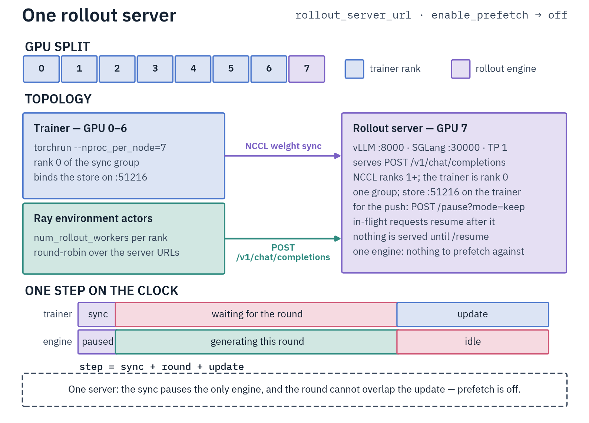
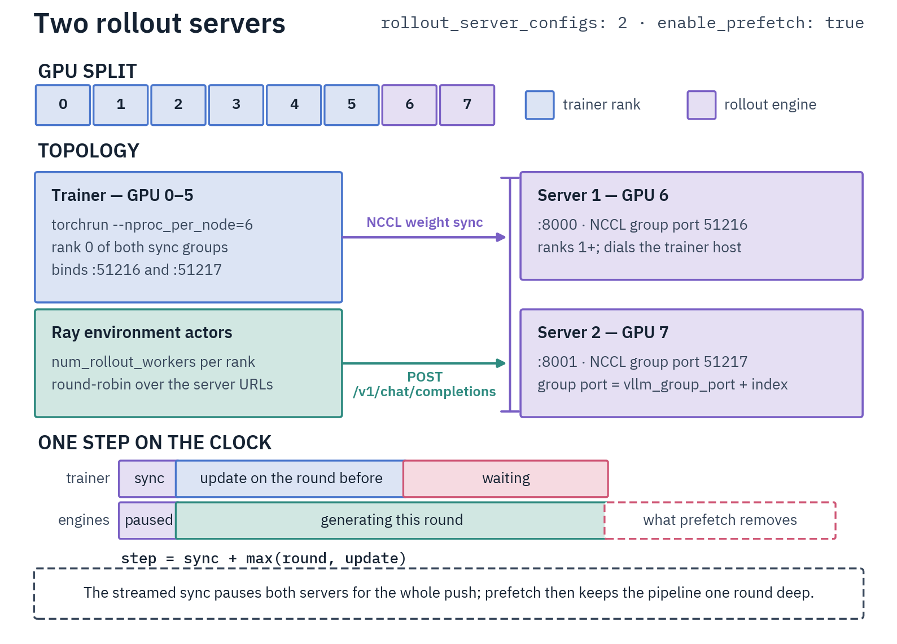
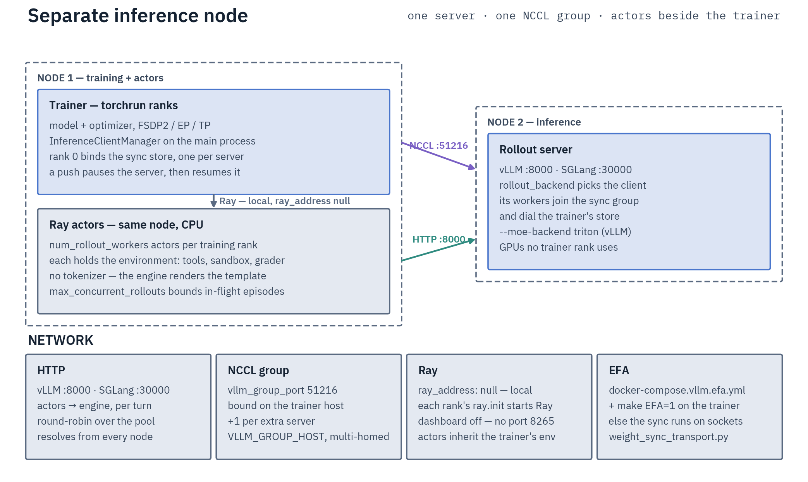
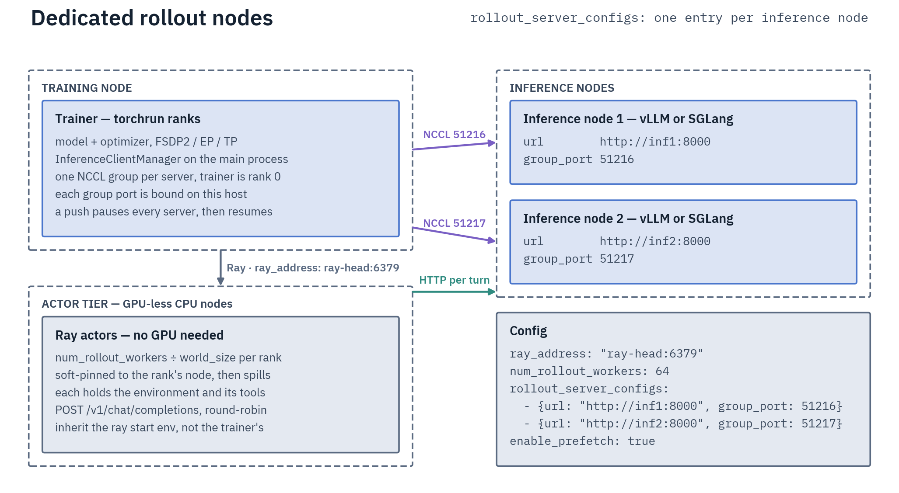

# Servers and Launch

## GPU split

Trainer GPUs must not overlap the server's: NCCL needs a distinct device for every rank of the sync group. Nothing
checks it up front; `CUDA_VISIBLE_DEVICES` enforces it, and the compose files put the server on GPU 7
(`docker-compose.vllm.yml` puts its trainer on 0–6). An overlap fails group formation in `init_communicator()` within
its 120 s deadline (the INFO line logged just before it names the trainer device); a server that never joins fails
the rendezvous after 120 s on SGLang, 300 s on vLLM.

## Rollout backend

`rollout_backend: vllm` (default) or `sglang`.

- A model the engine cannot update online is refused at construction
  ([which families each serves](../../infrastructure/rollout-servers.md#which-families-each-engine-serves)).
- SGLang also refuses `rollout_max_thinking_tokens` ([SGLang](reasoning.md#sglang)) and
  [`carry_reasoning`](episodes.md#carried-reasoning).
- TRL's `top_p`, `top_k`, `min_p`, `repetition_penalty` and `generation_kwargs` reach no sampler, so one set away
  from its TRL default is refused at trainer construction; the first four have `rollout_*` equivalents
  ([Sampling](episodes.md#sampling)). `temperature` is force-set to `rollout_temperature`, so log-probs are scored at
  the sampling temperature.

Rank 0 probes each server at startup:

- It **raises** when one turn cannot fit the served window: `max_prompt_length` + the environment's measured prompt
  overhead + `rollout_max_tokens`.
- It warns when the multi-turn worst case does not fit: that prompt budget plus the smaller of
  `max_turns × rollout_max_tokens` and `rollout_max_episode_tokens`.
- `verify_backend()` fails the launch on an unreachable external judge.

## Starting a server

```bash
make build-vllm
VLLM_MODEL=<hub-id-or-path> VLLM_CUDA_DEVICES=7 \
    docker compose -f docker-compose.vllm.yml up -d vllm-server

make build-sglang
SGLANG_MODEL=<hub-id-or-path> SGLANG_CUDA_DEVICES=7 \
    docker compose -f docker-compose.sglang.yml up -d sglang-server
```

Confirm `/health` (`:8000` vLLM, `:30000` SGLang) first, or client init hangs up to `rollout_connection_timeout`
(default 120 s). Parsers, `--moe-backend triton` and the rest:
[Rollout Servers](../../infrastructure/rollout-servers.md#vllm).

## Launching the trainer

```bash
CUDA_VISIBLE_DEVICES=0,1,2,3 DIST_NCCL_TIMEOUT_MINUTES=60 torchrun --nproc_per_node=4 \
    scripts/training/environmental_grpo.py <config>
```

- Add `--expert_parallel_size=4` for MoE expert distribution.
- `halo launch environmental-grpo <config> --nproc 4` builds the same `torchrun` line; the device split and
  `DIST_NCCL_TIMEOUT_MINUTES` stay yours.
- `accelerate launch` works only for plain data parallelism on a dense model; on a MoE it refuses the expert
  wrappers weight sync needs.
- Context and Pipeline Parallelism are rejected at config time.

## Expert parallelism group size

Dense models and `ep1` configs (no expert distribution) skip this. The trainer ranks must form **one** DeepEP dispatch group: set
`expert_parallel_size` to the trainer-GPU count. Above `ep_size: 2`, a group narrower than the NVLink domain is
rejected at config time: `ep4` on 4 trainer GPUs passes, on 8 it does not
([DeepEP](../../infrastructure/deepep.md#ep-grouping-what-is-reliable)).

- `ep_size: 8` needs 9 GPUs or a second node, since the server holds one.
- ZeRO-3 (`fsdp_reshard_after_forward: true`) is rejected wherever an expert-distribution group exists, since its
  backward all-gather races the DeepEP combine. It runs only at `ep_size: 1` with no expert TP
  ([ZeRO-2 vs ZeRO-3](../../parallelism/data-parallelism.md#zero-2-vs-zero-3-reshard_after_forward)).
- `beta > 0` without PEFT holds a frozen reference: the script loads it like the policy (run dtype, `model_revision`,
  attention, `reset_sinks`), from `model_name_or_path` and never a resume checkpoint, and hands it to TRL in place of
  TRL's fp32 copy ([Online GRPO](../grpo/online.md#grpo-objective-for-verifiable-rewards)). It is an unsharded dense
  replica per rank, warned about under EP, ETP and TP. Use `beta: 0`, or `use_peft: true` with an attention target
  off TP (which refuses adapters), to hold none.

## Weight synchronization

A forced sync runs at train-begin, after the resume restore and before the first rollout or `eval_on_start`; prefetch
starts there too, so no rollout uses pre-restore weights. Later syncs run at the **start** of a step, before that
round's generation.

- `sync_weights_every_n_steps` (default `1`) trades freshness for pause time; on slow environments sync every 2–4
  steps.
- `vllm_group_port` (TRL `GRPOConfig`, default `51216`) is bound on the **trainer** host, one listener per server, so
  two servers sharing a port collide even on distinct hosts. With several servers it is the base: an entry with no
  `group_port` binds `vllm_group_port + index`.
- Startup and every push fail fast: an error on any rank raises on all ranks together.
- Each EP layer's expert gather transiently materializes the **full expert set** on every rank, so its cost scales
  with total expert count, not `ep_size`.

## Multiple servers and prefetch

With a **single** server (`rollout_server_url`, default `http://localhost:8000`, or a one-entry
`rollout_server_configs`), prefetch is auto-disabled and the sync blocks, since that engine pauses for the push. Two or more
servers enable it.

```yaml
rollout_server_configs:
  - {url: "http://localhost:8000", group_port: 51216}
  - {url: "http://localhost:8001", group_port: 51217}
enable_prefetch: true
```

- Every push pauses all servers together.
- Prefetch runs **one round deep**: a round pops what the previous one submitted, then submits its own.
- `num_rollout_workers` and an explicit `max_concurrent_rollouts` are refused below `1`; turn prefetch off with
  `enable_prefetch: false`.

`async/prefetch_hit_rate` shows which phase bounds the step, not server health. On a short single-turn environment it
should approach 1; below ~0.8, add servers or raise `max_concurrent_rollouts` / `num_rollout_workers`. On a multi-turn
one the round outlasts the update, so it sits near 0.

### Prefetch across a resume

A checkpoint stores each rank's submitted-but-untrained round (`prefetch_pending-<rank>-of-<world>.pt`), and a resume
resubmits it before its first round.

- A save on a generation boundary (every save by default, since `steps_per_generation` equals the accumulation
  steps) resumes onto the batches an uninterrupted run trains. A save inside a round that feeds several optimizer
  steps trains that round twice.
- No file for this world size, or one drawn under another group size, round size or DP slice, resumes with a cold
  round: that batch is skipped and the next one trains twice.
- A file present on some ranks only (a non-shared filesystem under another rank-to-node placement, or a torn copy)
  raises. Resume with the saving placement, or delete the `prefetch_pending-*` files for a cold round.





## Multi-node

Point `ray_address` at the cluster head ([Ray Cluster](../../infrastructure/ray.md#multi-node)) and give each
inference node its own `rollout_server_configs` entry and `group_port`, plus `group_host` where the trainer's routable
address differs per server.

- Use resolvable host names. A loopback URL reaches actor nodes with no engine; those episodes error into masked rows,
  and two consecutive rounds where none survives halt training ([Batch construction](objective.md#batch-construction)).
- `num_rollout_workers` actors are created per training rank, soft-pinned to its node; on a shared cluster the budget
  divides by world size ([pool sizing](../../infrastructure/ray.md#pool-sizing)).
- The trainer's NCCL address must be routable from the serving nodes: set `VLLM_GROUP_HOST` or `SGLANG_GROUP_HOST`
  when the default-route NIC is wrong ([multi-homed nodes](../grpo/online.md#multi-homed-nodes-vllm_group_host)).
- The sync runs over EFA when both sides use their EFA overlays
  ([Servers on other nodes](../../infrastructure/rollout-servers.md#servers-on-other-nodes-efa)), over sockets
  otherwise.
- Co-located on one host, run the trainer container with `--network=host` too, or `localhost:8000` resolves inside its
  own namespace.





## Shipped recipes

`examples/grpo/environmental/<family>/<backend>/`: `gemma4`, `gptoss` and `qwen3_5`, each with `vllm/` and `sglang/`
(`sglang/` ships ep1 files only). In a filename, `-lora-` / `-full-` is the adapter and `-ep1` / `-ep4` the expert distribution
(none, or a 4-rank DeepEP group). Each header carries its launch line and server flags. One template sits at the root:
`environmental-grpo-template.yaml` (`react_math`).

Start from `gptoss/vllm/gptoss-20b-code-contests-lora-ep1.yaml` for a tool-heavy graded environment, or
`qwen3_5/vllm/qwen3.6-35b-a3b-react-math-full-ep4.yaml` for a light two-tool one.

- Every family recipe runs `beta: 0`; the root template runs `0.01`.
- The code-contests recipes drive two servers at `episode_timeout: 2700`; launch them with
  `DIST_NCCL_TIMEOUT_MINUTES=60` ([timeout bounds](performance.md#sizing-a-run)). The rest are single-server,
  prefetch off.
