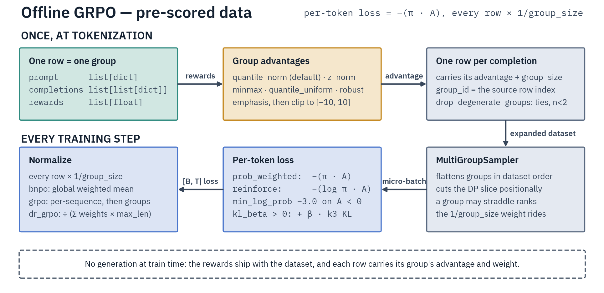

# Offline GRPO

Offline GRPO trains on pre-collected, off-policy data: several completions per prompt, each with a pre-computed reward. Trainer `OfflineGRPOTrainer`, script `scripts/training/offline_grpo.py`, config `OfflineGRPOConfig` ([field reference](../../reference/configuration-reference.md#offlinegrpoconfig)).

- **Models:** decoder-only, text-only. An encoder-decoder model is refused at construction, and the script refuses an image column.
- **Parallelism:** EP, TP, EP+TP, EP+ETP, pure ETP (`ep_size=1`), CP and EP+CP.
- **CP:** full fine-tuning only. PEFT and native expert LoRA are rejected under CP, even at `kl_beta: 0`.



## Dataset

Three conversational columns. A group is one **row**: put every completion of a prompt in one row, since two rows with the same prompt stay two groups.

| Column | Type | Contents |
|---|---|---|
| `prompt` | `list[dict]` | Message list (`{"role", "content"}`) |
| `completions` | `list[list[dict]]` | One message list per completion (typically 4–16) |
| `rewards` | `list[float]` | One reward per completion |

```jsonl
{"prompt": [{"role": "user", "content": "What is 2+2?"}], "completions": [[{"role": "assistant", "content": "4"}], [{"role": "assistant", "content": "5"}]], "rewards": [1.0, -0.5]}
```

- A singleton or exactly-tied group gets advantage 0 under every method.
- A `completions`/`rewards` length mismatch, an empty tokenized prompt, or a non-finite reward raises, naming the row or group.
- Strict templates (Qwen3.5) work: the script renders `prompt + completion` and strips the prompt.
- A `tools_field` column is passed as `tools=`.

`scripts/inference/reward_model/rm_rejection_sampling.py` emits this shape with `--output_format offline_grpo`.

## Configuration

```yaml
model_name_or_path: Qwen/Qwen3.6-35B-A3B
dataset:
  - path/to/gsm8k_<model>_offline_grpo.jsonl
advantage_method: quantile_norm
loss_type: bnpo
kl_beta: 0.0
initial_min_log_prob: -0.5
max_prompt_length: 512
max_completion_length: 6144
expert_parallel_size: 8
learning_rate: 5.0e-06
```

| Knob | Default | Effect |
|---|---|---|
| `advantage_method` | `quantile_norm` | Reward → advantage per group ([Advantages](#advantages)) |
| `best_completion_emphasis` | `0.0` | Top-reward boost ([Advantages](#advantages)) |
| `loss_type` | `bnpo` | Loss normalization: `bnpo`, `grpo`, `dr_grpo` |
| `policy_gradient_formulation` | `prob_weighted` | Per token `-(π·A)`; `reinforce` uses `-(log π·A)` |
| `min_log_prob` | `-3.0` | Log-prob floor, on negative-advantage rows only |
| `initial_min_log_prob` | `null` | Linearly schedule that floor from this start |
| `kl_beta` | `0.0` | k3 KL coefficient (Schulman's KL estimator) ([Reference model](#reference-model)) |
| `drop_degenerate_groups` | `false` | Drop exactly-tied and singleton groups at tokenization |
| `use_chunked_grpo_logprobs` | `false` | Vocab-chunked log-probs, not full logits |
| `max_prompt_length` | `512` | Prompt budget, left-truncated; `null` = no cap |
| `max_completion_length` | `null` | Completion budget, cut from the end; `null` = no cap |
| `max_length` | `null` | Any value is rejected at construction: only [pipeline parallelism](../../parallelism/pipeline-parallelism.md), not yet available, reads it |

- The shipped recipes run `learning_rate: 5.0e-06`, the top of the SFT full-FT band; a wider batch helps ([sizing](../sft.md#learning-rate-and-global-batch-size)).
- Both length knobs truncate, and the tokenizer's window is pinned only when both are bounded. A completion cut at its cap gets no EOS, so it is never taught to stop there.

### Advantages

Rewards map to advantages per group at preprocessing, then clip to `[-10, 10]`.

| `advantage_method` | Formula | Best for |
|---|---|---|
| `quantile_norm` (default) | inverse normal CDF of ranks | ordinal or outlier-heavy rewards |
| `z_norm` | `(r - mean) / (std + ε)` | normal reward distributions |
| `minmax` | `2(r - min)/(max - min) - 1` | bounded `[-1, +1]` advantages |
| `quantile_uniform` | uniform from ranks | most outlier-tolerant |
| `robust` | `(r - median) / IQR` | extreme outliers |

- `best_completion_emphasis` takes `0.0` (off), a float above `1.0` (`2.0` = 2× weight) or `"auto"` (`3.0 + 2.0·std/(1.0 + std)`); any other value raises.
- `drop_degenerate_groups: true` raises if it empties the dataset. Near-ties are kept at full scale under the rank methods.

### Loss types

All three weight each example by `1/group_size`, so every group counts equally.

- `bnpo` (default): global token average over the micro-batch's group-weighted token sum.
- `grpo`: per-sequence average, then a weighted mean across groups. Use when completion length varies.
- `dr_grpo`: divides by effective group count × `max_completion_length`, a constant that removes length bias; a `null` cap raises at init.

### Memory: chunked log-probs

The default path materializes `[B, T_completion, vocab]` logits, the memory peak on wide vocabularies with long completions (twice per micro-batch where the reference is scored live). `use_chunked_grpo_logprobs: true` computes the same log-probs from `last_hidden_state` with a vocab-chunked softmax. CP always takes this path. Limits: [Chunked log-probs](../async-grpo/performance.md#chunked-log-probs).

### MoE balancing

`moe_balancing: aux_loss` warns and does nothing (a policy-gradient loss adds no router aux term), or raises at construction with `output_router_logits` on and a positive `router_aux_loss_coef`. `bias_update` works on a family whose bias exports ([Callbacks](../callbacks.md#routerbiasbalancingcallback)). The recipes set `none`.

### Reference model

At `kl_beta > 0` the loss adds a k3 KL to a reference policy (log-ratio capped at 5 nats).

| Policy | Reference scoring |
|---|---|
| Full fine-tuning | One sweep of the run-start policy over the train and evaluation splits before the first update; no second resident model. Same lifecycle under CP |
| Full fine-tuning with a frozen `ref_model` (outside CP) | That model is swept once and released |
| PEFT (outside CP) | Live at every step with the adapters disabled; no sweep, no sidecar |
| Native expert-only LoRA | Live at every step against a required frozen base `ref_model`, which the script loads from `model_name_or_path` (never the resume checkpoint) with the policy's revision, attention and sinks settings |

A supplied reference is moved to the policy's device and frozen in eval mode. A run without KL rejects an unused `ref_model`.

#### The sweep

- It needs finite, unsharded `datasets.Dataset` splits. A pre-sharded dataset or a supplied `ref_per_token_logps` column is refused by the script before the model loads and by the trainer at construction. With KL off, PEFT or expert LoRA, neither restriction applies and unused reference columns are dropped.
- It finishes before step 1 and does not rerun on resume.
- Global rank 0 writes the scores on shared storage, each node's local rank 0 on node-local storage; every rank memory-maps the merged file. A write, merge or mapping failure on any rank raises on every rank.
- DPO and KTO share this persistence and resume lifecycle ([Checkpoints](../../reference/checkpoints.md#what-gets-saved)).

#### Resume

Every checkpoint carries the raw completion-token scores in `reference_logps.pt`, which a resume restores as the original anchor (the `min_log_prob` clamp is applied live).

- Token digests, row counts, reference settings and scoring precision must match: fp32 on the chunked and CP paths, the compute dtype on the full-logits path. A bf16 or fp16 resume off CP that toggles `use_chunked_grpo_logprobs` is refused with the regeneration steps.
- Non-finite scores or rank-divergent reference values raise.
- From Python, pass the resolved `resume_checkpoint` at trainer construction and the same path to `train()`.

A KL checkpoint without its sidecar cannot resume, since rescoring would anchor to the trained weights. The refusal gives the recovery flags. Either:

- copy `reference_logps.pt` from a complete checkpoint, or
- run one step of the same tokenized splits and configuration from the exact original model and revision into a scratch output, and copy its `checkpoint-1/reference_logps.pt` over (to each node, with node-local storage). Supplied scores and pre-sharded KL datasets are refused here too.

#### Scratch cache

The mapped files live under `_reference_cache/<launch>/` in `output_dir` for the whole run (a resume maps a hard link or copy of the sidecar). Hub uploads, export copies and the fresh-output-dir check skip it.

- Each new cache removes only the other launches' scratch whose `_reference_cache/<launch>.lock` it can take: a finished run's goes, a still-running job's stays. A mount without locks removes nothing.
- Host-local locks (NFS `nolock`, Lustre `localflock`, most FUSE mounts) cannot see a job on another host; give that job its own `output_dir`.

#### Evaluating new rows

`evaluate(new_tokenized_dataset)` reuses the original scores for token-identical rows and keeps new rows' scores for the run. Unseen rows need the exact original frozen policy:

- outside CP, pass the run-start weights as `original_reference_model`, fully frozen and in eval mode;
- under CP, declare evaluation splits before training.

## Launch

```bash
torchrun --nproc_per_node=8 scripts/training/offline_grpo.py \
    examples/grpo/offline/qwen3_5/offline-grpo-qwen3.6-35b-a3b-gsm8k.yaml --expert_parallel_size=8
```

`halo launch offline-grpo <config> --nproc 8` builds the same line. From Python, load the model through `load_distributed_model` and pass the same `ParallelismConfig` to the trainer.

## Testing a setup

Run `max_steps: 10` with `save_strategy: "no"` on a slice of the data first. A bad `loss_type`, `advantage_method` or `policy_gradient_formulation` fails when the config is parsed.

- CPU: `pytest tests/cpu/grpo -m cpu`.
- GPU, under `tests/gpu/`: `trainers/grpo/test_offline_grpo*.py`, `parallelism/{cp,combined}/test_*cp_grpo_scoring.py` (CP1 vs CP2/CP4), `trainers/lora/test_lora_offline_grpo*.py`.

## What to watch

Per-sample diagnostics, split by advantage sign, once per log step:

- `{positive,negative}/{logps,pg_objective,kl,ref_logps}_{mean,std,min,max,range}`, plus the pre-clamp `negative/*_unclamped_*`. `kl` and `ref_logps` exist only at `kl_beta > 0`.
- `min_log_prob_restriction`: the live clamp floor.
- Evaluation prefixes every key with `eval_`.

Read `positive/logps_mean` (stable or rising), `negative/logps_mean` (falling) and `positive/pg_objective_mean`.

| Symptom | Cause | Fix |
|---|---|---|
| Loss NaN or exploding | Low-probability tokens on negative-advantage rows | `min_log_prob: -3.0` and `max_grad_norm: 1.0` |
| `positive/pg_objective_mean` falls through training | Distribution shift from the offline data | Add `kl_beta: 0.05`, lower the learning rate |
| `Batch-count equalization left 0 full batches` | The split is too small for this world size | Lower `per_device_train_batch_size`, shrink the world |
| OOM | Full-vocab logits over long completions | `use_chunked_grpo_logprobs: true`, lower the batch or `max_completion_length`, or raise EP size |

## Related pages

[Online GRPO (RLVR)](online.md) · [Async GRPO with Environments](../async-grpo/README.md) · [Pipeline Parallelism](../../parallelism/pipeline-parallelism.md) · [Trainer Architecture](../../reference/trainer-architecture.md)
