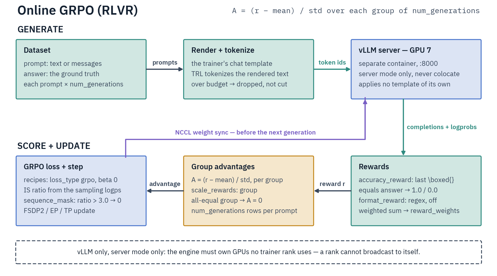

# Online GRPO (RLVR)

RLVR (Reinforcement Learning with Verifiable Rewards) is on-policy GRPO scored by the config's [reward terms](rewards/README.md), `\boxed{}` exact match by default. Trainer `DistributedGRPOTrainer`, script `scripts/training/online_grpo/rlvr.py`. A separate vLLM server generates and receives weights over NCCL; the trainer scores rewards.

Parallelism: EP, TP, EP+TP, EP+ETP and pure ETP (`ep_size=1`). CP and PP are rejected at config time.



## Dataset

Two columns: `prompt` (a string or a `{"role", "content"}` message list) and `answer` (the ground truth).

```jsonl
{"prompt": "What is 2 + 3? Put your answer in \\boxed{}.", "answer": "5"}
{"prompt": [{"role": "user", "content": "What is 2 + 3?"}], "answer": "5"}
```

- `prompt_field` and `answer_field` must name real columns; a typo raises at load.
- A row with a null or empty prompt is dropped at load.
- `system_prompt` is prepended unless the row already opens with a system turn.
- A rendered prompt over `max_prompt_length` is **dropped**, never truncated.

The recipes pull `openai/gsm8k`, `trl-lib/DeepMath-103K` and `open-r1/DAPO-Math-17k-Processed`.

## Rewards

Each `rewards:` [term](rewards/README.md) becomes one TRL reward function named after it, weighted through `GRPOConfig.reward_weights` and logged as `rewards/<name>/mean`. The default is one `accuracy` term. The list is YAML-only; the CLI cannot set it.

| `source` | Scores `1.0` when | Options |
|---|---|---|
| `accuracy` | the last `\boxed{...}` equals `answer` | none |
| `format` | the completion matches `pattern` | `pattern`, default `<think>.*?</think>\s*<answer>.*?</answer>` under `re.DOTALL` |

Accuracy is strict: the answer keeps only its text after a GSM8K `####`, both sides drop `,` and `$`, braces match by depth, and an empty extraction never scores. The environments' grader also lowercases and accepts `rtol=0.01` numeric matches.

A judge reads the `answer` column as its reference. A veto judge (one listing `checks`) is refused at config time; list `requirements` instead.

A `judge` or `reward_model` term reads the row's `conversation` and `answer` columns, so keep `remove_unused_columns: false` (TRL's GRPO default): at `true` TRL forwards neither column and the term raises at its first scoring call.

## Configuration

Fields: [`RLVROnlineGRPOScriptArguments`](../../reference/configuration-reference.md#rlvronlinegrposcriptarguments), TRL's `GRPOConfig`, `ModelConfig` and `DistributedArguments`.

```yaml
model_name_or_path: Qwen/Qwen3-4B-Instruct-2507
dataset: trl-lib/DeepMath-103K
answer_field: solution

beta: 0.0                     # no KL anchor, no reference model
num_generations: 8            # the GRPO group size
max_prompt_length: 1024       # dataset filter
max_completion_length: 2048   # generation budget; required

use_vllm: true                # server mode is mandatory
vllm_mode: server

learning_rate: 1.0e-06
```

- `max_completion_length` must be a positive int; `null` raises. With both length knobs bounded, their sum becomes `model_max_length`.
- TRL defaults `loss_type` to `dapo` and `scale_rewards` to `group`. The recipes (`examples/grpo/online/`) run `loss_type: grpo`, `beta: 0`, `epsilon` `0.15`–`0.2`, `num_generations` 4 or 8 and `max_completion_length` 128–4096.
- `reasoning_effort` (default unset; `low` / `medium` / `high` / `random`) is applied at dataset-map time and needs a template that reads it.
- Learning rate: `1e-6` to `5e-6` in the recipes, roughly 10× that for LoRA ([sizing](../sft.md#learning-rate-and-global-batch-size)).

### Optional objective changes

All off by default.

| Knob | Effect | Requires |
|---|---|---|
| `scale_rewards_std_floor` | A floor on the std divisor | Not `scale_rewards: none` |
| `drop_degenerate_groups` | Masks all-equal-reward groups out of the loss and normalizer | — |
| `balance_token_mass` | Cancels each generation round's net token-weighted push ([Token-mass balance](../async-grpo/objective.md#token-mass-balance)) | `loss_type` `cispo`, `dapo` or `dr_grpo`; `top_entropy_quantile: 1.0`; no `off_policy_mask_threshold` |
| `use_rlrr` | Intra-group ranking advantages ([arXiv:2601.23058](https://arxiv.org/abs/2601.23058)) | Neither the std floor nor the drop |
| `use_sdpg` | [Online SDPG](../distillation/online-sdpg.md) | — |

The std floor, the drop and RLRR also require `multi_objective_aggregation: sum_then_normalize`.

The `rlrr_*` tunables are range-validated always and refused at a non-default value with `use_rlrr` off. Defaults (recipe: `examples/grpo/online/qwen3/online-grpo-qwen3-8b-rlrr-math.yaml`):

```yaml
rlrr_mode: hrr                   # or prr
rlrr_tau: 0.1
rlrr_lambda: 2048.0
rlrr_xi_pos: 1.0e-3              # clip band; xi_neg > xi_pos is refused
rlrr_xi_neg: -1.0e-3
rlrr_std_normalize: false
rlrr_length_rerank: true
rlrr_correctness_clip: true
rlrr_correctness_threshold: 0.5  # the only correctness signal; no gold labels
```

### Importance sampling and the server probe

`vllm_importance_sampling_correction` (TRL default on) weights the loss by `exp(logπ_recompute − logπ_sampling)`. The default `sequence_mask` mode masks a sequence whose ratio exceeds `vllm_importance_sampling_clip_max` (`3.0`) or falls below `vllm_importance_sampling_clip_min` (unset); the `*_truncate` modes clamp instead. With the correction off (and aligned accumulation), the 5-nat k3 KL tail clamp and `kl_clamp_frac` cannot engage, so `beta > 0` warns.

A rank-0 startup probe refuses a server whose logprobs the correction cannot use:

- raw pre-temperature logprobs at `temperature != 1.0`; serve vLLM with `--logprobs-mode processed_logprobs`;
- logprobs renormalized over a sampling cut (`top_p < 1`, a `top_k` or a `min_p`) while the correction sums the per-token log-ratios over each sequence, which stalls the run silently. Keep all three off. A `sequence_*` mode sums them, and so does `loss_type: vespo` in either token mode TRL lets it run.

Under `loss_type: vespo` with `token_mask`, TRL zeroes each ratio outside the clip bounds, which floors that sum, so one such token silences its whole sequence; `token_truncate` clamps instead.

TRL sends `top_k`, `min_p` and `repetition_penalty` on every request, so the model's `generation_config.json` defaults never apply ([Rollout Servers](../../infrastructure/rollout-servers.md)).

### Forced settings

- **Dropout is off**, EP expert-LoRA dropout included, overriding `disable_dropout: false`; a config-level float only warns.
- **MoE balancing is off:** `aux_loss` is inert under a policy-gradient loss, and both bias-update modes downgrade to `none` ([Callbacks](../callbacks.md#routerbiasbalancingcallback)).

## GRPO objective for verifiable rewards

For a shaped reward in `[0, 1]` (a grade plus small shaping terms) over a small group, set these TRL `GRPOConfig` fields (async GRPO too).

| Knob | Set it to | Why |
|---|---|---|
| `loss_type` | `dapo` (TRL's default) | Length-unbiased: normalizes over the global active-token count, unlike `grpo`'s per-sequence mean |
| `epsilon_high` | `0.28` with `epsilon: 0.2` | DAPO clip-higher: only the upper bound loosens |
| `scale_rewards` | `batch` for a shaped reward | `group` divides by the group's own spread, inflating shaping noise to full-scale advantages |
| `mask_truncated_completions` | `true` (default `false`) | Drops a completion cut at the budget instead of scoring it. Async GRPO widens `truncated` to a turn overflow; its recipes leave it off |

- A single binary reward keeps `scale_rewards: group`: the `1e-4` added to the divisor keeps a uniformly-failed group's advantages at zero, not NaN.
- The clip binds only when a generation batch outlives one optimizer step. At the defaults (`num_iterations: 1`, `steps_per_generation` = `gradient_accumulation_steps`) `epsilon` is inert. `epsilon_high` falls back to `epsilon`.

`beta` is the KL anchor to the base model; every online recipe runs `beta: 0`. Without a PEFT wrapper (a full fine-tune, or expert-only LoRA, which builds no `PeftModel`), `beta != 0` holds a frozen reference:

- The script loads it as the policy loads (`load_reference_model_for_on_policy_grpo`, `src/distributed/loading/frozen_models.py`): run dtype, `model_revision`, the policy's attention request and `reset_sinks`, the non-persistent buffers repaired, the vocabulary grown with the tokenizer. The trainer hands it to TRL in place of the fp32 copy TRL would build from the hub's default revision.
- It is a dense replica on every rank, warned about under EP, ETP and TP. A resume loads it from `model_name_or_path`, never the checkpoint.
- A trainer constructed with `beta != 0` and no `ref_model` raises, as does a `ref_model` the run never reads (`beta: 0`, or a PEFT policy, whose reference is the policy with its adapter disabled), both before the rollout client connects.
- A reference whose sinks differ from the policy's is rejected in every mode, since the KL would be biased on every token. The script's reference takes the policy's `reset_sinks`, so live sinks (`reset_sinks: false`) score on both sides.

## Chat template handling

The trainer's tokenizer renders each prompt and TRL sends vLLM the **token ids**, so a `chat_template:` override needs no server-side setting ([unlike async GRPO](../async-grpo/episodes.md#chat-template)). A `tools_field` column rides through as `tools=`. The leading BOS is stripped **only** when the tokenizer's post-processor adds its own, so a template-emitted BOS (Gemma 4) survives.

## Chunked log-probs

`use_chunked_grpo_logprobs: true` (default off) replaces the full `[B, T, vocab]` logits with a vocab-chunked softmax, for large vocabularies with long completions ([Offline GRPO](offline.md#memory-chunked-log-probs), [limits](../async-grpo/performance.md#chunked-log-probs)). Here a multimodal batch falls back to the full path, and a PEFT adapter on `lm_head` raises.

## Server mode only

`DistributedGRPOTrainer` rejects two generation paths:

- **In-process generation** (`use_vllm: false`, `vllm_mode: colocate`), at init: two NCCL worlds on the same GPUs deadlock ([Rollout Servers](../../infrastructure/rollout-servers.md#vllm)).
- **TRL's tool-calling loop** (`tools`, `environment_factory`), which desynchronizes ranks. Tool use trains on [Async GRPO with Environments](../async-grpo/README.md).

Before the trainer is built, every rank raises if `max_prompt_length + max_completion_length` exceeds the served `max_model_len`.

> [!WARNING]
> **GPT-OSS: toolkit vLLM image, sinks on**
>
> Serve GPT-OSS from the toolkit `vllm-server:0.26.0` image with sinks on (the default) and keep `reset_sinks: false` on the trainer; stock vLLM emits garbage GPT-OSS output on Blackwell ([GPT-OSS](../../models/gpt-oss.md#serving-for-grpo-vllm)).

### Weight sync

Weights are pushed before the **next** generation, not at the optimizer step; a resumed run pushes before its first rollout ([mechanics](../../infrastructure/rollout-servers.md#weight-sync)). `validate_weight_sync_support` refuses at construction:

- QLoRA (`load_in_4bit` / `load_in_8bit`).
- A PEFT layer the sync cannot fold, or an adapter on a tensor the dense push does not send, such as EP expert weights ([PEFT](../../optimization/peft.md#online-rl--rollout-server-weight-sync)).
- GptOss sinks removed by the `flash_attention_2` `reset_sinks` reset, and `train_sinks: true`.
- Model types in the client's `UNSERVABLE_MODEL_TYPES`, families with `_supports_weight_sync = False`, and an MoE with no live EP wrapper (`expert_parallel_size: 1` with `use_grouped_gemm: false`) ([construction gates](../../infrastructure/rollout-servers.md#construction-gates)).
- Live `bias_update` balancing state.

### Multi-homed nodes (`VLLM_GROUP_HOST`)

Rank 0 advertises an address for the vLLM workers to dial back and binds the weight-sync TCPStore on it alone ([group rendezvous](../../infrastructure/rollout-servers.md#group-rendezvous)). Resolution order: an explicit `group_host` argument, `VLLM_GROUP_HOST`, **loopback when this host binds the server address itself** (avoiding firewalled hairpin traffic), then the default-route NIC.

Set `VLLM_GROUP_HOST` to the trainer IP a **remote** server should dial when the default route is not on its subnet. It is the control-plane address, not `NCCL_SOCKET_IFNAME`.

> [!NOTE]
> **Multi-server sync belongs to Async GRPO with Environments**
>
> The list-of-dicts `server_configs` API (per-server `url`/`group_port`/`group_host` via `InferenceClientManager`) belongs to [Async GRPO with Environments](../async-grpo/setup.md#multiple-servers-and-prefetch) (`AsyncTrainingConfig.rollout_server_configs`), not this single-server RLVR trainer.

## Launch

vLLM must own GPUs **no trainer rank uses**. The compose defaults put the server on GPU 7 (`VLLM_CUDA_DEVICES`) and the trainer on 0–6 (`TRAINER_CUDA_DEVICES`).

```bash
# vLLM on GPU 7 (flags: Rollout Servers)
VLLM_MODEL=Qwen/Qwen3-30B-A3B docker compose -f docker-compose.vllm.yml up vllm-server

CUDA_VISIBLE_DEVICES=0,1,2,3,4,5,6 torchrun --nproc_per_node=7 \
    scripts/training/online_grpo/rlvr.py examples/grpo/online/rlvr-online-grpo-template.yaml \
    --model_name_or_path=Qwen/Qwen3-30B-A3B
```

`halo launch rlvr <config> --nproc 7` builds the same line (FSDP2 data parallelism); the device split stays yours. Add `--tensor_parallel_size` for dense TP or `--expert_parallel_size` for MoE.

Under EP, set `expert_parallel_size` to the training-GPU count so the trainer forms **one** DeepEP group:

- Above `expert_parallel_size: 2`, a group narrower than the NVLink domain is rejected ([DeepEP](../../infrastructure/deepep.md#ep-grouping-what-is-reliable)).
- `num_experts` must divide by `ep_size`, so most rosters want a power-of-two split: trainer on GPUs 0–3 with `--expert_parallel_size=4`, server on `VLLM_CUDA_DEVICES=4,5,6,7`.
- Under EP+TP, `tp_size` must divide the NVLink domain and `ep_size` must be a multiple of `tp_size`.

### LoRA

Add `use_peft: true` and the `lora_*` fields. LoRA runs under FSDP2 DP, EP and pure ETP (attention adapters only: native expert LoRA is refused at `expert_tensor_parallel_size > 1`); under TP and EP+TP every adapter is **rejected**, native expert adapters included.

The weight sync folds each adapter, native expert-LoRA included, into its base weight as it sends it; vLLM loads no adapter and the trainer's frozen base is never written ([PEFT](../../optimization/peft.md#online-rl--rollout-server-weight-sync)).

## Data flow and batch construction

Each row becomes a group of `num_generations` completions. Under TP and ETP every rank takes its group leader's completions; TRL's `rollout_func` is refused there. The collator is TRL's row collator (left-padded prompts, right-padded completions, never packed), hence no CP.

**Counting.** Rollouts per optimizer step = `per_device_train_batch_size × gradient_accumulation_steps × data_parallel_size`. `per_device_train_batch_size` counts completions, not prompts; with the completion length, it sets per-forward memory.

**Geometry.** Under TP, ETP or a pre-sharded dataset the dataloader enforces both rules when it is built (elsewhere TRL's config check applies the first):

- `per_device_train_batch_size × steps_per_generation × data_parallel_size` must divide by `num_generations`. A pre-sharded dataset drops the DP factor.
- Under TP/ETP the per-rank product must **itself** divide by `num_generations`.

## vLLM on Blackwell (B200)

- **Server:** pin `VLLM_ATTENTION_BACKEND=FLASH_ATTN` only where FlashInfer JIT-fails on SM 10.0. On head-dim-256 families it resolves to FA2 and measures slower ([Rollout Servers](../../infrastructure/rollout-servers.md#throughput)).
- **Trainer:** all three GRPO scripts default `attn_implementation` to **SDPA** for their right-padded batches, except under `reset_sinks: false` and offline GRPO under CP ([padded workloads](../../optimization/flash-attention.md#model-specific-handling)). A pinned value wins.

## Testing a setup

Run a 3-step smoke config against a live server first: `examples/grpo/online/qwen3/online-grpo-qwen3-4b-smoke.yaml` (dense) or `.../gptoss/online-grpo-gptoss-20b-ep-smoke.yaml` (EP).

CPU: `pytest tests/cpu/grpo -m cpu`. GPU: `test_online_grpo_vllm_*_e2e.py` (the PEFT × parallelism × resume matrix, live server).

## What to watch

Metric names follow TRL's `GRPOTrainer`. Read every run: `rewards/accuracy/mean`, `frac_reward_zero_std`, `sampling/importance_sampling_ratio/mean` (near 1 when trainer and engine agree), `completions/clipped_ratio`, `entropy`, and each external term's (`judge`, `reward_model`) `<source>/<name>/scored`. Toolkit additions:

- `kl_clamp_frac`: share of loss tokens whose reference log-ratio hits the 5-nat clamp, at `beta > 0`.
- `sampling/degenerate_group_frac`: share of completions `drop_degenerate_groups` masked out.
- `advantage/net_token_mass` every round (an early sign of entropy drift) and, under `balance_token_mass`, `advantage/token_mass_scale`; the sign reads as the entropy push only under a token-sum loss such as `dapo`.

`early_stop_entropy_band` and `early_stop_logratio_gap` work as on [Async GRPO](../async-grpo/monitoring.md#early-stop); the gap needs `vllm_importance_sampling_correction` and reads TRL's `sampling/sampling_logp_difference/mean` (a mean absolute difference), so a threshold read off an Async GRPO run does not carry over. `save_completions` (default on) writes `<output_dir>/completions/completions_<step>.parquet` (step zero-padded to five digits, `_eval` suffix for evaluation).

**Eval padding.** An eval split's final round is padded with repeats of its first prompts, which TRL counts in generation, loss and metrics, so a split that does not fill whole rounds over-weights them. [Async GRPO with Environments](../async-grpo/README.md) never rolls the padding out: its rollout metrics and completions count the split's own episodes alone ([Padding and round means](../async-grpo/evaluation.md#padding-and-round-means)).

| Symptom | Cause | Fix |
|---|---|---|
| All rewards zero | The policy emits no `\boxed{}` | Ask for it in `system_prompt`, raise `max_completion_length`, read the parquet |
| IS ratio far from 1 | Trainer and engine disagree (template, sinks, dropout) | Match the served model; `reset_sinks: false` for GPT-OSS |
| Hang at sync or generation | Server down or wedged, a GPU shared with a trainer rank, blocked ports | `curl .../health`; check both containers' `CUDA_VISIBLE_DEVICES`; raise `DIST_NCCL_TIMEOUT_MINUTES` (default `30`); [Rollout Servers](../../infrastructure/rollout-servers.md#troubleshooting) |
| OOM | Full-vocab logits or a long completion | `use_chunked_grpo_logprobs: true`, lower the batch or `max_completion_length`, raise EP size |

## Related pages

[Offline GRPO](offline.md) · [Async GRPO with Environments](../async-grpo/README.md) · [Rollout Servers](../../infrastructure/rollout-servers.md) · [Trainer Architecture](../../reference/trainer-architecture.md)
