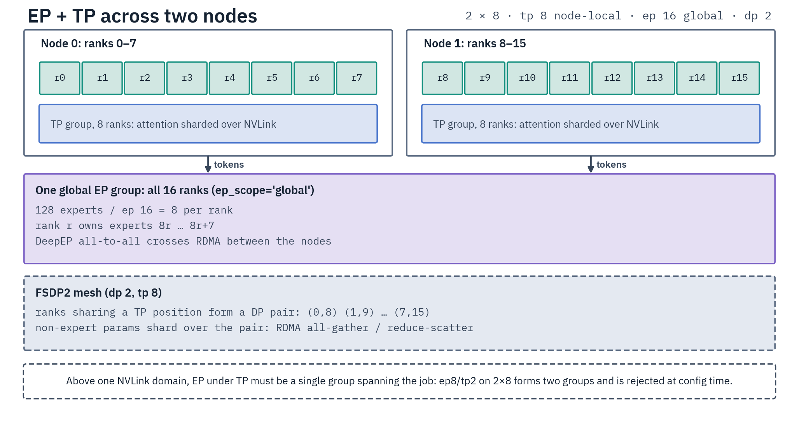

# Clusters and Multi-Node

Multi-node training is one `torchrun` per node, each in its own container
running the same image. Halo ships no scheduler: use one of the SkyPilot or
Nomad templates, or start the processes yourself.

## The launch pattern

On every node, start a container as in [Installation](installation.md), add
`--network host`, and run:

```bash
torchrun --nnodes=2 --node_rank=$NODE_RANK --nproc_per_node=8 \
    --master_addr=$MASTER_ADDR --master_port=29500 \
    scripts/training/sft.py examples/sft/gptoss/gptoss-20b-multinode-ep.yaml
```

Only `--node_rank` differs between nodes. Everything else must be identical
everywhere, or the job dies at startup with a process-group error: `--nnodes`,
`--nproc_per_node`, the master address and port, the config and every
parallelism flag.

- `MASTER_ADDR` must be an address the compute fabric routes (the InfiniBand or
  private IP, not the public SSH one), and port 29500 must be reachable between
  nodes.
- The image must already be on every node, pulled or built with `make build-*`.
  Flash Attention and DeepEP are compiled into it; a bare-host install is not
  supported.
- On SLURM, run one torchrun per node, not one per GPU: `--ntasks-per-node=1`
  and `srun bash -c 'torchrun --nnodes=$SLURM_NNODES --node_rank=$SLURM_NODEID ...'`.
  Without the single quotes every task gets node rank 0.

## Storage

`DIST_SHARED_FILESYSTEM` declares whether nodes share a filesystem.

- **`1` (default): shared** NFS or Lustre. Global rank 0 writes the model and
  does the downloads; each rank writes its own optimizer shard.
- **`0`: per-node local disk** (RunPod pods, ephemeral NVMe). Each node saves its
  own copy. Resume needs no copying as long as every node keeps its
  `--node_rank`, since optimizer shards stay on the node that wrote them
  ([what has run on real machines](supported-matrix.md#validation)).

A multi-node run checks the declarations against `output_dir` and the HF caches
at startup and refuses one that contradicts the mount. One input declaration
covers both caches, so `HF_HUB_CACHE` and `HF_DATASETS_CACHE` must sit on the
same kind of storage.

The umbrella splits into a read side (`DIST_INPUT_SHARED_FILESYSTEM`) and a write
side (`DIST_OUTPUT_SHARED_FILESYSTEM`). On a flaky NFS/EFS mount, set the input
side to `0` and leave the output side shared. Remote ranks then stop reading
files rank 0 is still writing (the `Stale file handle` error), and checkpoints
stay one authoritative copy ([Environment Variables](environment-variables.md)).

Other rules for multi-node storage:

- **Bounded waits.** While one rank goes first (a download, a dataset pack), the
  others wait up to `DIST_STORE_TIMEOUT_HOURS` (default 4). Raise it for a
  100B-scale download or a whole-corpus pack. It and `DIST_NCCL_TIMEOUT_MINUTES`
  must be identical on every rank, or the job refuses to start.
- **Same model source everywhere.** A local checkpoint missing on some nodes,
  or Hub caches at different commits, raises on every rank before the load. Put
  the checkpoint or `HF_HOME` on a shared mount, or set
  `DIST_INPUT_SHARED_FILESYSTEM=0` so each node fetches its own Hub copy (a
  local checkpoint must then exist on every node). Pin `model_revision` to one
  commit. A Hub fetch takes the repo's top-level files (config, tokenizer,
  weights, remote code); weight dumps in subfolders stay on the Hub.
- **FA4 kernel cache.** It lives under `HF_HOME` (the temp dir if `HF_HOME` is
  read-only) and locks files with `flock`.
  If a shared `HF_HOME` has no cross-node `flock` (Lustre without `flock`, NFS
  `nolock`), point `FLASH_ATTENTION_CUTE_DSL_CACHE_DIR` at node-local storage.

## Network fabric

InfiniBand and RoCE run on the NCCL defaults in the image. Three setups need
extra environment:

- **AWS EFA.** Set `NCCL_NET_PLUGIN=ofi NCCL_NET=Libfabric` and pass `--device
  /dev/infiniband`; cross-node expert parallelism also needs `NCCL_GIN_TYPE=2`
  and `--device /dev/gdrdrv`. Don't set them on an InfiniBand cluster: they
  slow it down. Details:
  [RDMA fabrics](../agent-docs/parallelism/multi-node.md#rdma-fabrics) ↗.
- **Multiple NICs.** Point `NCCL_SOCKET_IFNAME` at the fast interface so NCCL's
  bootstrap stays off the management network.
- **Rollout server on another node** (RL). The server needs the same fabric:
  see [Rollout Servers](rollout-servers.md#across-nodes).

On an NVL72 rack, `NVLINK_DOMAIN_SIZE=72` tells Halo the NVLink domain is the
rack, not the node. Its Grace hosts (GB200/GB300) are aarch64, which the images
do not build for ([Installation](installation.md)).

## Cross-node expert parallelism

Cross-node EP needs an RDMA fabric. The default `ep_scope: auto` goes global
once the EP group outgrows the NVLink domain. The ready-made config is
`examples/sft/gptoss/gptoss-20b-multinode-ep.yaml`.



Above one NVLink domain, EP with TP must be a single EP group spanning the job.
On 2×8 GPUs, `ep8 + tp2` forms two EP groups and is rejected at config time;
`ep16 + tp2` with `ep_scope=global` runs. Pure EP has no such rule: node-local
`ep8` on 2×8 is two DP replicas and runs as is.

## Pipeline parallelism across nodes

PP puts one stage per node, so only the boundary activations cross nodes. Two
recipes ship, each for 2 × 8 GPUs and launched as above, both without gradient
checkpointing:

```bash
torchrun --nnodes=2 --node_rank=$NODE_RANK --nproc_per_node=8 \
    --master_addr=$MASTER_ADDR --master_port=29500 \
    scripts/training/sft.py examples/sft/qwen3/qwen3-8b-multinode-pp2.yaml
```

`examples/sft/gptoss/gptoss-20b-multinode-pp2-ep8.yaml` adds EP inside each
stage. Both set `save_only_model: true`, so pass `--save_only_model=false` to
resume with the optimizer. On per-node storage, merge the nodes' directories
before you load the result
([Per-node PP saves](checkpoints.md#per-node-pp-saves)). What PP covers and
refuses: [Parallelism](parallelism.md#pipeline-parallelism).

## HSDP

Plain FSDP2 shards every parameter across the whole job, so every all-gather
and reduce-scatter crosses the fabric. `--use_hsdp=true` shards within an NVLink
domain and replicates across domains, so only the gradient all-reduce leaves the
NVLink domain.

It covers the plain data-parallel path (pure DP or CP). EP, TP, ETP and PP
reject it at startup, and on a single-domain job it does nothing.

## Rollout servers on other nodes

An RL job places the trainer ranks, the Ray actors that drive the environments,
and one or more rollout servers. The actors are CPU-only and can sit beside the
trainer or on GPU-less nodes. The servers need their own GPUs, because a trainer
rank and an engine cannot share one. Layouts, ports and the fabric setup:
[Rollout Servers](rollout-servers.md#where-the-server-lives).

## SkyPilot

`launcher-configs/skypilot/{aws,nebius}/{nodelocal,crossnode}-ep.yaml` launch
GPT-OSS 120B, one task per cloud fabric and EP topology, with rendezvous, fabric
setup and storage mounts; the [preset table](../agent-docs/infrastructure/skypilot.md#presets) ↗
retargets them to the other shipped models at launch:

```bash
pip install "skypilot-nightly[aws]"   # or [nebius]
sky launch -c oss-120b launcher-configs/skypilot/aws/crossnode-ep.yaml \
    --secret HF_TOKEN --secret WANDB_API_KEY
sky logs oss-120b --follow
```

Each YAML ships `resources.image_id` commented out, naming the prebuilt image
for its GPUs. Uncomment it (or pass `--image-id`) before launching. A
multi-node `nodelocal-ep` launch needs `--network-tier best`: on Nebius, without
it the cross-node gradient sync runs over TCP with no error
([SkyPilot](../agent-docs/infrastructure/skypilot.md) ↗).

## RunPod

No automation, but a manual runbook: pods in one datacenter on the same
InfiniBand fabric, `DIST_SHARED_FILESYSTEM=0`, and gathered (not sharded)
checkpoint saves. [RunPod](../agent-docs/infrastructure/runpod.md) ↗.

## Nomad

`launcher-configs/nomad/` holds batch job specs for a Nomad cluster you already
run: a single-GPU LoRA job, 8-GPU node-local EP, and a two-node EP recipe. Nomad
provisions nothing (GPU clients, the NVIDIA device plugin and the scratch disk
are yours), so these are closer to raw `docker run` than the SkyPilot tasks.

```bash
# scratch_host_path: the clients' large volume (no default)
nomad job plan -var 'scratch_host_path=/path/to/large/volume' launcher-configs/nomad/qwen3.5-35b-a3b-8gpu-ep.nomad.hcl
nomad job run  -var 'scratch_host_path=/path/to/large/volume' launcher-configs/nomad/qwen3.5-35b-a3b-8gpu-ep.nomad.hcl
```

Nomad has no gang scheduling, so a two-node job can half-place: rank 0 holds 8
GPUs while rank 1 waits. The spec bounds that with a rendezvous timeout but
cannot prevent it. [Nomad](../agent-docs/infrastructure/nomad.md) ↗.

## When it hangs

NCCL timeouts, rendezvous errors and stragglers are in
[Troubleshooting](troubleshooting.md#multi-node-and-clusters). Launch commands
per topology:
[Multi-Node](../agent-docs/parallelism/multi-node.md) ↗ ·
[Launch Recipes](../agent-docs/parallelism/launch-recipes.md) ↗.
