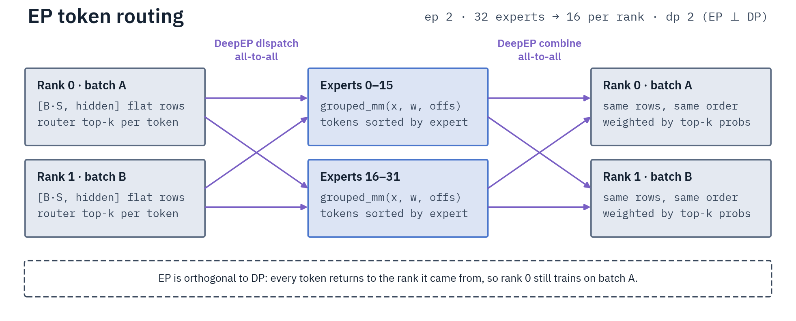
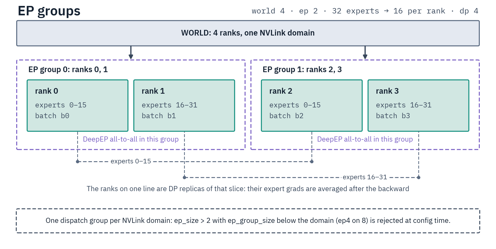
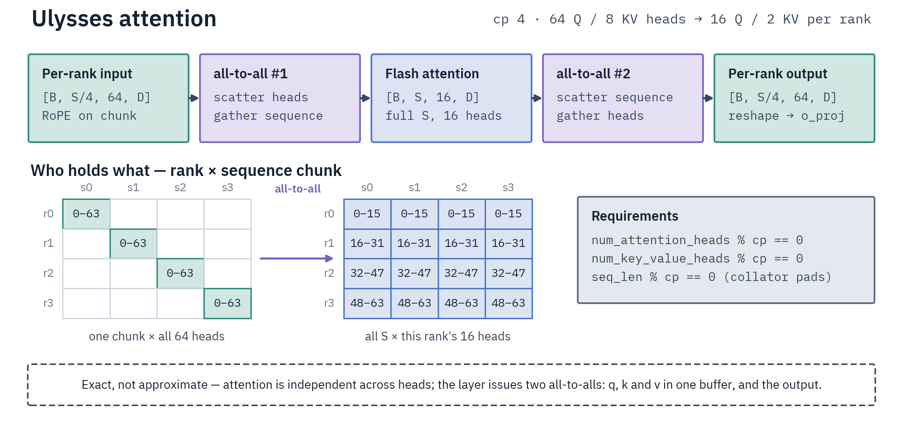
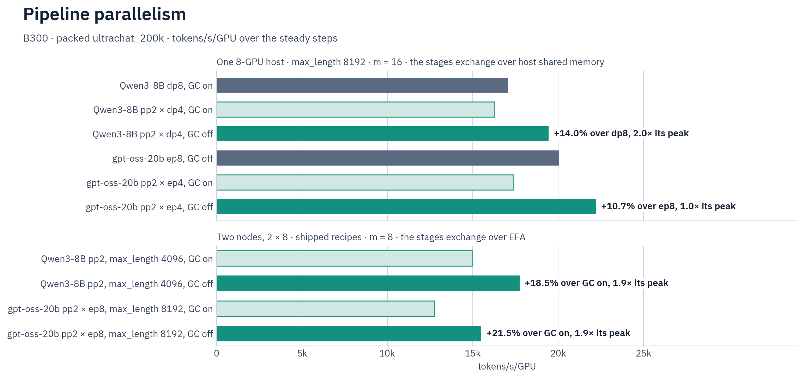

# Parallelism

Plain data parallelism needs no flags. `halo launch <method> <config> -n 8` (or
`torchrun --nproc_per_node=8`) shards the model across 8 GPUs with FSDP2. Each
GPU loads the whole model before the wrap, so a dense model must fit on one GPU
at its load dtype; past that, TP shards it as it loads
([Data Parallelism](../agent-docs/parallelism/data-parallelism.md#fsdp2-strategy-by-mode) ↗).
Add a mode below only when the model or the sequence does not fit.

| Need | Mode | Flag |
| --- | --- | --- |
| Shard MoE experts across GPUs | EP | `--expert_parallel_size=N` |
| Shard each expert's FFN | ETP | `--expert_tensor_parallel_size=N` |
| Shard dense weights (attention and FFN) | TP | `--tensor_parallel_size=N` |
| Split a long sequence across GPUs | CP | `--context_parallel_size=N` |
| Split a model's layers across nodes | PP | `--pipeline_parallel_size=N` |
| Cut cross-node FSDP traffic (DP or CP) | HSDP | `--use_hsdp=true` |

EP combines with one of TP, CP or ETP (EP+TP for MoE plus attention sharding,
EP+CP for MoE plus long context). PP combines with EP or pure ETP inside each
stage.

The data-parallel size is what PP, CP, TP and ETP leave; EP does not reduce it,
because an EP rank is also a data-parallel rank
([formula](../agent-docs/parallelism/README.md#stacking-the-dimensions) ↗).

## How EP groups work

Each token goes to the rank that holds its expert and comes back to the rank it
came from.

Ranks form dispatch groups of `ep_size`. Ranks that hold the same expert slice
are DP replicas, and their expert gradients are averaged after the backward
pass. Most of the rules below are about how these groups may be shaped.

## Rules that save you a wasted run

Halo validates the layout at startup and rejects an invalid shape with a
message that names the rule. Most checks run at config time. The CP and TP
model checks (head counts, attention classes) run on a meta-device copy of the
model before any weight loads, and LoRA under TP fails at trainer construction.

- **Allowed combinations** are in the
  [Supported matrix](supported-matrix.md#parallelism-modes).
- **Within one NVLink domain, EP fills the domain or uses `ep_size=2`.** EP=4 on
  8 GPUs is rejected, and so is `ep4 + tp2`; for a 4-way expert split on 8 GPUs,
  use `ep4 + etp2`
  ([why](../agent-docs/parallelism/expert-parallelism.md#single-domain-multi-group-ep-races-and-hangs) ↗).
- **Every other layout rule** (what stays inside one NVLink domain, which is
  the node, or the rack on NVL72 with `NVLINK_DOMAIN_SIZE=72`; EP+CP; HSDP; the
  FSDP knobs) is in
  [Topology rules](../agent-docs/parallelism/README.md#topology-rules) ↗.
- **LoRA, QLoRA and the trainers each mode covers** are in the
  [Supported matrix](supported-matrix.md#peft-quantization-and-data) and its
  [Training methods](supported-matrix.md#training-methods) table.

## Context parallelism

CP splits the sequence across ranks and switches to a head split for the
attention itself, so the result is exact. The cost is two all-to-alls per
attention layer. The head counts must divide by `cp_size`; the collator pads the
sequence length to fit.

## Pipeline parallelism

`pipeline_parallel_size` splits the decoder layers into stages, each a whole
number of NVLink domains, so only boundary activations cross nodes. A run needs
at least two nodes, and `pp2` under one `torchrun` on an 8-GPU node is rejected;
the figure's one-host rows run two 4-GPU `torchrun` agents, which count as two
nodes. Inside a stage it runs
FSDP2, EP or pure ETP. The methods and families it covers, multimodal text towers
and Qwen3.8-Flash-Next included, are in the
[Supported matrix](supported-matrix.md#model-families); any other model is
refused by name before a weight loads.

- **Batches.** `pipeline_microbatches` replaces gradient accumulation and must
  divide `per_device_train_batch_size`. Every batch pads to `max_length`, so use
  `packing` with one packed row per microbatch. Inkling, GLM-5 Next and
  DeepSeek-V4 refuse packing under PP and train on padded rows.
- **Gradient checkpointing.** Turn it off where memory allows. The shipped
  recipes do, and run 18–22% faster than with it, at about 1.9× the allocated
  peak. Reentrant checkpointing is refused; `use_reentrant: false` works.
- **Refused:** LoRA and any PEFT model, QLoRA, tied embeddings, `accelerate
  launch`, `padding_free`, `torch_compile`, Muon and FlashAdamW, `save_sharded_ep`,
  image data, and `aux_loss` with a live coefficient, so a MoE without an
  exportable bias trains at `moe_balancing: none`
  ([every refusal and why](../agent-docs/parallelism/pipeline-parallelism.md#rejected-combinations) ↗).

Launch recipes and per-node merges:
[Clusters](clusters.md#pipeline-parallelism-across-nodes).

## Picking a shape

Sharding costs throughput, so use the least that fits
([Performance](performance.md)).

Deep dives:
[Expert](../agent-docs/parallelism/expert-parallelism.md) ↗ ·
[Context](../agent-docs/parallelism/context-parallelism.md) ↗ ·
[Tensor](../agent-docs/parallelism/tensor-parallelism.md) ↗ ·
[Expert-Tensor](../agent-docs/parallelism/expert-tensor-parallelism.md) ↗ ·
[Pipeline](../agent-docs/parallelism/pipeline-parallelism.md) ↗ ·
[Multi-Node](../agent-docs/parallelism/multi-node.md) ↗.
