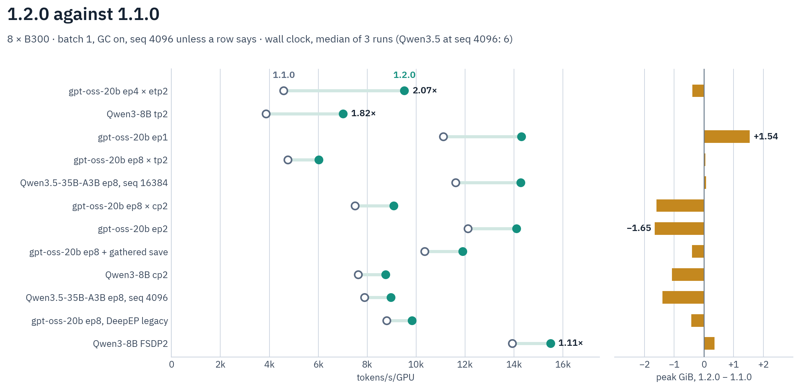
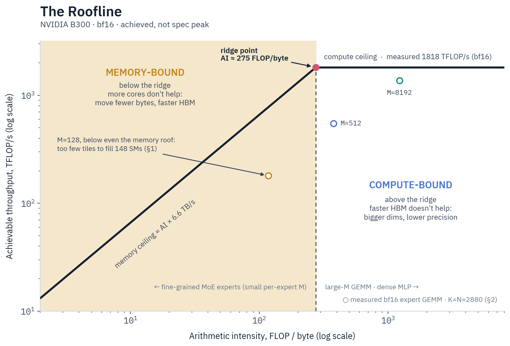

# Performance

The throughput to expect, the levers that move it, and the ones that do not
help at MoE shapes.

## Rough numbers

Wall-clock throughput on 8× B300 with the Blackwell image, at batch 1, 4,096
tokens and gradient checkpointing on:

| Shape | Halo 1.2.0, tok/s/GPU | vs 1.1.0 |
| --- | ---: | ---: |
| Qwen3-8B FSDP2 | 15,490 | 1.11× |
| Qwen3-8B CP2 | 8,748 | 1.15× |
| Qwen3-8B TP2 | 7,013 | 1.82× |
| GPT-OSS 20B EP1 | 14,304 | 1.29× |
| GPT-OSS 20B EP8 | 11,896 | 1.15× |
| GPT-OSS 20B EP4 + ETP2 | 9,521 | 2.07× |
| Qwen3.5-35B-A3B EP8 | 8,974 | 1.14× |

No shape of the twelve benchmarked against 1.1.0 ran slower. Peak memory matched
1.1.0 within 0.1 GiB or dropped, except FSDP2 (+0.36 GiB) and EP1 (+1.54 GiB), which
hold two decoder layers per shard group. A bigger batch goes
much higher: on 1.1.0 or earlier, GPT-OSS 20B reached about 28,700 at `ep1` (batch 4, no
checkpointing) and Qwen3.5-35B-A3B about 16,400 at `ep2` (batch 4, checkpointing
on). On real conversations at `ep8`, the packed Qwen3.5-35B-A3B recipe reaches
17,225 at 33,000 tokens per row. Pipeline parallelism across two machines reaches
17,608 on Qwen3-8B (`pp2`) and 15,715 on GPT-OSS 20B (`pp2 × ep8`), without
checkpointing, which on a fast link is 4.0% and 15.9% below `dp16` and `ep8` with DP.
More shapes:
[Throughput Benchmarks](../agent-docs/optimization/throughput-benchmarks.md) ↗ ·
[Pipeline Parallelism](../agent-docs/parallelism/pipeline-parallelism.md#measured-throughput) ↗.

GLM-5.3-Flash runs two kernels of its own: DeepSeek sparse attention as a tiled
matmul over the keys a query can reach, and hyper-connections as one launch per
direction, which DeepSeek-V4 shares. LoRA at `ep8` reaches 2,840 at 8,192 tokens
and 2,390 at 16,384, against 1,282 and 893 without them; a full fine-tune on two
8-GPU machines reaches 1,504 at `ep16` and 2,423 at `pp2 × ep8`
([GLM-5 Next](../agent-docs/models/glm5-next.md#throughput) ↗).

Pick the lowest expert-parallel size that fits, since EP costs throughput. CP
and the other sharding modes add sequence length and capacity at a cost in tokens
per second.

Before you judge a number, check `M = per_device_train_batch_size × max_length`.
On a B300 MoE run it should be at least ~8k; below that throughput is still
climbing fast. Read it on a warm Triton cache too: on a fresh one, a recipe's first
~20 steps run about 40% of the steady rate while kernels compile. Set
`enable_efficiency_metrics: true` to log tokens/s/GPU in your own run; it counts a
batch that TP, ETP, CP or PP ranks share once, and a PP rate also counts padding.

## Levers that help

Set these per run:

- **A bigger `M`**: raise `per_device_train_batch_size` or `max_length`, and
  fill the global batch with `gradient_accumulation_steps`, not more
  parallelism. It is the largest effect on MoE.
- **`gradient_checkpointing: false`** when the activations fit, at much higher
  peak memory. On packed SFT rows `gradient_checkpointing_plan: auto` finds that
  out itself: it measures step 2 and checkpoints only the layers the memory
  needs ([Callbacks](../agent-docs/training-methods/callbacks.md#gradientcheckpointingplancallback) ↗).
- **`packing: true`** on a corpus of short rows; `padding_free: true` gains
  less. Where SFT rows share long prefixes (GPT-OSS, Qwen3, Qwen3.5/3.6,
  GLM-5 Next), `tree_packing: true` stores each prefix once, at some extra
  step time on full-attention layers
  ([Tree Packing](../agent-docs/optimization/tree-packing.md) ↗).
- **`liger_kernel_config: {fused_linear_cross_entropy: true}`** on large-vocab
  models and long rows: it never materializes the logits, which cuts peak memory at equal or better speed
  ([measured](../agent-docs/optimization/liger-kernels.md#crossentropy-vs-fusedlinearcrossentropy) ↗).
- **`PYTORCH_CUDA_ALLOC_CONF=expandable_segments:True`** in front of a dense
  launch: 13–14% less peak reserved memory at the same speed. Under EP it costs
  throughput, so set it there only to fit
  ([Allocator](../agent-docs/optimization/throughput-benchmarks.md#allocator-expandable-segments) ↗).
- **`--numa-binding node`** on `torchrun` or `halo launch` on a multi-socket
  host: each rank runs on the CPUs next to its GPU. Host-bound runs (TP, CP,
  small-batch EP) gain up to ~3%; GPU-bound runs are flat
  ([NUMA binding](../agent-docs/optimization/throughput-benchmarks.md#numa-binding) ↗).
- **`fsdp_defer_grad_sync: true` with `fsdp_reshard_after_backward: false`**
  under gradient accumulation: one gradient reduce and one re-gather per
  optimizer step, at an unsharded gradient copy per GPU.
- **`use_chunked_grpo_logprobs: true`** on GRPO when the full logits do not fit.

On by default: grouped GEMM for MoE experts, Flash Attention 4 on Blackwell,
Liger, `AdamWBF16` (6 bytes per parameter instead of 12), the atomic-free expert
permute and its sync-free routing sort, the fused MoE path, TP linears on their
local shards, two decoder layers per FSDP2 shard group under ZeRO-2, one Ulysses
all-to-all for Q, K and V under CP, and `sdpa_flex_sliding` for Gemma 4 and
Step-3.7. Each lever's page carries its measurements:
[Optimization](../agent-docs/optimization/README.md) ↗.

## Levers that do not help here

Halo's fp8/fp4 QAT path and the opt-in DeepGEMM adapter ran whole training steps at
about half bf16's speed or less, and `torch.compile` on an EP MoE run gained at most
1%
([Levers that do not help](../agent-docs/optimization/README.md#levers-that-do-not-help-at-these-shapes) ↗).

An expert GEMM with few tokens sits in the memory-bound region. At 128 token
rows against GPT-OSS's 16 MB expert weight, the tensor cores idle while HBM
streams the weight, and fine-grained MoEs put even fewer tokens on each expert.
A bigger `M` helps here, and a faster kernel does not.

## Compared with other frameworks

On packed 64k and 128k rows on 8 B300s, Halo 1.2.0 trains Qwen3.6-35B-A3B at 1.10–1.12× Megatron Bridge, 1.47× TRL 1.17.1
and 1.9–2.0× NeMo AutoModel 0.7.0, and trails a tuned Megatron by 11.5% on dense Qwen3.5-9B at 64k. Rates, layouts and the
conditions that decide how to read them are in the
[framework comparison](../agent-docs/optimization/throughput-benchmarks.md#full-parameter-sft-framework-comparison) ↗; the
TRL side is in [Halo vs stock TRL](../agent-docs/optimization/halo-vs-stock-trl.md) ↗.

For memory rather than speed, start at [Parallelism](parallelism.md). For a run
slower than these numbers with no obvious cause, turn on the profiler
([Monitoring](monitoring.md)). Why the defaults are what they are:
[GPU Training Theory](../agent-docs/reference/gpu-training-theory.md) ↗.
