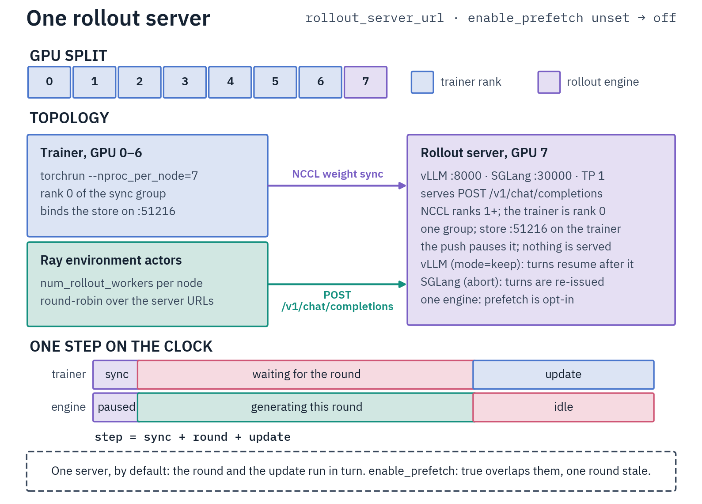
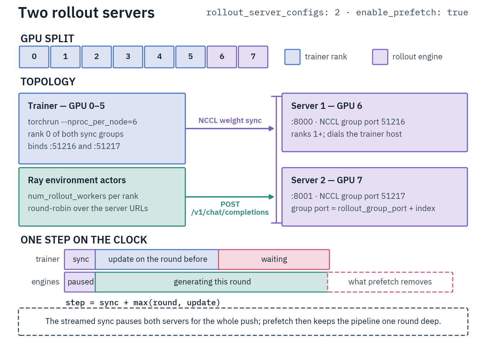

# Async GRPO with Environments

This is the multi-turn arm of GRPO. The model works inside an environment (calling tools, running code,
searching, editing a workspace) until the episode ends. The environment grades the whole trajectory, and
GRPO trains on the group of episodes that shared a prompt.

Pick it when the reward comes from what the model *did*. Single-turn verifiable rewards are cheaper on
[Online GRPO (RLVR)](online-grpo.md), and pre-scored data belongs on [Offline GRPO](offline-grpo.md).

Rollouts run on a **separate vLLM or SGLang container**, driven by **Ray actors** that hold the
environments and their tools. Ray configures itself on one node, so the server is the only thing you start
by hand ([Rollout Servers](../rollout-servers.md)).


## The environments

`environment_type` picks one: `react_math` and `react_search` (plain-text actions), `native_math`,
`native_coding` and `native_combined` (native tool calls), `qa_search`, `exam_qa`, `swe` (an
edit-run-test loop over a workspace), `code_contests`, `codeforces`, or `mcp` (whatever tools an MCP
server advertises). The
[registry](../../agent-docs/training-methods/async-grpo/environments/README.md#registry) ↗ lists each
one's tools and turn budget. An environment that grades against `answer` refuses a dataset without that
column at startup
([`requires_answer`](../../agent-docs/training-methods/async-grpo/environments/README.md#common-knobs) ↗).

The hosts that run the Ray actors need what their environment needs: a sandbox and a large `TMPDIR` for
the code environments, outbound network (and usually a search API key) for the search ones, and the MCP
server's launcher on `PATH` for `mcp`. Your own environment class registers alongside these
([Custom Environments](../../agent-docs/training-methods/async-grpo/environments/custom.md) ↗).

> [!WARNING]
> The default `local` sandbox does not confine the program it runs. Policy-written code can read the
> trainer's environment, `--env-file` secrets included. For RL on untrusted code, set
> `sandbox_backend: bubblewrap` (or `remote`) under `environment_kwargs`. `bubblewrap` needs the trainer
> to run as root in a container started with `--init`, either `--privileged` or `SYS_ADMIN` with seccomp
> and AppArmor unconfined, and a clean `/proc` mounted before launch. The training image ships `bwrap` and
> `uidmap`
> ([Sandboxes](../../agent-docs/training-methods/async-grpo/environments/sandbox.md#choosing-a-backend) ↗).

## Data

`prompt` is the task, and `answer` the ground truth where the environment grades against one. Rename
either with `prompt_field` / `answer_field`, and pass extra columns through `context_fields`.

```jsonl
{"prompt": "Solve: ...", "answer": "42"}
```

A `prompt` given as a message list is reduced to its **last user turn**. The environment owns the system
prompt and the tool schema, so this method has no `system_prompt` field.

For code contests, `halo run prepare-code-dataset` builds the pool. It leaves out Codeforces problems
graded only on their statement's examples unless you pass `--include_examples_only`
([Building a pool](../../agent-docs/training-methods/async-grpo/environments/tasks/code-contests/datasets.md#building-a-pool) ↗).

## Rewards

The episode reward is the environment's grade priced by an `environment` term, plus the environment's own
shaping, plus any external term you add:

```yaml
rewards:
  - source: environment    # the env's grade in [0, 1]: a solved problem, an answer match, a passing test
```

`judge` and `reward_model` terms take the same options as on the [online arm](online-grpo.md#rewards).
Only this arm also accepts a **veto judge**, a `judge` that lists `checks`: a fired veto check strips the
episode of its credit, `reward/objective` included, and the other checks price process flags at the
term's non-positive `weight`
([Veto judge](../../agent-docs/training-methods/grpo/rewards/judge.md#veto-judge) ↗).

Every code-contests recipe audits the whole episode this way: six checks veto hacks and tool misuse, and
the rest price wasted or untested runs. These recipes set `on_error: invalid`, so an episode the judge
could not score leaves training: a judge outage trains nothing, and a second step in a row with no valid
episode stops the run
([Audit judge](../../agent-docs/training-methods/async-grpo/environments/tasks/code-contests/reward.md#audit-judge) ↗).

Each component logs as `reward/<name>` (`reward/objective` for the environment term), and the components
sum exactly to the reward the environment settled. The trainer's reasoning-length charges come on top
([Reward Terms](../../agent-docs/training-methods/grpo/rewards/README.md) ↗).

## Config

From `examples/grpo/environmental/qwen3_5/vllm/qwen3.6-35b-a3b-react-math-full-ep4.yaml`: four trainer
GPUs, and one server on the other four at the default `rollout_server_url`, `http://localhost:8000`.

```yaml
model_name_or_path: Qwen/Qwen3.6-35B-A3B
expert_parallel_size: 4
environment_type: react_math
max_turns: 10
num_rollout_workers: 16            # Ray environment actors per training rank
rollout_max_tokens: 8192           # budget for ONE turn, not the trajectory
enable_prefetch: false             # needs two or more servers
num_generations: 8                 # episodes per prompt
beta: 0.0                          # no KL anchor, so no second model in memory
scale_rewards: batch
per_device_train_batch_size: 1
gradient_accumulation_steps: 8
learning_rate: 1.0e-06
```

`examples/grpo/environmental/environmental-grpo-template.yaml` is the annotated starting point. GPT-OSS,
Qwen3.5/3.6 and Gemma 4 ship recipes under `examples/grpo/environmental/<family>/{vllm,sglang}/`; the
SGLang ones are `ep1` only.

- **Sampling** goes through the `rollout_*` fields (`rollout_temperature`, `rollout_top_p`,
  `rollout_top_k`, `rollout_min_p`, `rollout_repetition_penalty`). Every request sends all five, so the
  model's `generation_config.json` never fills them in. TRL's `top_p`, `top_k`, `min_p`,
  `repetition_penalty` and `generation_kwargs` reach no sampler here, and setting one raises at startup.
- **`beta`** above 0 on a full fine-tune or native expert-only LoRA loads a frozen reference: under EP,
  ETP or TP a whole unsharded copy on every rank. A PEFT policy is its own reference with the adapter
  off.
- **The objective** truncates each token's importance-sampling ratio from above, and startup refuses the
  loss types and ratio modes it does not implement
  ([Objective](../../agent-docs/training-methods/async-grpo/objective.md) ↗).

Three decisions matter more than the rest:

- **Turn budget.** `rollout_max_tokens` caps one turn and `max_turns` the number of turns.
  `rollout_max_episode_tokens` caps what one episode samples across all its turns (off by default; the
  code-contests recipes set it). The trajectory is never truncated: a row longer than the context window
  fails the step. If `episode/turns` sits at the cap, raise `max_turns`; if it sits far below, lower it,
  since turns run one after another
  ([Trajectory length](../../agent-docs/training-methods/async-grpo/episodes.md#trajectory-length) ↗).
- **Reasoning effort.** `environment_kwargs.reasoning_effort` (`low` / `medium` / `high` / `random`) sets
  how much the model should think, and `reasoning_effort_profiles` gives each level its own per-turn
  budget (`thinking_tokens`). The model sees the level only through a chat template that renders it: pin
  one with `chat_template:` plus `force_chat_template: true`, and serve the same file. Engine caps on
  reasoning bind on vLLM only, and `rollout_backend: sglang` refuses `rollout_max_thinking_tokens` and
  `carry_reasoning` ([Reasoning Budgets](../../agent-docs/training-methods/async-grpo/reasoning.md) ↗).
- **Tool budgets.** An environment pays `tool_success_reward` per successful call and charges
  `tool_error_penalty` per failed one. `tool_reward_cap` (default `tool_success_reward × max_turns`)
  caps what successful calls earn per episode. Keep them small beside the objective, or calling tools
  pays better than finishing the task.

A turn the engine cut at its cap, an empty turn, or one whose every tool call was invalid or refused earns
no reward. It trains only as a penalty, when its episode scored below the group's mean
([Untrainable turns](../../agent-docs/training-methods/async-grpo/objective.md#untrainable-turns) ↗).

### Thinking budgets

A level's `thinking_tokens` is a per-turn budget. By default the engine enforces it, closing the turn's
reasoning at the budget, mid-thought if need be. `enforce_thinking_cap: false` in the level's profile
makes it soft: the effort template states it as a target, and the engine closes the reasoning only at the
run's ceiling, `rollout_max_thinking_tokens` or else `rollout_max_tokens − rollout_max_answer_tokens`
([Enforced and soft budgets](../../agent-docs/training-methods/async-grpo/reasoning.md#enforced-and-soft-budgets) ↗).

Two trainer-side terms price reasoning length: `reasoning_price` charges reasoning tokens (with
`reasoning_price_past_budget: true`, only those past each turn's soft budget), and `reasoning_floor`
charges an episode that reasons too little. Neither is charged in a training group where no episode
earned the objective, unless `reasoning_terms_in_failed_groups: true`. The code-contests recipes run soft
budgets priced past the budget
([Reasoning length reward](../../agent-docs/training-methods/async-grpo/reasoning.md#reasoning-length-reward) ↗).

### One server or several



With one server the step is serial: sync, generate, train. The push pauses the only engine, so prefetch
turns itself off.



With two or more, list them in `rollout_server_configs`, each with its own `group_port`. Prefetch
(`enable_prefetch`, on by default) then generates the next round while the current one trains, the only
way to overlap the two.

## Run

```bash
make build-vllm   # or set VLLM_IMAGE to the public image
export HALO_SCRATCH=/path/to/large/volume   # or set it in .env; compose refuses to start without it
VLLM_MODEL=Qwen/Qwen3.6-35B-A3B VLLM_CUDA_DEVICES=4,5,6,7 VLLM_TP=4 VLLM_REASONING_PARSER=qwen3 \
VLLM_TOOL_CALLING_FLAGS= \
    docker compose -f docker-compose.vllm.yml up -d vllm-server
CUDA_VISIBLE_DEVICES=0,1,2,3 DIST_NCCL_TIMEOUT_MINUTES=60 halo launch grpo/environmental \
    examples/grpo/environmental/qwen3_5/vllm/qwen3.6-35b-a3b-react-math-full-ep4.yaml -n 4
```

A native-tool environment needs the server started with the model family's tool-call parser. Without one
vLLM rejects every rollout; with the wrong one the calls come back as text and every episode scores zero.
ReAct environments read their actions from the text and serve without a parser
(`VLLM_TOOL_CALLING_FLAGS=`, as above).

Before a long run, put the config through a few rows. This exercises the parser, the template and the
sandbox or judge backend in a minute:

```bash
halo run eval-env --training_config <config>.yaml --dataset <hub-id-or-path> --split train \
    --answer_field <column> --num_examples 20 --base_url http://localhost:8000/v1 --model <served-id>
```

`--training_config` carries the environment and rollout settings, not the dataset fields. Match
`--split` (default `test`), `--answer_field` (default `answer`) and, where needed, `--config` and
`--prompt_field` to the config's dataset.

Evaluation runs the same loop: set `eval_strategy`, and `num_generations_eval: 1` for a fast pass@1
monitor ([Evaluation](../../agent-docs/training-methods/async-grpo/evaluation.md#during-training) ↗).

## What to watch

- `reward/objective` says whether the task is being learned. A rising total reward with a flat objective
  is shaping, not progress. Code contests also log `outcome/solve_rate`.
- `episode/turns` and `episode/truncation_rate` say whether episodes finish.
- `reward/within_group_std` near zero means a group's episodes all scored the same, so its prompt teaches
  nothing. `drop_degenerate_groups` (on by default) drops such groups, and
  `sampling/degenerate_group_frac` counts them.
- `sampling/logratio_mean` drifting steadily negative means the weight sync is broken and the policy
  trains on stale rollouts. If `advantage/net_token_mass` also stays negative and `entropy` climbs, a
  KL-free run is drifting instead: turn on `balance_token_mass` and the early stop.
- `episode/reward_scored` below 1 means a judge or reward model is failing; `<source>/<name>/scored`
  names which one. Under `on_error: invalid` those episodes also leave training, and
  `sampling/invalid_episode_frac` rises.

Rollouts land in `<output_dir>/completions/` as parquet, one directory per logged step holding a part
per rank. Every metric, including the prefetch hit rate:
[Monitoring](../../agent-docs/training-methods/async-grpo/monitoring.md) ↗. Symptoms and fixes:
[Troubleshooting](../../agent-docs/training-methods/async-grpo/troubleshooting.md) ↗.

## Sizing a run

Rollouts in flight per server are at most `world_size × per_device_train_batch_size ×
steps_per_generation ÷ num_servers`, capped per rank by `max_concurrent_rollouts`. Measure the engine's
decode speed at about that concurrency with the run's own prompts; nothing in the config predicts it.

- `request_timeout`: at least twice one turn's budget at that speed.
- `episode_timeout`: the time for the smaller of `max_turns` turns and `rollout_max_episode_tokens`
  tokens, plus tool time. Above the NCCL watchdog (`DIST_NCCL_TIMEOUT_MINUTES`) startup raises, and at
  80% of it or more startup warns.
- Serving GPUs: start from one per trainer GPU, one engine per GPU while the model and its KV cache fit.

Worked numbers:
[Memory and Throughput](../../agent-docs/training-methods/async-grpo/performance.md#sizing-a-run) ↗.

## Go deeper

- [Async GRPO with Environments](../../agent-docs/training-methods/async-grpo/README.md) ↗ ·
  [Environments](../../agent-docs/training-methods/async-grpo/environments/README.md) ↗: servers, objective,
  metrics and every knob.
- [Code Contests](../../agent-docs/training-methods/async-grpo/environments/tasks/code-contests/README.md) ↗ ·
  [SWE](../../agent-docs/training-methods/async-grpo/environments/tasks/swe.md) ↗: the two deepest
  environments.
- [Rollout Servers](../rollout-servers.md) · [Online GRPO (RLVR)](online-grpo.md) ·
  [Training Methods](README.md)
